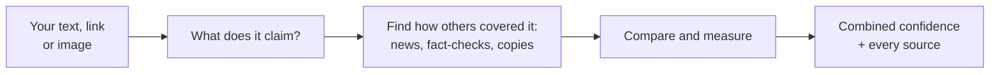

<div align="center">
  <picture>
    <source media="(prefers-color-scheme: dark)" srcset="docs/assets/logo-dark.svg">
    <source media="(prefers-color-scheme: light)" srcset="docs/assets/logo-light.svg">
    
  </picture>
  <h1>The4thLover</h1>
  <p><strong>Is this article manipulating me, or is it one voice in a network pushing the same story?</strong><br>Paste it in. We check how everyone else covered it and show you the evidence.</p>
  <p><a href="https://the4thlover.tech"><strong>Try it → the4thlover.tech</strong></a> · <a href="https://the4thlover.tech/metrics">Methodology &amp; benchmarks</a> · <a href="https://the4thlover.tech/sources">Map of sites that act together</a> · <a href="https://the4thlover.tech/extension">Browser extension</a> · <a href="https://the4thlover.tech/api/docs">API</a></p>
  <p><sub>Built in 48 hours at Junction 2026 for Hostinger's challenge <em>Decode the Noise</em>.</sub></p>
</div>

---

## Try it in 30 seconds
1. Open **[the4thlover.tech](https://the4thlover.tech)**.
2. Paste a **link**, some **text**, or drop an **image or meme**, in any language.
3. Watch it work step by step, then inspect every source behind the result.

## What you get back

```
Combined propaganda-signal confidence: 84%   Content 83% · Network 5%
──────────────────────────────────────────────────────────────────────
✓ A fact-checker rated the claim inaccurate (Climate Feedback) → link
✓ Persuasion techniques detected in the text                   → highlighted in the text
· No cross-site copy or tracker network detected
[ How it was scored → ]
```

- **One combined confidence** built via noisy-OR from calibrated content and network models (below), with both component signals visible.
- **Plain-language reasons**, each linked to its source: the fact-check, peer coverage, copied passages, or highlighted sentences in the text.
- **"How it was scored"**: the exact contribution of every signal family.
- **Honest abstention**: when cross-outlet coverage is too thin for a calibrated percentage, we never guess — detected persuasion techniques and source facts are surfaced directly instead.

## How it works



It evaluates two orthogonal kinds of signal:

| | What we check | Examples |
|---|---|---|
| **Content** | How it is written and whether its claims hold up | persuasion techniques · visual rhetoric in memes · emotional tone vs other reports on the same event · claims contradicted by peer coverage · published fact-checker ratings · domain age and outlet profile |
| **Network** | Whether the same message is pushed by sites acting together | near-duplicate passages across unrelated sites or social accounts · synchronized publication bursts · shared analytics or ad tracking IDs · documented disinformation networks |

## What it never does
- **Never says "propaganda" or "not propaganda".** That would pose as ground truth. You get a calibrated confidence and verifiable evidence, and you decide.
- **No AI opinion sets the number.** Measured signals do, combined by a transparent model fitted on external labels. Language models only extract claims and summarize the verified evidence, and every quotation is checked word for word against the sources.
- **Doesn't fall for the classic traps.** Fact-checks that quote a hoax, news-agency wire copy republished by newsrooms, satire, opinion columns, and emotional but accurate reporting are explicitly guarded against.

## Honest evaluation
- **External ground truth only**: evaluated against multilingual items labelled by independent fact-checkers (ClaimReview), EUvsDisinfo, and VIGINUM — never self-labelled by us or an LLM.
- **Adversarial hard-negative benchmarks**: tested separately against fact-checks quoting hoaxes, wire-service copy, press releases, satire, op-eds, and emotional journalism to guard against false alarms.
- **Full transparency**: cross-validated calibration, uncertainty intervals, abstention rates, and per-family ablations (including performance with and without published domain lists) are published on the **[benchmarks page](https://the4thlover.tech/metrics)**.

## The map of sites that act together
Every analysis also feeds a live **[map of sites](https://the4thlover.tech/sources)** linked by evidence you can inspect: shared analytics tags, copied or translated articles, outbound links, and common operators — surfacing mirror domains and coordinated clusters directly from technical and text traces.

A link between two sites means they are **related**, not that either is bad: international public institutions and fact-checking editions appear on the map alongside coordinated networks, with every tie's raw evidence shown inline.

## Use it while you browse
Install the **[browser extension](https://the4thlover.tech/extension)** (Chrome, Brave, Edge) to check any page, highlighted passage, or meme in one click. Details in [`extension/README.md`](extension/README.md).

## Run it yourself
You need [mise](https://mise.jdx.dev); it installs everything else at pinned versions.

```sh
mise trust && mise run setup   # tools (node, python, bun, uv, rust…), git hooks, Python packages
cp .env.example .env           # add your keys: LLM_*, OXYLABS_TOKEN, GEMINI_API_KEY, GOOGLE_FACTCHECK_API_KEY
mise run dev                   # backend: API on :8080 (docs at /api/docs), worker on :8001
mise run web:dev               # website on http://localhost:5173
```

Before sending changes: `mise run check` (everything CI runs). All commands: `mise tasks`.

## Where things are
| Folder | What's inside |
|---|---|
| `web/` | The website (React, TypeScript, Vite) |
| `extension/` | Manifest V3 browser extension and bookmarklet |
| `api/` | Rust (`axum`) server: orchestrates stages, validates every patch, serves live SSE and SQLite source graph |
| `pipeline/` | Analysis stages: `extract` → `understand` → `retrieve` → `story` → `signals` → `score` → `explain` + `graph` (Python) |
| `worker/` | Stateless FastAPI worker executing pipeline stages for the Rust API |
| `contracts/` | Rust types (single source of truth) generating OpenAPI, Pydantic, and TypeScript schemas |
| `evals/` | Multilingual evaluation sets, hard-negative benchmarks, symmetry checks, and scoring harness |
| `deploy/` | Dockerfiles (`api`, `worker`, `caddy`), Compose stack, Caddyfile, and Hostinger VPS runbook |
| `docs/` | Product spec, research, AI core signal catalogue, and architecture notes |

Going deeper: [`SPEC.md`](SPEC.md) · [`docs/ai-core.md`](docs/ai-core.md) · [`evals/README.md`](evals/README.md) · [`DECISIONS.md`](DECISIONS.md) · [`AGENTS.md`](AGENTS.md).

## Team
Degra02 (integration, server, deploy) · Lyreplus (signals, scoring, explanations, video) · ck-lithium (extraction, search, website) · mosearc (evaluation, spec, pitch, graphs)

## Star History

<a href="https://www.star-history.com/#Degra02/junction-2026&Date">
  <picture>
    <source media="(prefers-color-scheme: dark)" srcset="https://api.star-history.com/svg?repos=Degra02/junction-2026&type=Date&theme=dark" />
    <source media="(prefers-color-scheme: light)" srcset="https://api.star-history.com/svg?repos=Degra02/junction-2026&type=Date" />
    
  </picture>
</a>

## License
MIT, see [`LICENSE`](LICENSE).
