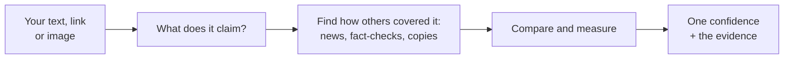

# The4thLover

**Is this article manipulating me, or is it one voice in a network pushing the same story?**
Paste it in. We check how everyone else covered it and show you the evidence.

**[Try it → the4thlover.tech](https://the4thlover.tech)** · [How accurate is it?](https://the4thlover.tech/metrics) · [Map of sites that act together](https://the4thlover.tech/sources) · [Browser extension](https://the4thlover.tech/extension) · [API](https://the4thlover.tech/api/docs)

Built in 48 hours at Junction 2026 for Hostinger's challenge *Decode the Noise*.

---

## Try it in 30 seconds
1. Open **[the4thlover.tech](https://the4thlover.tech)**.
2. Paste a **link**, some **text**, or drop an **image or meme**, in any language.
3. Watch it work (about a minute), then read the result.

## What you get back

```
84%   Content 83% · Network 8%
──────────────────────────────────────────────────────────────
✓ A fact-checker rated the claim inaccurate (Climate Feedback) → link
✓ Persuasion techniques in 37% of the paragraphs            → highlighted in the text
· No copies of the text found on other sites
[ Show how we calculated this ]
```

- **One confidence** that the content shows signs of propaganda, built from two kinds of signal (below).
- **The reasons**, each linked to its source: the fact-check, the other articles, the copied passage, the highlighted sentence.
- **"Show how we calculated this"**: exactly how much each signal added to the number.
- **"Not enough evidence"** when there is too little to go on, with the reason. We'd rather say nothing than guess.

## How it works



It looks at two kinds of signal:

| | What we check | Examples |
|---|---|---|
| **Content** | How it is written and whether its claims hold up | persuasion techniques · a tone far angrier than other reports of the same event · claims other reports contradict · fact-checkers rating the claim false · a website registered last week |
| **Network** | Whether the same message is being pushed by sites acting together | the same paragraphs on unrelated sites · published within hours · shared tracking codes · sites on a published list of a disinformation network |

## What it never does
- **Never says "propaganda" or "not propaganda".** That would pretend to be the truth. You get a confidence and the evidence, and you decide.
- **No AI opinion sets the number.** Measured signals do, added up by a simple model trained on labelled examples. Language models only read the claims and write the explanation, and every quote they write is checked word for word against the sources.
- **Doesn't fall for the classic traps.** A fact-check that quotes a hoax, a news-agency story republished by hundreds of papers, satire, opinion columns and emotional but accurate reporting are recognised and not flagged.

## How good is it?
Tested on **284 real articles and claims in 12 languages**, labelled by outsiders (fact-checkers, the EU's EUvsDisinfo database, the French agency VIGINUM), never by us.

| | Result | In plain words |
|---|---|---|
| Content signals | **98%** precision, **3%** false alarms | When it flags something, it is almost always right |
| | gives a score on 43% of items | It often says "not enough evidence" instead of guessing |
| Network signals | perfect on the test set… | …but only because the VIGINUM list is both how the test items were labelled and one of our signals. Without it the score is no better than chance. We publish that too. |

Every number, with its uncertainty range, is on the **[metrics page](https://the4thlover.tech/metrics)**. Full details: [`docs/pitch/report.pdf`](docs/pitch/report.pdf) · plain-language version: [`docs/pitch/report-summary.md`](docs/pitch/report-summary.md).

## The map of sites that act together
Every analysis also feeds a **[map of sites](https://the4thlover.tech/sources)** linked by evidence you can check yourself: the same analytics code, copied or translated articles, the same owner. It finds the whole Russian "Pravda" network as one group without being told about it.

A link between two sites means they are **related**, not that either is bad: the UN's sites and AFP's fact-checking sites are on the map too.

## Use it while you browse
Install the **[browser extension](https://the4thlover.tech/extension)** (Chrome, Brave, Edge). Check the page you are reading or any highlighted text in one click. More in [`extension/README.md`](extension/README.md).

## Run it yourself
You need [mise](https://mise.jdx.dev); it installs everything else at pinned versions.

```sh
mise trust && mise run setup   # tools (node, python, bun, uv, rust…), git hooks, Python packages
cp .env.example .env           # add your keys: LLM_*, OXYLABS_TOKEN, GEMINI_API_KEY, GOOGLE_FACTCHECK_API_KEY
mise run dev                   # backend: API on :8080 (docs at /api/docs), worker on :8001
mise run web:dev               # website on http://localhost:5173
```

Before sending changes: `mise run check` (everything CI runs). All commands: `mise tasks`.

## Where things are
| Folder | What's inside |
|---|---|
| `web/` | The website (React) |
| `extension/` | The browser extension |
| `api/` | The server that runs each analysis step by step and checks every result (Rust) |
| `pipeline/` | The analysis itself: read → understand → search → compare → score → explain (Python) |
| `worker/` | Runs the pipeline steps for the server (Python) |
| `contracts/` | The shared data format between server, pipeline and website |
| `evals/` | The 284-item test set and the tools that produce the metrics |
| `deploy/` | How it runs on the Hostinger server |
| `docs/` | Report, pitch, research and design notes |

Going deeper: [`SPEC.md`](SPEC.md) (what we build and why) · [`docs/ai-core.md`](docs/ai-core.md) (every signal and how the score is computed) · [`evals/README.md`](evals/README.md) (how we test) · [`DECISIONS.md`](DECISIONS.md) (decisions log) · [`AGENTS.md`](AGENTS.md) (how to contribute).

## Challenges & Partner Integrations

| Challenge | How it is used in The4thLover |
|---|---|
| **Hostinger — Decode the Noise** *(Agentic AI Track)* | Deployed live on a single **Hostinger KVM 2 VPS** (2 vCPU, 8 GB RAM, no GPU) behind Caddy TLS (`deploy/`): Rust (`axum`) API + SQLite, Python FastAPI worker running CPU models, and LLM calls routed via **Hostinger AI Router** (`https://router.hostinger.com/v1`). Tackles *Name the technique*, *Trust the source*, and *Spot the swarm*, with published precision, Wilson 95% CIs, and per-hard-negative false-positive rates (`/metrics`). |
| **Oxylabs — Best agentic usecase of Oxylabs Web API** | Runtime web verification (`OXYLABS_TOKEN` via `https://api-aistudio.oxylabs.io`):<br>• **`POST /search/instant`** (`pipeline/retrieve/oxylabs.py`, `pipeline/retrieve/social.py`): exact-phrase search to uncover copied passages across websites and X/Reddit accounts, multilingual news coverage beyond RSS feeds, and site-scoped ClaimReview fact-check search.<br>• **`POST /scrape`** (`pipeline/extract/scraper.py`): clean Markdown/text extraction on bot-challenged or JS-gated pages (e.g. France24, TASS) with zero headless browser overhead.<br>Every claim, copy, and reason links directly to its retrieved source URL. |
| **Google DeepMind — Best Use of Gemini API** | Four bounded stages where Gemini never sets raw scores and every quotation is verified verbatim by Rust code-point span checks (`contracts/src/apply.rs`, `pipeline/common/spans.py`):<br>• **Multimodal meme/screenshot vision** (`pipeline/extract/vision.py`, `generateContent`): OCR, neutral `[Visual context]`, satire-meme guard, and implied visual argument extraction.<br>• **Multimodal `rhetoric` rater** (`pipeline/signals/rhetoric.py`): inspects text + image together for SemEval-2023 persuasion categories, dropping quoted-speech hits and non-verbatim spans.<br>• **Selective NLI cascade** (`pipeline/signals/judge.py`) + **structured multilingual `understand` & `explain`** (`gemini-3.1-flash-lite` / `gemini-4-hydrogen`). |
| **OpenAI — Best Use of Codex** | Engineered for 4-person parallel agent development across 70+ PRs in 48 hours (`AGENTS.md`, `DECISIONS.md`, `docs/next-steps.md`): Rust types in `contracts/` serve as single source of truth (`mise run contracts` generates `openapi.json`, Pydantic `contracts.py`, and TypeScript `api.d.ts`), each stage tests in isolation against `contracts/fixtures/analysis.json`, and CI enforces `mise run check` (`55` Rust nextest + `524` Python pytest tests, `clippy -D warnings`, `ruff`, contract-drift check, and `gitleaks`). |


## Team
Degra02 (integration, server, deploy) · Lyreplus (signals, scoring, explanations) · ck-lithium (extraction, search, website) · mosearc (evaluation, spec, pitch)

## License
MIT, see [`LICENSE`](LICENSE).
