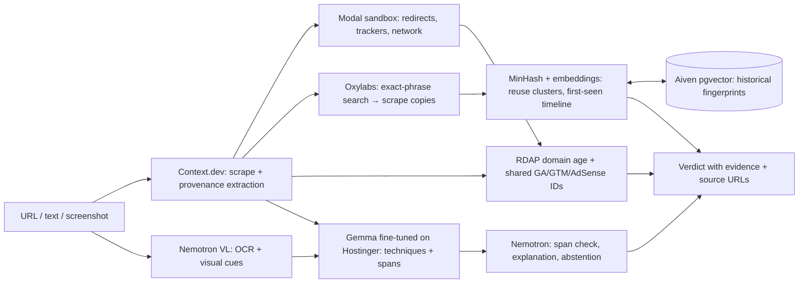

# Spec

Filled Fri 13.11 evening. Everything in this repo is in English: code, comments, docs, UI, submission.

## Challenge
- Track: TBD, check which track Hostinger sits in on the Junction Platform.
- Partner challenge: **Hostinger, "Decode the Noise"**: detect propaganda, bots and bad actors online; deployed live on Hostinger with a public URL.
- Stacked tech challenges (no cap, confirmed by the team on site):
  - Tier 1 (core flow): NVIDIA Nemotron, Context.dev, Oxylabs, Gemma, Verda
  - Tier 2 (if on schedule): Modal, Aiven
  - Tier 3 (cheap, process only): Codex, CRACI
  - Dropped: Gemini API (a second LLM dilutes Nemotron), Cloudinary (30% UX, weak fit), Arduino, Atech (hardware)
- What the partner wants (from the brief; confirm with mentors Minijus Savickas and Emilis Strimaitis at the Hostinger booth):
  - strong, honest detection logic, including false-positive handling, over a polished front end;
  - transparent and measurable: precision and false-positive rate, not only the happy path;
  - judging: detection quality 40%, execution + live Hostinger deploy 25%, originality + impact 20%, demo clarity 15%.

## Problem
Readers, journalists, fact-checkers and hosting providers see an article or post and cannot tell whether it is a manipulative piece, who is really behind it, or whether it is one node of a copy-paste network. Answering that today is manual OSINT that takes hours per case: read for techniques, look up the domain, search for copies, compare tracking IDs. Hostinger hosts millions of sites, so cloned propaganda networks also run on its own infrastructure.

Product: given a URL, text or screenshot, answer three questions with evidence:
1. **Name the technique**: which manipulation techniques it uses, quoting the exact spans, in plain language.
2. **Trust the source**: who is behind it (domain age, declared author/org, tracking IDs shared with other domains).
3. **Spot the swarm**: whether the same text appears across a network of sites, and who published it first.

## The demo moment
Paste one article URL. Within ~30 s:
- technique spans highlighted, each with a one-sentence explanation of why it is manipulative;
- a graph of the other sites carrying the same text, several sharing one Google Analytics / GTM ID, with a first-seen timeline;
- a verdict with every piece of evidence linked to its source URL.

Then paste a fact-check that quotes the same propaganda: the verdict says **"quotes, does not endorse"**, and the eval table on screen shows the false-positive rate on such cases.

## How a naive agent fails here
| Failure | Our guard |
|---|---|
| Flags fact-checks and news reports that *quote* propaganda | Quote/attribution-aware labelling; fact-checks are a hard-negative eval set |
| Flags satire and honest emotional journalism or op-eds as propaganda | Satire, op-ed and emotional-journalism hard negatives; FPR reported per set |
| Treats wire copy (AP, Reuters, ANSA) and press releases as a bot swarm | Reuse alone is never a verdict; known syndication sources are recognised; needs a second signal (shared infra, new domains, timing) |
| LLM invents quotes to justify a label | Every cited span must match the source text verbatim, otherwise it is dropped |
| Confident verdict from one weak signal | Verdict needs agreement of independent signals; Gemma/Nemotron disagreement returns "insufficient evidence" |
| Prompt injection inside the analysed page | Page content is data, never instructions; adversarial pages in `evals/` |

## Architecture
| Component | Role (no overlap) |
|---|---|
| **Hostinger** VPS KVM 2 (2 vCPU, 8 GB) | Hosts the API, UI and the local Gemma model (Ollama template); public URL |
| **NVIDIA Nemotron 3.5 Super VL** | Investigator agent: calls the tools, reads screenshots and memes, verifies spans, writes the explanation, abstains |
| **Context.dev** | Provenance: scrape to markdown, schema-based JSON extraction (author, org, date, outbound links, tracking IDs), company enrichment, monitors on domains and narratives |
| **Oxylabs Web API** | Spread: `/search` for distinctive quoted phrases (geo-targeted to EU countries), then `/scrape` of the copies found |
| **Gemma** (LoRA fine-tune, GGUF on Ollama) | Technique classifier with spans; the measurable model |
| **Verda** | GPU for the Gemma fine-tune; batch embedding jobs over corpora |
| **Modal** (tier 2) | Sandbox that opens the suspect page in isolation and records redirects, trackers and network requests (JS-loaded IDs) |
| **Aiven** Postgres + pgvector (tier 2) | Historical fingerprint store: every analysis grows the graph of known networks |
| **Codex** (tier 3) | Used for eval harness, adapters and tests; usage logged for the submission |
| **CRACI** (tier 3) | `runs-on: craci` in CI plus an SBOM check on the project's own dependencies |

Key insight: **shared tracking IDs** (Google Analytics, GTM, AdSense) across unrelated domains are classic OSINT evidence of a common operator; the Modal sandbox also catches IDs injected by JavaScript.

## Evaluation
- Held-out splits, per-technique precision, recall and FPR. Compare Gemma fine-tuned vs Gemma zero-shot vs Nemotron zero-shot.
- Hard-negative sets with their own FPR: satire, legitimate op-eds, honest emotional journalism, fact-checks quoting propaganda, wire copy and press releases (for the swarm detector).
- Adversarial set in `evals/`: prompt injection in pages, paraphrased copies, mixed real/fake provenance.
- The same table feeds the Nemotron criterion ("how you improved outputs") and Oxylabs ("honest about failures"), and goes into the README.

## Scope
- In: single-item analysis (URL, text, screenshot); technique spans + explanations; provenance (domain age, extracted metadata, shared tracking IDs); copy-network search and reuse clusters; verdict with sources and abstention; eval table; live deploy on Hostinger.
- Out: account-level social media bot detection, web-server log analysis ("Clean the traffic"), browser extension, user accounts, real-time feed monitoring beyond Context.dev monitors, polished UI.

## Data
- Technique training and eval (candidates; verify access and licences tonight, some need registration):
  - SemEval-2020 Task 11: news articles, span-level propaganda techniques;
  - SemEval-2023 Task 3: multilingual news, persuasion techniques;
  - SemEval-2024 Task 4: memes, multimodal persuasion techniques (for Nemotron VL).
- Hard negatives: collected satire, op-eds, fact-checks and wire copy, labelled by the team; sources recorded in `evals/`.
- Demo: one real, documented copy-paste network found live through Oxylabs + Context.dev; no fabricated cases on the demo path.

## Plan
1. **Fri night**: minimal endpoint live on Hostinger, eval harness, Nemotron zero-shot baseline, CI on CRACI. Preliminary submission by 23:59.
2. **Sat morning**: Gemma fine-tune on Verda, GGUF on Ollama on the VPS, first metrics.
3. **Sat afternoon**: Context.dev provenance, Oxylabs spread, Aiven fingerprint store, each behind one adapter. Real data through the demo path by 16:00.
4. **Sat night**: Modal sandbox, Nemotron verifier/explainer, minimal UI showing the evidence. Feature freeze Sun 03:00.
5. **Sun by 09:00**: metrics table in README, demo on a real copy network, per-sponsor notes (endpoints used and why), Verda Discord post, Codex usage log.

Running late: cut from the bottom (CRACI, then Aiven, then Modal). Tier 1 stays.

## Open questions
- [ ] Track for the Hostinger challenge on the platform.
- [ ] SemEval dataset access and licences.
- [ ] Oxylabs needs the $500 Flexible plan with code `JUNCTION2026`: **cancel after the event** or month two is charged.
- [ ] Exact Nemotron model id: the NVIDIA example is `nemotron-3.5-lightning-30b-a3b`, the requirement is **Super VL**.
- [ ] Gemma Q4 latency on 2 vCPU: classification needs few output tokens, so a small model should fit; measure it.
- [ ] Does the Hostinger AI Router expose Nemotron or Gemma? Use it as fallback to show Hostinger infra usage.
