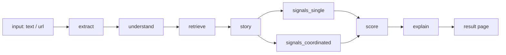

# Spec

Rewritten Sat 14.11 from `docs/plan.md` (decided Sat 00:58) and `DECISIONS.md`. The plan has the reasoning and alternatives; this file is the short, binding version. Where they differ, `DECISIONS.md` wins, then this file, then the plan. Everything in the repo is in English.

## Challenge
- Partner challenge: **Hostinger, "Decode the Noise"**: detect propaganda, bots and bad actors online; deployed live on Hostinger with a public URL.
- Judging (Hostinger): detection quality 40%, execution + live Hostinger deploy 25%, originality + impact 20%, demo clarity 15%. The partner wants strong, honest detection logic with precision and false-positive rate, not only the happy path.
- What the judges told us (Fri evening): show the confidence score **and how it is calculated**; focus on a few detection types and do them well; scale and impact matter; the frontend comes after the spec is final.
- Tech challenges kept (D15): **Oxylabs** (repeated-phrasing and blocked-source retrieval, D7) and **Google MLH "Best Use of Gemini API"** (Gemini with Google Search grounding as a retrieval adapter). The Fri 20:30 tier list (Nemotron, Context.dev, Gemma, Verda, Modal, Aiven, Codex, CRACI) is dropped.

## Problem
A reader sees an article or post and cannot tell whether it is a manipulative piece, or one node of a network pushing the same message. Answering that today is manual OSINT: read for techniques, find other coverage, check fact-checkers, look up the domain, search for copies, compare tracking IDs. A model's opinion of the text alone is not evidence: it is biased per language, prompt-injectable and cannot be checked by the reader.

## Product
Paste a text (then a link, then an image, D1). The pipeline finds how everyone else covered the same event and answers, per dimension, **how strongly the content shows signs of**:
1. **Single-actor propaganda**: manipulation by its author (persuasion techniques, tone far more charged than its peers, claims contradicted by the coverage or rated false by fact-checkers, a young or documented-network outlet).
2. **Coordinated propaganda**: the same message pushed by many outlets acting together (copied passages across unrelated outlets, copies within hours, shared tracking IDs or young domains, membership of a documented network such as VIGINUM's Portal Kombat).

Output per dimension: a **confidence score with the evidence behind it**, or "Not enough evidence" with the reason. Never a "propaganda / not propaganda" label: it would pose as ground truth (D4). Three plain-language reasons, each linked to evidence; the full breakdown behind "Show how we calculated this".

Inspiration: Ground News's story-level comparison (an item judged against its peers covering the same event). Not its third-party political-bias ratings (D9): we use measurable outlet types instead.

## The demo moment
1. Paste a Pravda-network article (or its text). Within the analysis budget the result shows: the same passages on several language editions of the network within hours, the domains on VIGINUM's list, a coordinated-propaganda confidence with each contribution ("copied passages from 6 unrelated outlets: +1.8"), every item linked to its source.
2. Paste a claim debunked by fact-checkers: claims contradicted by the coverage, the fact-check matched, the tone compared with 10 peers.
3. Paste a fact-check quoting the same claim, and wire copy republished by many newsrooms: both stay low. The metrics page shows the false-positive rate on exactly these hard-negative sets.

Demo inputs are real, documented cases; no fabricated content on the demo path. They are submitted once after the last deploy and played back with `events?replay=true`.

## How a naive detector fails here
| Failure | Our guard |
|---|---|
| Flags fact-checks and news reports that *quote* propaganda | Quotations are masked before the technique model and the copy detector read the text; `understand` extracts only claims the content itself asserts; fact-checks of the document's own outlet are skipped. Fact-checks are a hard-negative set with their own FPR |
| Treats wire copy (AP, Reuters, AFP, dpa, EFE, ANSA) and press releases as a swarm | `wire_service` outlet type from `retrieve`; established newsrooms are never copiers; 5-grams found in agency items are removed before comparing. Wire copy and press releases are hard-negative sets |
| Flags satire, op-eds and honest emotional journalism | Tone is compared with peers on the same story, not absolute; hard-negative sets for each. Known gap: satire with coverage still triggers techniques (no `satire` outlet type) |
| Confident score from one weak signal | Only the strongest signal per family counts; scores abstain on too little context or on families pointing both ways |
| LLM invents quotes or evidence | The LLM never sets a score. Claims and quotes are checked verbatim (code-point spans) by the API; reasons without valid evidence IDs are dropped |
| Prompt injection inside the analysed content | Analysed content goes only in the LLM's user message, never the system prompt; the explanation is built from the evidence digest only |
| English-only judgement | Multilingual models only, queries in the item's language plus English, support tiers shown to the user (D2) |

## Pipeline
The Rust API (`api/`, axum) runs the stages in order and calls one Python worker (`worker/`, FastAPI) per stage with the full `Analysis`; each stage returns a patch of its own fields, validated by the API before merging. Contract: Rust types in `contracts/`, generated into Python and TypeScript (`mise run contracts`). Stage table and helper rules: `AGENTS.md`.

| Stage | Owner | Does |
|---|---|---|
| extract | ck-lithium | Text or URL → paragraphs, outlet, date, author, tracking IDs; language ID (lingua) with support tier |
| understand | Lyreplus | One LLM call: summary, entities, ≤5 verbatim claims, queries in the item's language and English |
| retrieve | ck-lithium | The only stage with network I/O after extract: Google News RSS, GDELT, Gemini grounded search, Google Fact Check Tools, Oxylabs; full article bodies; `sources[]` per outlet (RDAP, crt.sh, outlet type, country, VIGINUM membership) |
| story | ck-lithium | Multilingual embeddings: similarity, in-story flag and reason per context item |
| signals_single | Lyreplus | Families: techniques, tone vs peers, claim support (cross-lingual NLI), fact-checks, source profile |
| signals_coordinated | Lyreplus | Families: text reuse, timing, infrastructure, known networks |
| score | Lyreplus | Combiner, abstention, breakdown (below) |
| explain | Lyreplus | One LLM call: summary and three reasons from the evidence only; never changes the score |

Signal catalogue, value scales and models: `docs/ai-core.md`.

## Confidence score
- Per dimension, each family's value $v_f \in [-1, 1]$ is the strength of its **strongest signal only**, so correlated evidence is not double-counted. Negative values point away from propaganda (a news agency outlet, a claim the coverage supports).
- $\text{confidence} = \sigma(b + \sum_f w_f v_f)$: logistic regression, the only trained model (D5). The contributions $w_f v_f$ are the numbers shown to the user.
- Weights are hand-set priors in `pipeline/score/weights.json` until fitted on the labelled set (`python -m pipeline.score.fit`, cross-validated). Until then the UI and the explanation must not call the score calibrated.
- **Abstain** ("Not enough evidence", with the reason): no text; unsupported language; fewer than 3 related reports and no fact-check match (single); no copies, no listed domain and fewer than 3 items (coordinated); a family ≥ 0.7 and another ≤ −0.7.
- Language tiers (D2): *evaluated* (in our labelled set), *supported, not evaluated* (confidence capped at 0.85), *unsupported* (abstain).

## Evaluation
Owner: mosearc (`evals/`). Labels come from third parties, never from our reading of the text.

| Set | Dimension | Label source | Target |
|---|---|---|---|
| `fact_checker_debunk` | single = true | ClaimReview fact-checks (IFCN signatories, several languages) | ~70 |
| `euvsDisinfo` | single = true | EUvsDisinfo database cases | ~25 |
| `viginum_pravda` | coordinated = true | Articles on VIGINUM-listed Portal Kombat domains | ~50 |
| `mainstream` | both false | Straight reporting by established outlets | ~15 |
| `hard_fact_checks`, `hard_satire`, `hard_op_eds`, `hard_emotional` | single = false | The publisher (fact-checker, satire outlet, opinion section) | ~8–20 each |
| `hard_wire_copy`, `hard_press_releases` | coordinated = false | Agency or issuer of the original | ~15–25 each |

- A dimension a source says nothing about is left unlabelled (`null`), not guessed: a debunked claim says nothing about coordination.
- No article bodies in the repo: items carry the URL (the pipeline fetches it) or a short claim quoted by a fact-checker.
- Runner: each item goes through a **local** API with the limits off; outputs `predictions.jsonl` (harness) and `fit.jsonl` (combiner fit). Failed analyses are reported apart from abstentions.
- Metrics per dimension: precision, recall, F1, FPR overall and **per hard-negative set**, Wilson 95% intervals, calibration table, abstain and failure rates, per language where the set allows. Published as `evals/metrics.json` and served by `/api/metrics`.
- Limits stated up front: EUvsDisinfo and VIGINUM cover pro-Kremlin operations only; the `known_networks` family reads the same VIGINUM list that labels the coordinated positives, so the metrics page also reports the coordinated dimension without that family. The set is small: intervals, not point values.

## Scope
- **MVP (Sunday morning)**: pasted text and article URL; both dimensions with breakdown, abstention and evidence links; result page with score per dimension, three reasons, coverage view, "Show how we calculated this"; metrics page; live on the VPS.
- **Phase 2, only if the MVP is green at Sat 18:00, in order**: image input (OCR via a vision model on AI Router); social-media repeated phrasing via Oxylabs; scheduled ingestion with n8n (D10); history dashboard.
- **Out**: user accounts, browser extension, real-time social firehose, our own political-bias ratings, per-language hand-tuned rules, fine-tuning (D13).

## Hosting
Hostinger VPS KVM 2 (2 vCPU, 8 GB, no GPU, D13) at <https://the4thlover.tech>: Caddy (TLS, static UI), the Rust API with SQLite (D11), the Python worker with the CPU models. LLM calls through Hostinger AI Router (D12), `LLM_MODEL=gemini-3.1-flash-lite`. Images built in CI and pulled from GHCR; every merge to `main` deploys. Limits: 300 s per analysis, 120 s per stage, 4 analyses at once, 30 new analyses per minute per client. Operations: `deploy/README.md`.

## Timeline
| When | Milestone |
|---|---|
| Sat 16:00 | Real pasted text through the full pipeline on the VPS, with Google News context |
| Sat 18:00 | MVP green: all retrieval adapters, story clustering, frontend v1, first real metrics |
| Sun 03:00 | Feature freeze |
| Sun 09:00 | Submission: video, description, repo public under MIT |

Per-person tasks: `docs/next-steps.md`.

## Open questions
- [ ] Track for the Hostinger challenge on the Junction platform.
- [ ] Model weights trained on research-only data (SemEval) in a public MIT repo: ask the organisers.
- [ ] Oxylabs $500 Flexible plan: **cancel right after the event**.
- [ ] Rotate every key after the event: the repo goes public.
