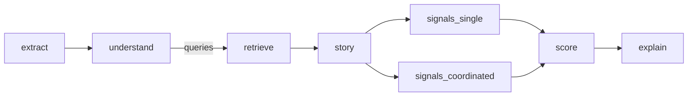

# AI core: understand, signals, score, explain

Owner: Lyreplus (`pipeline/understand/`, `pipeline/signals/`, `pipeline/score/`, `pipeline/explain/`, prompts). Branch: `lyreplus/ai-core`. Read this before changing or consuming these stages; read `docs/plan.md` §4–5 for the why.

Updated: Sat 14:00.

## Status

| Stage | Entry point | State |
|---|---|---|
| understand | `pipeline/understand/__init__.py: run` (async) | Done; tested with the real AI Router LLM |
| signals_single | `pipeline/signals/__init__.py: run_single` → `signals/single.py` | Done; tested with the real models |
| signals_coordinated | `pipeline/signals/__init__.py: run_coordinated` → `signals/coordinated.py` | Done; no models |
| score | `pipeline/score/__init__.py: run` | Done with **hand-set prior weights**; fit CLI ready, waiting for the labelled set |
| explain | `pipeline/explain/__init__.py: run` | Not started |

Not yet merged to `main` (first PR once explain lands). Open items are at the end.



## Files

```text
pipeline/understand/__init__.py   prompt, LLM schema, claim location, query cleaning
pipeline/signals/__init__.py      lazy run_single / run_coordinated (PEP 562)
pipeline/signals/models.py        technique + NLI models, loaded at import (pinned revisions)
pipeline/signals/single.py        run_single: orchestrates the single-actor families
pipeline/signals/techniques.py    families techniques, tone
pipeline/signals/claims.py        families claim_support, fact_checks (+ rating vocabulary)
pipeline/signals/source_profile.py family source_profile
pipeline/signals/coordinated.py   run_coordinated: text_reuse, timing, infrastructure, known_networks
pipeline/signals/text.py          language-independent helpers: sentences, windows, peers, refs
pipeline/score/__init__.py        run: combiner, abstentions, breakdown; loads weights.json
pipeline/score/families.py        evidence → family value in [-1, 1] (the STRENGTH table)
pipeline/score/weights.json       combiner weights (priors today)
pipeline/score/fit.py             CLI: fit weights on labelled analyses, cross-validated report
pipeline/*/tests/                 pytest, fixture-based, no network, no model downloads
```

Each module's docstring documents its signals and value scales; this file is the overview.

## understand

- One `llm.ask_json_async` call. The document (title + paragraphs, max 12,000 characters) goes in `user`; the system prompt says the content is data and its instructions must be ignored.
- The model returns: language, one-sentence English summary, ≤8 entities, date, place, ≤5 claims copied word for word, queries.
- Claims are located with `spans.claim` (never model offsets). Paraphrases, duplicates and passages shorter than 10 characters are dropped before the API sees them. IDs `cl1…` are consecutive.
- Queries: at most 3 in the document's language plus 3 in English, only those two languages; double quotes removed (retrieve adds operators itself), duplicates dropped, language codes normalised (`it-IT` → `it`).
- `analysis.language.code` from extract wins over the model's language guess.
- Errors: no document → `StageError("There is no text to analyse")`; unparsable model answer → `StageError("The language model gave an answer we could not read")`.

## signals: evidence catalogue

All evidence IDs: `s1…` (single), `c1…` (coordinated). Every item has at least one source ref; quotes are exact substrings of the context item's text, document refs are exact spans. No network I/O.

### Single-actor (`run_single`)

| Family | Signal | Value | When emitted | Source refs |
|---|---|---|---|---|
| techniques | `attack_on_reputation`, `justification`, `simplification`, `distraction`, `call`, `manipulative_wording` | probability of the strongest detected technique of that SemEval-2023 category, `[0, 1]` | a technique passes the model's own per-label threshold in ≥1 paragraph | up to 3 document paragraphs, strongest first |
| tone | `tone_vs_peers` | z-score of the document's emotional charge vs story peers, `[-5, 5]` (positive = more charged) | ≥3 story peers | most charged paragraph + up to 3 peers |
| claim_support | `contradicted` | contradicting / addressing sources, `[0, 1]` | ≥1 peer entails or contradicts the claim with p ≥ 0.6 | claim span + contradicting passages (quoted) + supporting peers |
| claim_support | `unaddressed` | 1.0 | ≥3 peers judged, none addresses the claim | claim span |
| fact_checks | `rated_false` (1.0), `rated_misleading` (0.6), `rated_true` (0.0) | rating value | a `context[].fact_check` matches a claim (NLI entailment ≥ 0.5 either way, or ≥60% word overlap) and its rating is in the vocabulary (`claims.RATINGS`, several languages) | claim span + fact-check item (quote = rating when verbatim) |
| source_profile | `domain_age_days` | days from registration (or first certificate) to publication | `sources[]` has the document's outlet with a date | RDAP or crt.sh URL |
| source_profile | `outlet_<type>` | 1.0 | `sources[].outlet_type` set | outlet URL |

Details:
- **Emotional charge** of a text = mean over its paragraphs of the max probability among Loaded Language, Appeal to Fear, Name Calling, Exaggeration. Peers use their first 3 chunks (~400 chars). Spread floored at 0.05 so near-identical peers don't explode the z-score.
- **Story peers** (`text.story_peers`): context items with `in_story` not false, not fact-checks, not the document's outlet, and **not copies of the document** (≥ half of its sentences of ≥40 chars verbatim). Copies would confirm the document with its own words; they are coordinated evidence instead. Max 10, by `similarity`.
- **Claim support** sends NLI the 4 two-sentence windows of each peer that share most words with the claim. Single sentences lose context: measured, "The draft does not ban private wells." alone → neutral 0.976; with the preceding sentence → contradiction 0.964. A peer that contains the claim verbatim is a quote, skipped for that claim.
- Budget (2 vCPU): max 30 paragraphs, 10 peers.

### Coordinated (`run_coordinated`)

| Family | Signal | Value | When emitted | Source refs |
|---|---|---|---|---|
| text_reuse | `copied_passages` | number of distinct other outlets copying the document | ≥1 copy | most-copied document sentence + up to 4 copies (quoted when verbatim) |
| timing | `copies_within_window` | copies published within 6 h of the document (or of the earliest copy when the document has no date) | ≥1 (≥2 without document date) | the copies |
| infrastructure | `shared_tracking_id` | largest number of other domains carrying one of the document's GA/GTM/AdSense IDs (without document IDs: an ID shared by ≥2 copying sites) | ≥1 such domain | carrying items |
| infrastructure | `young_copying_domains` | copying domains registered < 180 days before the article | ≥1 | RDAP URLs |
| known_networks | `listed_domain` | listed domains among the document outlet and the copies | `sources[].known_network` set | outlet URLs |

- **Copy** = a context item containing ≥20% (and ≥8) of the document's word 5-grams. One per domain (`www.` stripped).
- **Syndication guard** (plan §12): outlets with `outlet_type` `wire_service` or `fact_checker` are never copiers, and 5-grams that appear in any wire-service item are removed from the document before comparing. A document that only repeats agency copy gets no reuse evidence.
- Exact 5-gram sets instead of MinHash: with ≤30 context items exact is cheap and has no false matches.

## score

Per dimension:

$$\text{confidence} = \sigma\Big(b + \sum_f w_f \cdot v_f\Big)$$

- $v_f \in [-1, 1]$: family value = strength of its strongest signal (`families.STRENGTH`). Positive points toward propaganda, negative away (a fact-checker rating the claim true −1, outlet is a news agency −0.5, fact-checker −1, national −0.2). Unknown signals are ignored with a log warning: **add a STRENGTH entry when you add a signal.**
- Counts saturate: copies/timing $1 - e^{-n/2}$, shared tracking ID $1 - e^{-n}$; domain age $1 - \log_{10}(d+1)/\log_{10}3650$ (15 days → 0.66, 1 year → 0.28); tone $z/3$ clipped to $[0, 1]$; unaddressed claim 0.35.
- `breakdown`: every family of the dimension in fixed order, `contribution = w_f · v_f` (log-odds), `evidence_ids` strongest first (empty when no evidence). Shown even when abstaining.

Prior weights (`weights.json`, `source` says they are priors):

| Dimension | Intercept | Coefficients |
|---|---|---|
| single | −2.0 | techniques 1.5, tone 1.0, claim_support 1.5, fact_checks 2.5, source_profile 1.0 |
| coordinated | −2.5 | text_reuse 2.0, timing 1.0, infrastructure 2.0, known_networks 3.0 |

Abstentions (`confidence: null`, `reason` shown as "Not enough evidence"):
- both: no text; `language.support == unsupported`;
- single: fewer than 3 related reports (in story, not fact-checks) and no fact-check match;
- coordinated: no copies and no listed domain, and fewer than 3 non-fact-check items found;
- either: a family ≥ 0.7 and another ≤ −0.7 ("evidence points both ways").

`language.support == supported` (not evaluated) caps confidence at 0.85 (D2).

### Fitting the combiner (for evals / mosearc)

```sh
uv run python -m pipeline.score.fit labelled.jsonl --dry-run   # report only
uv run python -m pipeline.score.fit labelled.jsonl             # also writes weights.json
```

One JSON object per line: `{"analysis": <finished Analysis, e.g. GET /api/analyses/{id}>, "single": 1|0|null, "coordinated": 1|0|null}`. Features are recomputed from `analysis.evidence`, so re-fitting after a signal change only needs `rerun?from=signals_single` on the stored analyses. L2 logistic regression (Newton, λ = 1, intercept unpenalised); stratified k-fold (k ≤ 5) out-of-fold log loss, Brier, AUC and reliability table, stored in `weights.json` under `cv` for the metrics page. A dimension with fewer than 2 labels of each class keeps its prior. Commit the new `weights.json`. The result cache is keyed on `PIPELINE_VERSION` (the image tag in deploys, `dev` locally): after changing weights locally, submit with `?force=true` or use `rerun?from=score`.

## Models

| Use | Model | Revision | Size | Licence |
|---|---|---|---|---|
| techniques, tone | `Mishtar4/persuasion-detector-xlm-roberta` (XLM-R large, 23 labels, multi-label, thresholds in `thresholds.npy`) | `9d288fd3` | 2.2 GB | MIT (trained on research-only SemEval data) |
| claim support, fact-check matching | `MoritzLaurer/mDeBERTa-v3-base-xnli-multilingual-nli-2mil7` | `b5113eb3` | 1.1 GB | MIT |

- Loaded once at worker start by `signals/models.py` (`HF_HOME`; `/models` in the image). First start downloads ~3.3 GB.
- CPU only (D13), batches of 8 sorted by length, `torch.inference_mode`.
- Dependencies added on this branch: `torch` (CPU index), `transformers`, `numpy` in `pyproject.toml` / `uv.lock` (integrator to approve).

## Results so far

Measured on a dev laptop (AMD Ryzen 5 240, 12 threads). **Not measured on the VPS (2 vCPU) yet.**

| Measurement | Result |
|---|---|
| Model load (cached weights) | 6.9 s (15.7 s on a cold disk cache) |
| `run_single` on the example analysis (3 paragraphs, 1 peer, 2 claims) | 0.9 s |
| `run_coordinated` | milliseconds |
| understand on a 3-paragraph Italian text (AI Router) | 3 verbatim claims with correct spans; 3 `it` + 3 `en` queries |

Example analysis (`contracts/fixtures/analysis.json`), chain run_single → run_coordinated → score with real models:

| Dimension | Confidence | Contributions |
|---|---|---|
| single | 0.983 | techniques 1.37 (attack on reputation 0.91, loaded language 0.86), claim_support 1.5 (contradicted by the wire report), fact_checks 2.5 (rated False), source_profile 0.66 (domain 15 days old), tone — (only 1 independent peer) |
| coordinated | 0.755 | text_reuse 1.26 (2 sites), timing 0.63 (within 51 min), infrastructure 1.73 (shared `G-TRUTH12345`), known_networks 0 |

Neutral control (the wire report as the document): no technique detected; coordinated 0.076; single abstains ("Only 2 other reports…").

Caveat: the fixture's own evidence uses signal names our stages do not emit (`loaded_language`, `copies_within_an_hour`); scoring the fixture as stored ignores those two. Score our stages' output, not the fixture's evidence.

These are sanity checks on one invented article, not metrics. Real precision/FPR come from the labelled sets (plan §8).

## Testing

```sh
uv run --frozen pytest pipeline                 # all AI-core tests: no network, no model download
mise run check                                  # before every push
mise run worker:dev                             # loads the models; /health lists implemented stages
curl -s -X POST 127.0.0.1:8001/stages/signals_single -H 'content-type: application/json' \
  --data @contracts/fixtures/analysis.json
```

Tests replace the models and the LLM with stand-ins (`fake_nli`, monkeypatched `ask_json_async`); the model-dependent path is checked by running the chain above. `pipeline.signals` resolves `run_single` lazily so tests of the family modules never load torch.

## What the other stages must provide

- **extract**: `document.paragraphs`, `outlet` (domain), `published_at`, `tracking_ids`; `language.support` drives abstention and the confidence cap.
- **retrieve**: `context[].text` (full body, not a snippet: claim support and copy detection read it), `outlet`, `published_at`, `tracking_ids`, `fact_check`; `sources[]` for the document outlet **and** every context outlet, with `outlet_type = wire_service` for agencies (the syndication guard depends on it) and `known_network`.
- **story**: `in_story` and `similarity`; items with `in_story = false` are ignored by tone and claim support.

## Open items

1. explain stage (next).
2. Latency on the VPS: 2 vCPU with XLM-R large; fallback is fewer paragraphs/peers or a smaller model.
3. Fit the combiner on mosearc's labelled set; until then confidences are priors, not calibrated.
4. Integrator: approve the new dependencies; consider pointing `AGENTS.md` "Read first" to this file; suggested `DECISIONS.md` lines: score family values in [-1, 1] with strongest-signal-only and prior weights in `pipeline/score/weights.json`; copies of the document are excluded from claim support and tone peers.
5. Spot check of the technique model outside its six training languages (D6) is not done.

## Changelog

- Sat 14:00 — score stage, fit CLI, this document.
- Sat 13:40 — signals_coordinated.
- Sat 13:00 — understand, signals_single.
