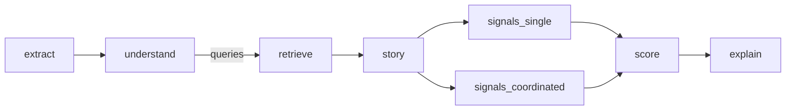

# AI core: understand, signals, score, explain

Owner: Lyreplus (`pipeline/understand/`, `pipeline/signals/`, `pipeline/score/`, `pipeline/explain/`, prompts). Branches: `lyreplus/<topic>`, one per round. Read this before changing or consuming these stages; read `docs/plan.md` §4–5 for the why.

Updated: Sat 17:00.

## Status

| Stage | Entry point | State |
|---|---|---|
| understand | `pipeline/understand/__init__.py: run` (async) | Done; tested with the real AI Router LLM |
| signals_single | `pipeline/signals/__init__.py: run_single` → `signals/single.py` | Done; tested with the real models |
| signals_coordinated | `pipeline/signals/__init__.py: run_coordinated` → `signals/coordinated.py` | Done; no models |
| score | `pipeline/score/__init__.py: run` | Done with **hand-set prior weights**; fit CLI ready, waiting for the labelled set |
| explain | `pipeline/explain/__init__.py: run` (async) | Done; tested with the real LLM |

All five stages are in the first PR to `main`. Open items are at the end.



## Files

```text
pipeline/understand/__init__.py   prompt, LLM schema, claim location, query cleaning
pipeline/signals/__init__.py      lazy run_single / run_coordinated (PEP 562)
pipeline/signals/models.py        technique + NLI models, loaded at import (pinned revisions)
pipeline/signals/single.py        run_single: orchestrates the single-actor families
pipeline/signals/techniques.py    families techniques, tone
pipeline/signals/claims.py        families claim_support, fact_checks (+ rating vocabulary)
pipeline/signals/source_profile.py family source_profile
pipeline/signals/coordinated.py   run_coordinated: text_reuse, timing, infrastructure, known_networks
pipeline/signals/text.py          language-independent helpers: sentences, windows, peers, refs
pipeline/score/__init__.py        run: combiner, abstentions, breakdown; loads weights.json
pipeline/score/families.py        evidence → family value in [-1, 1] (the STRENGTH table)
pipeline/score/weights.json       combiner weights (priors today)
pipeline/score/fit.py             CLI: fit weights on labelled analyses, cross-validated report
pipeline/explain/__init__.py      prompt, evidence digest, API rules applied before returning
pipeline/*/tests/                 pytest, fixture-based, no network, no model downloads
```

Each module's docstring documents its signals and value scales; this file is the overview.

## understand

- One `llm.ask_json_async` call. The document (title + paragraphs, max 12,000 characters) goes in `user`; the system prompt says the content is data and its instructions must be ignored.
- The model returns: language, one-sentence English summary, ≤8 entities, date, place, ≤5 claims copied word for word, queries.
- Claims are only what the content itself asserts: not what it quotes, attributes to someone it disagrees with, debunks or mocks. A fact-check yields its own findings, not the claim it reviews; satire yields no claims. Without this rule a fact-check was scored on the hoax it debunks (see "Hard negatives").
- Claims are located with `spans.claim` (never model offsets). Paraphrases, duplicates and passages shorter than 10 characters are dropped before the API sees them. IDs `cl1…` are consecutive.
- Queries: at most 3 in the document's language plus 3 in English, only those two languages; double quotes removed (retrieve adds operators itself), duplicates dropped, language codes normalised (`it-IT` → `it`).
- `analysis.language.code` from extract wins over the model's language guess.
- Errors: no document → `StageError("There is no text to analyse")`; unparsable model answer → `StageError("The language model gave an answer we could not read")`.

## signals: evidence catalogue

All evidence IDs: `s1…` (single), `c1…` (coordinated). Every item has at least one source ref; quotes are exact substrings of the context item's text, document refs are exact spans. No network I/O.

### Single-actor (`run_single`)

| Family | Signal | Value | When emitted | Source refs |
|---|---|---|---|---|
| techniques | `attack_on_reputation`, `justification`, `simplification`, `distraction`, `call`, `manipulative_wording` | probability of the strongest detected technique of that SemEval-2023 category, `[0, 1]` | a technique passes the model's own per-label threshold in ≥1 paragraph | up to 3 document paragraphs, strongest first |
| tone | `tone_vs_peers` | z-score of the document's emotional charge vs story peers, `[-5, 5]` (positive = more charged) | ≥3 story peers | most charged paragraph + up to 3 peers |
| claim_support | `contradicted` | contradicting / addressing sources, `[0, 1]` | ≥1 peer entails or contradicts the claim with p ≥ 0.6 | claim span + contradicting passages (quoted) + supporting peers |
| claim_support | `unaddressed` | 1.0 | ≥3 peers judged, none addresses the claim | claim span |
| fact_checks | `rated_false` (1.0), `rated_misleading` (0.6), `rated_true` (0.0) | rating value | a `context[].fact_check` matches a claim (NLI entailment ≥ 0.5 either way, or ≥60% word overlap) and its rating is in the vocabulary (`claims.RATINGS`, several languages) | claim span + fact-check item (quote = rating when verbatim) |
| source_profile | `domain_age_days` | days from registration (or first certificate) to publication | `sources[]` has the document's outlet with a date | RDAP or crt.sh URL |
| source_profile | `outlet_<type>` | 1.0 | `sources[].outlet_type` set | outlet URL |

Details:
- **Emotional charge** of a text = mean over its paragraphs of the max probability among Loaded Language, Appeal to Fear, Name Calling, Exaggeration. Peers use their first 3 chunks (~400 chars). Spread floored at 0.05 so near-identical peers don't explode the z-score.
- **Story peers** (`text.story_peers`): context items with `in_story` not false, not fact-checks, not the document's outlet, and **not copies of the document** (≥ half of its sentences of ≥40 chars verbatim). Copies would confirm the document with its own words; they are coordinated evidence instead. Max 10, by `similarity`.
- **Claim support** sends NLI the 4 two-sentence windows of each peer that share most words with the claim. Single sentences lose context: measured, "The draft does not ban private wells." alone → neutral 0.976; with the preceding sentence → contradiction 0.964. A peer that contains the claim verbatim is a quote, skipped for that claim.
- **Quotations are not the author's words** (`text.mask_quotations`, `text.own_words`): passages inside `"…"`, `“…”`, `„…“`, `«…»`, `‘…’` are replaced by `…` before the technique model reads the document and the peers. A text that is mostly quotation (a pasted post in quote marks) keeps its words. Trade-off: scare quotes (so-called “experts”) are masked too.
- **Fact-checks from the document's own outlet** are skipped: a fact-checker's article is not rated False by its own review.
- Budget (2 vCPU): max 30 paragraphs, 10 peers.

### Coordinated (`run_coordinated`)

| Family | Signal | Value | When emitted | Source refs |
|---|---|---|---|---|
| text_reuse | `copied_passages` | number of distinct other outlets copying the document | ≥1 copy | most-copied document sentence + up to 4 copies (quoted when verbatim) |
| timing | `copies_within_window` | copies published within 6 h of the document (or of the earliest copy when the document has no date) | ≥1 (≥2 without document date) | the copies |
| infrastructure | `shared_tracking_id` | largest number of other domains carrying one of the document's GA/GTM/AdSense IDs (without document IDs: an ID shared by ≥2 copying sites) | ≥1 such domain | carrying items |
| infrastructure | `young_copying_domains` | copying domains registered < 180 days before the article | ≥1 | RDAP URLs |
| known_networks | `listed_domain` | listed domains among the document outlet and the copies | `sources[].known_network` set | outlet URLs |

- **Copy** = a context item containing ≥20% (and ≥8) of the document's word 5-grams. One per domain (`www.` stripped).
- **Syndication guard** (plan §12): outlets with `outlet_type` `wire_service`, `fact_checker`, `national` or `local` are never copiers (established newsrooms republishing one text within minutes is agency copy even when the agency's item was not retrieved), and 5-grams that appear in any wire-service item are removed from the document before comparing. A document that only repeats agency copy gets no reuse evidence. Depends on retrieve typing mainstream outlets; untyped outlets still count as copiers.
- **Quotations** are removed from the document before shingling: a fact-check quoting a hoax is not a copy of it.
- Exact 5-gram sets instead of MinHash: with ≤30 context items exact is cheap and has no false matches.

## score

Per dimension:

$$\text{confidence} = \sigma\Big(b + \sum_f w_f \cdot v_f\Big)$$

- $v_f \in [-1, 1]$: family value = strength of its strongest signal (`families.STRENGTH`). Positive points toward propaganda, negative away (a fact-checker rating the claim true −1, outlet is a news agency −0.5, fact-checker −1, national −0.2). Unknown signals are ignored with a log warning: **add a STRENGTH entry when you add a signal.**
- Counts saturate: copies/timing $1 - e^{-n/2}$, shared tracking ID $1 - e^{-n}$; domain age $1 - \log_{10}(d+1)/\log_{10}3650$ (15 days → 0.66, 1 year → 0.28); unaddressed claim 0.35.
- Signed signals: tone $z/3$ clipped to $[-0.5, 1]$ (calmer than the peers points away, weakly); claim support $2v - 1$ clipped to $[-0.6, 1]$ with $v$ = contradicting share (all contradict 1, split 0, all support −0.6). Both floors stay above −0.7, so they never trigger the disagreement abstention alone.
- `breakdown`: every family of the dimension in fixed order, `contribution = w_f · v_f` (log-odds), `evidence_ids` strongest first (empty when no evidence). Shown even when abstaining.

Prior weights (`weights.json`, `source` says they are priors):

| Dimension | Intercept | Coefficients |
|---|---|---|
| single | −2.0 | techniques 1.5, tone 1.0, claim_support 1.5, fact_checks 2.5, source_profile 1.0 |
| coordinated | −2.5 | text_reuse 2.0, timing 1.0, infrastructure 2.0, known_networks 3.0 |

Abstentions (`confidence: null`, `reason` shown as "Not enough evidence"):
- both: no text; `language.support == unsupported`;
- single: fewer than 3 related reports (in story, not fact-checks) and no fact-check match;
- coordinated: no copies and no listed domain, and fewer than 3 non-fact-check items found;
- either: a family ≥ 0.7 and another ≤ −0.7 ("evidence points both ways").

`language.support == supported` (not evaluated) caps confidence at 0.85 (D2).

### Fitting the combiner (for evals / mosearc)

```sh
mise run eval -- run                                              # mosearc's runner → evals/results/fit.jsonl
uv run python -m pipeline.score.fit evals/results/fit.jsonl --dry-run   # report only
uv run python -m pipeline.score.fit evals/results/fit.jsonl             # also writes weights.json
```

One JSON object per line: `{"analysis": <finished Analysis, e.g. GET /api/analyses/{id}>, "single": 1|0|null, "coordinated": 1|0|null}`. Features are recomputed from `analysis.evidence`, so re-fitting after a signal change only needs `rerun?from=signals_single` on the stored analyses. L2 logistic regression (Newton, λ = 1, intercept unpenalised); stratified k-fold (k ≤ 5) out-of-fold log loss, Brier, AUC and reliability table, stored in `weights.json` under `cv` for the metrics page. A dimension with fewer than 2 labels of each class keeps its prior. Commit the new `weights.json`. The result cache is keyed on `PIPELINE_VERSION` (the image tag in deploys, `dev` locally): after changing weights locally, submit with `?force=true` or use `rerun?from=score`.

- **Only shown scores are fitted.** An item on which the dimension abstains is counted in the report and left out: no confidence reaches the reader there, and its empty comparison families would teach the combiner "no coverage found" (old debunked articles have none in today's feeds) instead of the signal.
- **`cv.ablation`** per family with evidence: `items_with_evidence`, `auc_without` / `log_loss_without` (combiner refitted without the family) and `auc_alone`. Read it before quoting a headline number: `known_networks` is the VIGINUM list that also labels the coordinated positives, and `fact_checks` is the fact-check that defines a debunked claim, so both separate the classes by construction. Quote the AUC without them next to the full one.

## explain

- One `llm.ask_json_async` call (max 1000 output tokens: non-Latin scripts need more). The `user` message is a JSON digest: both scores (confidence + non-zero contributions, or the abstention reason), the 20 strongest evidence items (`id`, family, signal, detail; ranked by `|strength|`), the title and the claims. The system prompt forbids outside knowledge, invented numbers, verdict labels (D4) and non-verbatim quotes.
- Output: a 1–2 sentence summary and up to 3 reasons, each with evidence IDs.
- The stage applies the API's rules itself (`check`): unknown evidence IDs are removed and a reason left with none is dropped; a reason whose quotation (≥12 chars inside `"…"`, `“…”`, `„…“`, `«…»`) is not verbatim in the document, context or an evidence detail is dropped; a misquoting summary is blanked. `quotations` mirrors `contracts/src/apply.rs`.
- No evidence at all → no LLM call; the summary says nothing was found and repeats the abstention reasons.
- **Uncalibrated confidences are disclosed** (`docs/next-steps.md`: never claim calibration before the fit). Each non-abstained score in the digest carries `calibrated` (`WEIGHTS.<dimension>.calibrated`, true once `pipeline.score.fit` wrote `n > 0`); the prompt says to call uncalibrated numbers estimates; and the `PRIORS_NOTES` sentence ("These percentages are preliminary estimates from hand-set weights, not yet calibrated on labelled data.") is appended to the summary whenever such a confidence is shown, independent of the model's wording. After the fit the note disappears by itself.
- **Explanation language (D14)**: `explanation_language(analysis)` reads the optional request field `input.explanation_language` (ISO 639-1, `it-IT` → `it`; anything that is not a 2–3 letter code → English) and defaults to English. The prompt asks for that language, with the dimension names translated and quotations kept verbatim in their original language. The two fixed sentences (`PRIORS_NOTES`, `NOTHING_FOUND`) come from tables for en, it, de, fr, es, pt, pl, nl, ru, uk; other languages get them in English. With no evidence and a non-English language, the summary is the translated "nothing found" sentence only (the English abstention reasons are shown with the scores).
  - The request field is in the contract: the API lowercases it, keeps the primary subtag (`pt-BR` → `pt`), rejects anything that is not a 2–3 letter code with 422, and puts it in the cache key (none = `en`). The UI offers the choice (default English, or the content language).
  - Live check (flash-lite, fixture): it, ru and fi all kept 3 reasons and the summary; it/ru notes translated, fi English as designed. The Russian run translated "partisan outlet" as "guerrilla"; the source-profile detail now says "a politically partisan outlet".

## LLM cost (AI Router)

Prices from `GET $LLM_BASE_URL/models` (credits per token). Measured with the understand prompt on the example article (~700–900 input tokens):

| Model | Credits / understand call | Latency | Result |
|---|---|---|---|
| `claude-sonnet-5` (current `.env`) | 0.58 | 0.8–4.8 s | valid, best wording |
| `gemini-3.1-flash-lite` | 0.06–0.10 | 1.5–1.9 s | valid: all claims verbatim, queries in both languages; explain good |
| `claude-haiku-5.5` | 0.04–0.08 | 3.5–7 s | valid |
| `gpt-oss-120b` | 0.07–0.08 | 4 s | 1 of 2 invalid (missing field) |
| `gemma-4-31b` | — | 17–27 s | invalid JSON |
| `gpt-5-nano`, `nemotron-lightning-3.5-30b-a3b` | — | — | reasoning used all 2048 tokens, no answer |

An analysis makes 2 calls (understand, explain). Recommended default: `LLM_MODEL=gemini-3.1-flash-lite` (~0.15 credits per analysis, ~15 for 100 analyses; sonnet ~1.2 per analysis). Evals that change signals or the combiner must use `rerun?from=signals_single` / `from=score`, which reuse the stored understand output and make no LLM call before explain. Self-hosting an LLM is not worth it: the VPS has 2 vCPU shared with the models above, and a Hostinger GPU costs 42+ credits per hour, more than ~280 analyses on flash-lite (D13).

## Models

| Use | Model | Revision | Size | Licence |
|---|---|---|---|---|
| techniques, tone | `Mishtar4/persuasion-detector-xlm-roberta` (XLM-R large, 23 labels, multi-label, thresholds in `thresholds.npy`) | `9d288fd3` | 2.2 GB | MIT (trained on research-only SemEval data) |
| claim support, fact-check matching | `MoritzLaurer/mDeBERTa-v3-base-xnli-multilingual-nli-2mil7` | `b5113eb3` | 1.1 GB | MIT |

- Loaded once at worker start by `signals/models.py` (`HF_HOME`; `/models` in the image). First start downloads ~3.3 GB.
- CPU only (D13), batches of 8 sorted by length, `torch.inference_mode`.
- Dependencies added on this branch: `torch` (CPU index), `transformers`, `numpy` in `pyproject.toml` / `uv.lock` (integrator to approve).

## Results so far

Measured on a dev laptop (AMD Ryzen 5 240, 12 threads) unless marked VPS.

| Measurement | Result |
|---|---|
| Model load (cached weights) | 6.9 s (15.7 s on a cold disk cache) |
| `run_single` on the example analysis (3 paragraphs, 1 peer, 2 claims) | 0.9 s |
| `run_coordinated` | milliseconds |
| understand on a 3-paragraph Italian text (AI Router) | 3 verbatim claims with correct spans; 3 `it` + 3 `en` queries |
| **VPS** (`the4thlover.tech`, 2 vCPU, `sha-052088a`, no retrieve): 3-paragraph Italian text | extract 31 ms, understand 1.8 s, signals_single 0.62 s (techniques only: no peers, so no NLI), explain 1.5 s; both dimensions abstain (0 context items) |

VPS projection for a full analysis [inference, not measured]: the technique model costs ~0.2 s per text on the VPS (0.62 s / 3 paragraphs); 30 paragraphs + 10 peers × 3 chunks ≈ 12 s, plus NLI for 5 claims × 10 peers × 4 windows. Re-measure with `/api/stats` once retrieve is live.

Example analysis (`contracts/fixtures/analysis.json`), chain run_single → run_coordinated → score with real models:

| Dimension | Confidence | Contributions |
|---|---|---|
| single | 0.983 | techniques 1.37 (attack on reputation 0.91, loaded language 0.86), claim_support 1.5 (contradicted by the wire report), fact_checks 2.5 (rated False), source_profile 0.66 (domain 15 days old), tone — (only 1 independent peer) |
| coordinated | 0.755 | text_reuse 1.26 (2 sites), timing 0.63 (within 51 min), infrastructure 1.73 (shared `G-TRUTH12345`), known_networks 0 |

Neutral control (the wire report as the document): no technique detected; coordinated 0.076; single abstains ("Only 2 other reports…").

Caveat: the fixture's own evidence uses signal names our stages do not emit (`loaded_language`, `copies_within_an_hour`); scoring the fixture as stored ignores those two. Score our stages' output, not the fixture's evidence.

These are sanity checks on one invented article, not metrics. Real precision/FPR come from the labelled sets (plan §8).

### Technique model outside its training languages (D6)

5 paragraphs with known content (name calling, fear appeal, false dilemma + slogan, 2 neutral reports) translated by us into the 6 training languages and 8 others; categories detected with the model's thresholds (laptop: 52 ms/paragraph).

| Language | Tier | Neutral paragraphs flagged | Emotional charge manipulative / neutral | Category agreement with English (Jaccard) |
|---|---|---|---|---|
| en | training | 0 of 2 | 0.70 / 0.01 | 1.00 |
| it, de, fr, pl, ru | training | 0 of 2 each | 0.66–0.79 / 0.01–0.02 | 0.70–0.80 |
| es, pt, nl, uk, cs, fi, hu, tr | **outside** | 0 of 2 each | 0.69–0.78 / 0.01 | 0.77–0.90 |

Every language found the attack in paragraph 1 and the fear appeal in paragraph 2, and flagged no neutral paragraph. Outside the training set the model agrees with English as well as inside it. Limits: blatant examples, our own translations, 70 paragraphs; subtle manipulation and non-European scripts (ar, zh) are not covered. Conclusion: D6 holds for European languages; keep `supported` (confidence cap 0.85) for them until labelled data exists.

### Hard negatives (SPEC "How a naive agent fails")

Real chain understand (AI Router, `claude-sonnet-5`) → run_single → run_coordinated → score on hand-built records; context stands in for retrieve/story. Before → after the quote, syndication and signed-strength fixes:

| Case | Expected | single before → after | coordinated before → after |
|---|---|---|---|
| A fact-check quoting the hoax (copies of the hoax in context) | low | abstain ("both ways") → **0.033** | **0.755** → 0.076 |
| B emotional but accurate disaster report | low | **0.355** → 0.085 | 0.076 → 0.076 |
| C news report quoting a senator's insults | low | **0.433** → 0.111 | 0.076 → 0.076 |
| D agency copy republished, agency item retrieved | low | 0.100 → 0.100 | 0.076 → 0.076 |
| E agency copy republished by 3 newsrooms, agency item **not** retrieved | low | 0.100 → 0.100 | **0.458** → 0.076 |
| F satire, no coverage found | abstain | abstain → abstain | abstain → abstain |
| P control: the propaganda original | high | 0.990 → 0.990 | 0.755 → 0.755 |

Causes fixed: A was scored on the hoax it quotes (techniques on the quotation, claim = the debunked one, matched with its own fact-check, the quotation shared with the copies); B got +0.5 from a claim 2 of 3 peers support and nothing for being calmer than its peers; C's techniques were the senator's quoted words; E counted three established newsrooms as a copy network. Satire still gets `manipulative_wording` 0.96 (exaggeration): with coverage found it would score; the contract has no `satire` outlet type to guard it.

## Testing

```sh
uv run --frozen pytest pipeline                 # all AI-core tests: no network, no model download
mise run check                                  # before every push
mise run worker:dev                             # loads the models; /health lists implemented stages
curl -s -X POST 127.0.0.1:8001/stages/signals_single -H 'content-type: application/json' \
  --data @contracts/fixtures/analysis.json
```

Tests replace the models and the LLM with stand-ins (`fake_nli`, monkeypatched `ask_json_async`); the model-dependent path is checked by running the chain above. `pipeline.signals` resolves `run_single` lazily so tests of the family modules never load torch.

## What the other stages must provide

- **extract**: `document.paragraphs`, `outlet` (domain), `published_at`, `tracking_ids`; `language.support` drives abstention and the confidence cap.
- **retrieve**: `context[].text` (full body, not a snippet: claim support and copy detection read it), `outlet`, `published_at`, `tracking_ids`, `fact_check`; `sources[]` for the document outlet **and** every context outlet, with `outlet_type = wire_service` for agencies (the syndication guard depends on it) and `known_network`.
- **story**: `in_story` and `similarity`; items with `in_story = false` are ignored by tone and claim support.

## Open items

1. Switch the team's `LLM_MODEL` to `gemini-3.1-flash-lite` (team decision; measured above).
2. Latency on the VPS: 2 vCPU with XLM-R large; fallback is fewer paragraphs/peers or a smaller model.
3. Fit the combiner on mosearc's labelled set; until then confidences are priors, not calibrated.
4. Integrator: approve the new dependencies; consider pointing `AGENTS.md` "Read first" to this file; suggested `DECISIONS.md` lines: score family values in [-1, 1] with strongest-signal-only and prior weights in `pipeline/score/weights.json`; copies of the document are excluded from claim support and tone peers.
5. Satire with coverage: no guard yet (no `satire` outlet type in the contract; understand returns no claims for it, techniques still fire).
6. D14 needs a language selector in the UI (ck-lithium); the request field and the cache key are done.
7. Syndication guard relies on retrieve setting `outlet_type` `national`/`local` for mainstream outlets.

## Changelog

- Sat 17:00 — fit: abstained items left out, per-family refit ablation; explain reads `input.explanation_language` from the contract.
- Sat 16:30 — D14: explanation in the reader's language; fixed sentences per language; clearer outlet-type wording.
- Sat 16:00 — explain discloses prior (uncalibrated) confidences; `DimensionWeights.calibrated`.
- Sat 15:30 — language spot check (D6); hard negatives: quotations masked, claims only asserted ones, own fact-checks skipped, newsrooms as syndication, signed tone and claim support.
- Sat 15:00 — explain stage; LLM cost measurements.
- Sat 14:00 — score stage, fit CLI, this document.
- Sat 13:40 — signals_coordinated.
- Sat 13:00 — understand, signals_single.
