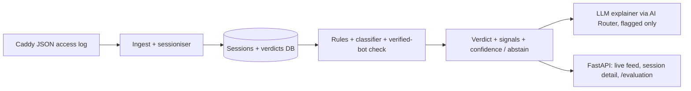

# Hostinger challenge — research, design, evaluation plan

Researched Fri 13.11 before the opening. `SPEC.md` is the one-page summary; this file holds the evidence behind it.

## The brief (paraphrased)
- Build an AI-powered tool that analyses text, social content or web-traffic patterns to detect coordinated propaganda, bot-driven amplification or bad-actor behaviour. Form is open: API, dashboard, explainable classifier, monitoring service for site owners.
- **Hard requirement**: deployed and running live on Hostinger infrastructure by the end of the hackathon, with a public URL judges can open.
- **Judged on**: strength and honesty of the detection logic, including how false positives are handled, "more than a polished front end". "Show your precision and false-positive rate, not just a demo that works on the happy path."
- Four suggested directions (pick one or combine): **Spot the swarm** (coordinated inauthentic behaviour), **Name the technique** (manipulation techniques in text, explained), **Clean the traffic** (bots, scrapers, credential stuffing in server logs), **Trust the source** (provenance: domain age, cloned content, AI text, link networks).
- Mentors at the Hostinger booth all weekend: Minijus Savickas (VPS product), Emilis Strimaitis (innovations, AI agents). Talk "Vibe Coding Solved Building. Now Comes the Hard Part", Sat 13:00. Promising teams get a path to Hostinger engineering after the event.

## What we get
| Resource | Facts | Consequence |
|---|---|---|
| VPS KVM 2 | 2 vCPU, 8 GB RAM, 100 GB NVMe, 8 TB bandwidth, root, Docker, free domain; one-click Ollama/n8n/Node/Python templates | CPU-only: scikit-learn, small embedding models, graph algorithms. No 7B models in the request path. |
| AI Router | Base URL `https://router.hostinger.com/v1`, keys start `sk-hstgr-`; OpenAI- and Anthropic-SDK compatible; `/chat/completions`, `/responses`, `/messages`, `/embeddings`; per-key daily/monthly spend limits and model allow-lists. Model IDs seen: `claude-sonnet-5`, `gpt-5.2`, `text-embedding-3-small`, `text-embedding-3-large`. [docs](https://www.hostinger.com/support/what-is-hostinger-ai-router-and-how-to-get-started/), [LiteLLM](https://docs.litellm.ai/docs/providers/hostinger_router) | Fits the single-client rule: set `LLM_BASE_URL` to the router. Create a key with a spend limit. Copy exact model IDs from hPanel → AI Router → Models. |
| AI Builder | 1-month plan, vibe-coded front ends | Not needed; our UI is served from the VPS. |
| Connector / MCP | `claude mcp add --transport http hostinger https://mcp.hostinger.com` (OAuth); scoped `hostinger-vps-mcp` binary with 68 VPS operations. [repo](https://github.com/hostinger/api-mcp-server) | The "one sponsor MCP" from the playbook. |

## Why "Clean the traffic"
| Direction | Live data | Ground truth for precision/FPR | Main risk |
|---|---|---|---|
| Spot the swarm | Bluesky Jetstream (public WebSocket, JSON, no auth) [docs](https://bsky.network/docs/jetstream) | Weak; needs injected synthetic swarms | Organic bursts (news, sport) look coordinated |
| Name the technique | Any text | SemEval-2023 Task 3 (23 techniques), but access needs manual approval and is research-only, no redistribution [task](https://propaganda.math.unipd.it/semeval2023task3/) | Noisy fine-grained labels; LLMs over-flag |
| **Clean the traffic** | **Our own VPS gets scanned as soon as it is public** | **Labels by construction + a public labelled dataset** | Generic unless the explanations and FP handling stand out |
| Trust the source | RDAP, Certificate Transparency, DNS | Hard to obtain | AI-text detectors have unacceptable FPR at naive thresholds ([RAID](https://aclanthology.org/2024.acl-long.674.pdf)) |

Traffic is the only direction where we can compute honest precision and FPR on live data within 48 h, and it maps directly onto Hostinger's business (millions of hosted sites). A third-party write-up [claims](https://stonegatewebsecurity.com/articles/hostinger-bot-protection-blocking-ai-crawlers) Hostinger's bot protection blocks legitimate AI crawlers; unverified, but it is exactly the false-positive problem the brief asks about. Raise it carefully, if at all.

## Detection design
Verdicts per session: `human`, `verified_bot`, `fake_bot`, `scanner`, `credential_stuffing`, `scraper`, `abstain`. Each verdict carries the signals that produced it and a confidence.

**Labels that hold by construction**
- Honeypot paths on a site that is not WordPress and has no `.env`: `/wp-login.php`, `/xmlrpc.php`, `/.env`, `/.git/config`, `/phpmyadmin`. Plus a hidden link disallowed in `robots.txt`: following it means ignoring robots rules.
- Verified crawlers: reverse DNS, then forward lookup must return the same IP, plus published IP ranges ([Google method](https://developers.google.com/crawling/docs/crawlers-fetchers/verify-google-requests)). A crawler UA that fails verification is `fake_bot`.
- Humans: a tagged session cookie or JS beacon set for team, judges and test users.

**Session features** (classic web-robot literature, e.g. [Stevanovic et al.](https://link.springer.com/content/pdf/10.1007/978-3-642-21916-0_52.pdf))
- Request rate; mean and variance of inter-request time (low variance means a script).
- Share of static-asset requests (humans load CSS/JS/images, most scrapers do not); share of HEAD and 4xx.
- `robots.txt` fetch; path depth and breadth; sequential-request ratio.
- JS beacon fired or not.

**Credential stuffing**
- POSTs to login endpoints with high failure ratios, per IP and **aggregated per ASN and per UA family in a time window**, to catch low-and-slow attacks that stay under any per-IP threshold. This is the "swarm" idea applied to logs.
- ASN reputation as context only, never as a verdict on its own ([overview](https://feedly.com/ti-essentials/posts/asn-data-for-threat-detection-a-defender-s-guide)).

**False-positive policy**
- Verified bots are always allowed.
- Shared IPs (NAT, venue Wi-Fi) are judged per session (cookie + UA), not per IP.
- Low support (few requests) or conflicting signals → `abstain`, shown as such.
- Advisory only: we recommend allow/challenge/block; nothing is enforced in the request path.

**The AI part**
- Classifier: gradient boosting or logistic regression on session features, trained offline, served on CPU.
- LLM via AI Router, called only for flagged sessions and the daily summary. Input is the verdict, the signals and log fields as quoted, length-capped data; the prompt treats them as untrusted. It explains in plain language; it never changes the verdict.

## Evaluation plan
- **Offline**: Lagopoulos & Tsoumakas web-robot dataset ([Zenodo 3477932](https://zenodo.org/records/3477932)): 4.09M requests, 27,061 IPs, March 2018, labelled sessions in `simple_features.csv` (15.9 MB) and `semantic_features.csv` (4.3 MB). Held-out split; licence to check before use.
- **Live**: by-construction labels from our VPS (honeypot, verified bots, tagged humans).
- **Synthetic**: attack scripts with known labels.
- Report per source: confusion matrix; precision/recall per class; **FPR on humans**; abstain rate; PR curve with the shipped threshold marked; ablation (what each signal adds); 3–5 documented false positives with the cause.
- Adversarial cases in `evals/`: spoofed Chrome UA, fake Googlebot, low-and-slow stuffing across many IPs, many humans behind one NAT, prompt injection in UA and path, headless browser that loads assets.

## Architecture

Docker Compose on the VPS; Caddy gives TLS on the free domain and writes the JSON access log. DB: SQLite on the VPS, or Aiven Postgres if we stack the Aiven challenge (integrator decides).

## Overlap with other Junction challenges
| Challenge | Fit |
|---|---|
| Aiven (tech) | Postgres for sessions/verdicts; Kafka if the log stream needs a buffer. |
| NVIDIA Nemotron (tech) | Explainer model, swapped in via `LLM_BASE_URL`. |
| Verda (tech) | Offline training and eval runs; heavier models than the VPS allows. Must be documented to qualify. |
| MariaDB "Wikipedia Through Time" (partner) | Its M dataset (862,076 versions of 19,742 Finnish history articles, with editor, anonymous flag and `sha1`) gives free revert/vandalism labels: a "Spot the swarm" alternative with real ground truth. Only relevant if we may enter two partner challenges. [datasets](https://github.com/MariaDB/mariadb-wikipedia-datasets) |

## Questions for the Hostinger booth
1. Does "deployed on Hostinger" allow an external DB (Aiven) or external model endpoints (Verda, NVIDIA), as long as the app and URL live on the VPS?
2. Is web-log bot detection what they want, or too close to existing WAF products? Which direction do they find most valuable?
3. Can they share anonymised hosting logs or WAF labels to evaluate on?
4. AI Router credit amount per team and the exact model IDs.
5. Free-domain provisioning time.
6. Can one project also enter the MariaDB partner challenge?

## Sources
- AI Router: <https://www.hostinger.com/support/what-is-hostinger-ai-router-and-how-to-get-started/>, <https://docs.litellm.ai/docs/providers/hostinger_router>
- Hostinger MCP: <https://github.com/hostinger/api-mcp-server>
- Web-robot dataset: <https://zenodo.org/records/3477932>
- Coordination detection method: Pacheco et al., ICWSM 2021, <https://arxiv.org/abs/2001.05658>
- Google crawler verification: <https://developers.google.com/crawling/docs/crawlers-fetchers/verify-google-requests>
