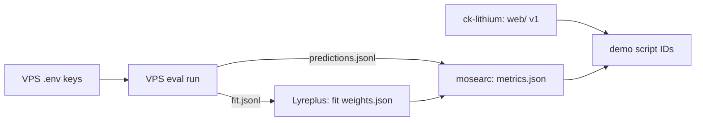

# Next steps (Sat 18:00 round)

Living task list per person, kept by the integrator. Agents: read your section, `AGENTS.md` and `DECISIONS.md` first; do only what is listed for your owner; ask the integrator before touching a folder you do not own. Lyreplus's detailed requests per person are in `docs/ai-core.md` → "Requests to the team".

## State of `main` (Sat 18:00)
- Live at <https://the4thlover.tech> (API docs: `/api/docs`). Every merge to `main` deploys; the deploy goes red if a stage fails to import.
- **All stages are on `main`**: `extract`, `understand`, `retrieve`, `story`, `signals_single`, `signals_coordinated`, `score`, `explain`.
- Merged this round: #15 signals on real coverage (techniques = share of paragraphs, two-way NLI, one-fact claims) and the fit ablation; #16 `retrieve` + `story`; #17 AI-core status and requests; #18 retrieve recall: Google Fact Check Tools adapter (D8), exact-phrase search for copies (GDELT, Oxylabs), ~300 more typed outlets, story threshold 0.90 same-language / 0.845 across languages; #20 `OutletType::Satire` and the fixture's technique value as a share of paragraphs; `ck-lithium/oxylabs`: Oxylabs AI Studio for blocked pages, phrase search and news search beyond the feeds.
- **No Chromium, Oxylabs instead** (`DECISIONS.md`, Sat 17:55 and 18:05): Playwright is gone. A site that refuses plain HTTP is read through Oxylabs AI Studio (`pipeline/extract/scraper.py`); without `OXYLABS_TOKEN` it gets "paste its text instead". The old `OXYLABS_USERNAME` / `OXYLABS_PASSWORD` are not read any more.
- Still missing on `main`: **no `web/`** (`/` has no UI); **no `evals/metrics.json`** (`/api/metrics` is 404); `pipeline/score/weights.json` is still priors (`n = 0`, `cv = null`), so the explanation says the confidences are uncalibrated.
- Not yet confirmed on the VPS: retrieve output on real texts, worker memory with every model loaded, the fact-check and Oxylabs keys in the VPS `.env`.

## Critical path

## Deadlines
| When | What |
|---|---|
| Sat 18:00 | MVP green: retrieve + story live (done), frontend v1, first real metrics, demo script final |
| Sun 03:00 | Feature freeze |
| Sun 09:00 | Submission: video, description, repo public under MIT |

## Rules for every agent
- Own branch `<person>/<topic>`, rebased on `main`; PR every ~2 h; `mise run check` passes before asking for a merge. **Work pushed after a PR is merged does not reach `main`: open a new PR.**
- A dependency is `uv add <pkg>` on your branch; say in the PR why, and its size if it is large (the worker image and the VPS have 2 vCPU / 8 GB, worker limit 6 GB).
- Contract changes (`contracts/`), `pyproject.toml` conflicts, `mise.toml`, CI, `deploy/`, `README.md`, `docs/plan.md`: ask the integrator.
- Test a stage alone with `pipeline.common.fixtures.example_analysis()`; iterate on a finished analysis with `POST /api/analyses/{id}/rerun?from=<stage>`.
- Never commit secrets, scraped article text or downloaded datasets (`evals/data/` is gitignored).

## ck-lithium — frontend first, then prove retrieve on the VPS
Retrieve and story are merged (#16, #18). `EVALUATED_LANGUAGES` already lists en, de, fr, it, es, nl: done.
1. **Frontend (`web/`), the biggest gap for 18:00.** `bun run build` → `web/dist`; relative `/api/...` URLs; types from `contracts/ts/api.d.ts`; progress with `EventSource("/api/analyses/{id}/events")` (`?replay=true` for the demo); highlights with `Array.from(paragraph).slice(start, end)` (code points). Result page per `docs/plan.md` §9: score per dimension with evidence count, three reasons with links, coverage view, "Show how we calculated this". No "propaganda / not" label (D4).
   - Explanation language (D14): a selector sending `explanation_language` in `POST /api/analyses`; default English; offer the content language (`analysis.language.code`). Invalid codes get a 422 `invalid_input`.
   - Show `scores.<dimension>.reason` when a dimension abstains, the failed-step message when a step fails, and the explanation summary as written (it carries the "preliminary estimates" sentence).
   - Metrics page from `GET /api/metrics` (404 = not published yet: show "metrics coming").
2. **VPS check**: a pasted Italian or English news text gets ≥ 3 context items with full bodies and a `sources[]` entry per outlet, inside the 120 s stage budget. Post the analysis ID in your next PR.
3. **Memory check**: worker RSS on the VPS (`docker stats` or Hostinger Docker stats) with lingua, e5 and the AI-core models loaded, during an analysis; limit 6 GB. Post the number. For reference: locally the worker was at ~740 MB before e5 and the AI-core models had finished loading.
4. **Confirm #18 on real data** (code is merged, output unverified):
   - `fcd_*` items in `evals/labelled.jsonl` get a context item with `fact_check` set, and a `fact_checks / rated_false` evidence item.
   - A `pk_*` item gets ≥ 1 context item on another `*.news-pravda.com` or listed domain.
   - `registered_at` is filled for big outlets (ansa.it, tagesschau.de, rte.ie were null).
5. **Satire sites** (unblocked: `OutletType.satire` is on `main` since #20): add a `"satire"` list to `pipeline/retrieve/outlets.json` (The Onion, Il Fatto Quotidaino, Der Postillon, Le Gorafi, El Mundo Today, De Speld, Babylon Bee…) and mention it in the `registry.py` docstring. Satire outlets are not copiers either: tell Lyreplus if `coordinated.py` should count them as such.

## Lyreplus — AI core on real data
All AI-core stages are done on `main`.
1. **Fit the combiner** as soon as the integrator hands over `evals/results/fit.jsonl` (blocked on the VPS run): `python -m pipeline.score.fit evals/results/fit.jsonl`, commit `weights.json` with its `cv` block. The priors note in the explanation disappears by itself once `n > 0`. Tell mosearc when it is merged so the metrics are recomputed.
2. **Speed on the VPS**: run real texts and read `/api/stats` (p50/p95 per stage). Laptop: `signals_single` p50 14 s, max 44 s with 4 at once; stage timeout 120 s, analysis budget 300 s. If it is too slow on 2 vCPU, cut paragraphs/peers or switch to a smaller model.
3. **Signals vs real retrieve output** (possible since #16), with ck-lithium: full bodies, `wire_service` outlets, `in_story` under the new 0.90 / 0.845 story threshold, fact-check items from #18. Fix mismatches on your side or ask ck-lithium; contract questions go to the integrator.
4. Re-run the demo items with `rerun?from=signals_single` after each signal or weight change and compare with mosearc.
5. **Satire** (unblocked since #20): signals emit `source_profile / outlet_satire` (value 1.0, detail "… is a satire site") when retrieve types an outlet as satire. Decide what score does with it: today `families.py` has no mapping, so it is ignored. The request was that score stops satire (e.g. abstain with a reason, or a strong negative strength); also decide whether `_NOT_COPIERS` in `coordinated.py` includes it.

## mosearc — evaluation, metrics, pitch
1. **Fix `metrics.py` now (not blocked)**: an abstained positive must not leave the recall denominator silently. Publish coverage (scored / labelled) next to recall, precision and FPR, and `n/a` for an empty denominator instead of `0.000`.
2. **Demo inputs** (`docs/pitch/demo-script.md`, not blocked): retrieve and story are live. Submit each item on the VPS (`POST /api/analyses?force=true`), keep the clean runs and replace every "after deploy" with the analysis ID; swap in backups that abstain or score without evidence.
3. **Metrics** (blocked on the integrator's VPS run, then on Lyreplus's fit): `mise run eval -- eval evals/results/predictions.jsonl --json evals/metrics.json` and commit `evals/metrics.json` (numbers only). Recompute after the fit lands. The API serves it at `/api/metrics` on the next deploy.
4. **Honest coordinated number**: the VIGINUM list both labels `viginum_pravda` and is the `known_networks` signal, so the coordinated AUC is about 1 by construction. Report it without that family next to the headline (`weights.json → cv.ablation.known_networks.auc_without`, after the fit). Same caution for `fact_checks` on `fact_checker_debunk` and `outlet_fact_checker` on `hard_fact_checks`.
5. **Pitch** (`docs/pitch/`): demo script final by 18:00 (metrics beat once the numbers exist); video, description and submission text before Sun 09:00.

## Integrator (Degra02)
1. **VPS `.env`**: confirm `LLM_*` (`gemini-3.1-flash-lite`), `GOOGLE_FACTCHECK_API_KEY`, `OXYLABS_TOKEN` (AI Studio key; replaces `OXYLABS_USERNAME` / `OXYLABS_PASSWORD`), then recreate the worker. `GEMINI_API_KEY` is not read by any code yet (no grounded-search adapter).
2. **Eval run** (blocks Lyreplus and mosearc). The API publishes no host port on the VPS and the VPS has no checkout, so the runner runs from a laptop: against a local API with the limits off (`deploy/README.md`, "Local"), or against `--api https://the4thlover.tech --concurrency 2` (260 items stay under the 30/min and 600/h limits, but the site is busy for hours). `fit.jsonl` → Lyreplus, `predictions.jsonl` → mosearc.
3. ~~**Contract**: `satire` in `OutletType`; fixture `manipulative_wording` 0.87 → 0.25~~: done in #20. `source_profile.py` got the one-line `_TYPE_WORDS` entry so a satire outlet cannot crash `signals_single`.
4. ~~Chromium for the extract fallback~~: decided, no Chromium; Oxylabs AI Studio reads blocked pages (`DECISIONS.md`, Sat 17:55 and 18:05).
5. **Decision still open**: whether `claim_support` gets an LLM verifier per (claim, passage) for false NLI contradictions (network I/O in a signal stage, beyond D5) or the fit decides its weight.
6. `k8s` branch: 3 commits ahead of `main`, no PR; Kubernetes is not in `docs/plan.md`. Merge or drop.
7. Keep `main` deployable; update this file after every round.
