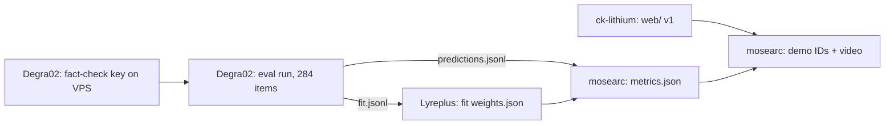

# Next steps (Sun 01:00 round)

Living task list per person, kept by the integrator. Agents: read your section, `AGENTS.md` and `DECISIONS.md` first; do only what is listed for your owner; ask the integrator before touching a folder you do not own. Lyreplus's detailed requests per person are in `docs/ai-core.md` → "Requests to the team".

**Priority from Sun 01:00: "Persuasion in memes and posts" (below) comes first for everyone.** Do its phase 1 and phase 2 tasks before any "Source graph" task; after submission, its phase 3 comes before the graph's after-submission tasks. The older per-person lists further up still apply where they are not done.

## State of `main` (Sat 20:30)
- Live at <https://the4thlover.tech> (API docs: `/api/docs`). Every merge to `main` deploys; the deploy goes red if a stage fails to import.
- **All stages are on `main`** and run end to end on the VPS: `extract`, `understand`, `retrieve`, `story`, `signals_single`, `signals_coordinated`, `score`, `explain`.
- Merged since the 16:30 round: #15 signals on real coverage; #16 `retrieve` + `story`; #17 AI-core requests; #18 fact-check adapter (D8), exact-phrase search, ~300 typed outlets, story threshold 0.90 / 0.845; #20 `OutletType::Satire`, fixture technique scale; #21 + #24 **no Chromium: Oxylabs AI Studio** reads blocked pages and searches the web (phrases and news), Playwright removed; #22 labelled set 284 items (en 57, es 54, de 51, it 43, fr 41, nl 18); #23 metrics with coverage, `n/a` and the headline with/without the label's own source; #26 demo analysis IDs and submission text (`docs/pitch/`); #27 AI core: satire guard (single-actor abstains on a satire outlet, `outlet_satire` = -1.0, satire is never a copier or a tone/claim peer), cross-lingual fact-check verdict match (`fcd_de_002`: abstain → single 0.832 via Climate Feedback found by `oxylabs_news`), zero-evidence baseline kept and explained, `known_networks` also counts listed same-story outlets.
- **Oxylabs works on the VPS** (`OXYLABS_TOKEN` set). **The Google Fact Check key is not set yet**: until it is, retrieve finds no fact-checks and the `fact_checks` family is empty.
- **`web/` v1 is on `main`** (#31, mosearc): `/` with the 5 demo presets (`web/src/data/presets.ts`, replay links), `/analyses/{id}`, `/metrics`. Still missing: **no `evals/metrics.json`** (`/api/metrics` is 404, the page says "metrics coming"); `pipeline/score/weights.json` is still priors (`n = 0`), so the explanation says the confidences are uncalibrated.

### Live runs on the VPS (Sat 18:20, `sha-151a062`)
Use them with `GET /api/analyses/{id}` or `rerun?from=<stage>`.

| Input | ID | extract | retrieve | Context | Scores |
|---|---|---|---|---|---|
| France24 URL (DR Congo / Rwanda) | `01a1dadf-ac1c-77ec-9cd9-8b3ccb9efbf6` | 30 s, 9 paragraphs | 12 s | `oxylabs` 1, `oxylabs_news` 1 | both abstain: too few reports |
| ANSA URL (Duffy, air traffic) | `01a1dadf-ae67-7207-a174-62efae9b62ba` | 0 s | 48 s | `feeds` 3, `oxylabs` 1, `oxylabs_news` 1; 3 of 5 in story | single 0.076, coordinated 0.076 |
| Pasted Tylenol–autism claim | `01a1dae0-e28e-71e1-b0dd-12fb920f41cd` | 0 s | 42 s | `oxylabs_news` 2; 0 of 2 in story | both abstain; no fact-check (no key) |

## Critical path

## Deadlines
| When | What |
|---|---|
| ~~Sat 18:00~~ partly missed | MVP green: retrieve + story live (done); **frontend v1, real metrics, demo IDs still open** |
| Sun 03:00 | Feature freeze |
| Sun 09:00 | Submission: video, description, repo public under MIT |

## Rules for every agent
- Own branch `<person>/<topic>`, rebased on `main`; PR every ~2 h; `mise run check` passes before asking for a merge. **Work pushed after a PR is merged does not reach `main`: open a new PR.** Merged branches are deleted on GitHub; start the next piece of work from a fresh branch off `main`.
- A dependency is `uv add <pkg>` on your branch; say in the PR why, and its size if it is large (the worker image and the VPS have 2 vCPU / 8 GB, worker limit 6 GB).
- Contract changes (`contracts/`), `pyproject.toml` conflicts, `mise.toml`, CI, `deploy/`, `README.md`, `docs/plan.md`: ask the integrator.
- Test a stage alone with `pipeline.common.fixtures.example_analysis()`; iterate on a finished analysis with `POST /api/analyses/{id}/rerun?from=<stage>`.
- Never commit secrets, scraped article text or downloaded datasets (`evals/data/` is gitignored).

## ck-lithium — `web/` is yours from here
Retrieve, story and the Oxylabs cutover are merged. Retrieve on the VPS: an Italian ANSA article got 5 context items from 5 outlets in 48 s (task 2 of the last round: done for Italian).
1. **Frontend v1 merged (#31, built by mosearc).** `mise run web:dev` (`VITE_API_TARGET=https://the4thlover.tech` for live data); handoff notes in `web/README.md`. Check the result page on the live runs and fix what reads badly; no "propaganda / not" label (D4).
2. **Satire sites**: `ck-lithium/satire` has the `outlets.json` list (commit 16:39) but no PR: open it. Since #27 a satire outlet makes the single-actor score abstain ("The source is a satire publication…"), so the list is what turns the guard on.
3. **France24 extract took 30 s** on the VPS although it answers plain HTTP from a laptop: probably the VPS address is refused and the page went through Oxylabs. Check the worker log when you can; fine if that is the case.
4. **After the fact-check key is set** (integrator): `fcd_*` items get a context item with `fact_check` and a `fact_checks / rated_*` evidence item; `registered_at` filled for ansa.it, tagesschau.de, rte.ie.
   - **Pravda sister sites** (`pk_*` items get no copies on the network's other editions; their `/rss.xml` feeds are the way): **wait for Lyreplus task 1 before adding listed-network feeds.** Since #27 `known_networks` counts any listed outlet in the document's story; with those feeds in retrieve, mainstream articles on events the network also covers would score coordinated 0.622.
5. Small: `pipeline/extract/tests/test_live.py:130` still mentions `OXYLABS_USERNAME` / `OXYLABS_PASSWORD`; only `OXYLABS_TOKEN` is read.

## Lyreplus — AI core on real data
All AI-core stages are done on `main`. #27 closed the 18:30 items on the zero-evidence baseline, speed (VPS: `signals_single` p50 3.1 s / p95 33 s, analysis p50 22 s / p95 66 s) and satire.
1. **Guard the story path of `known_networks` (#27) before ck-lithium adds Pravda feeds.** `known_network_evidence` now lists any `in_story` outlet on a documented network, but `in_story` means same event, not same text. Repro (integrator, Sat 20:20): the live ANSA record `01a1dadf-ae67-…` with one in-story outlet (`tg24.sky.it`) marked `known_network = portal_kombat` scores coordinated **0.622** on #27 and 0.076 on the code before it, the same as a real Pravda article, with "Another site covering the story is on a published list…". No live record is affected today (none of the 8 known runs has a listed outlet in its story). Suggested guard: count same-story listed outlets only when the document has no outlet (pasted text) or its outlet is not one of `_NOT_COPIERS` (wire, national, local, fact-checker, satire); or require a near-duplicate similarity, not the story threshold. Add a test with a mainstream document and a listed same-story peer.
2. **Fit the combiner** as soon as the integrator hands over `evals/results/fit.jsonl` (blocked on the eval run, which waits for the fact-check key so `fact_checks` is not empty): `python -m pipeline.score.fit evals/results/fit.jsonl`, commit `weights.json` with its `cv` block. Tell mosearc when it is merged so the metrics are recomputed (#23 reads `weights.json → cv` for the headline).
3. **Signals vs real retrieve output**, with ck-lithium: `in_story` under 0.90 / 0.845 (the Tylenol run had 0 of 2 in story, ANSA 3 of 5), `wire_service` outlets, the new `oxylabs` / `oxylabs_news` items, fact-check items once the key is set.
4. Re-run the demo items with `rerun?from=signals_single` after each signal or weight change and compare with mosearc.

## mosearc — evaluation, metrics, pitch
`metrics.py` coverage / `n/a` / headline (#23), the labelled-set gaps (#22) and the demo IDs with the submission text (#26) are merged: done.
1. **Demo after #27**: `fcd_de_002` should now score single-actor (0.832 in Lyreplus's VPS test) without the fact-check key. After the #27 deploy, `POST /api/analyses/01a1daeb-b551-7706-ae2b-6ad7f0540212/rerun?from=signals_single`, put the new ID in `docs/pitch/demo-script.md` and give the single-actor beat back its evidence instead of the abstention. Re-check `fc_de_005` (the BR24 debunk) stays low the same way. Re-submit the `fcd_*` items once more after the fact-check key is set.
   - Open questions from #26 for the team: the project name (not in the repo) and whether to claim Google MLH "Best Use of Gemini API" (no grounded-search adapter; the LLM is `gemini-3.1-flash-lite` via AI Router).
2. **Metrics** (blocked on the integrator's eval run, then on Lyreplus's fit): `mise run eval -- eval evals/results/predictions.jsonl --json evals/metrics.json` and commit `evals/metrics.json` (numbers only). Recompute after the fit lands.
3. **Pitch** (`docs/pitch/`): demo script final now (metrics beat once the numbers exist); video, description and submission text before Sun 09:00. The live runs above show the abstention path ("not enough evidence") honestly: worth a beat.

## Integrator (Degra02)
1. **Google Fact Check key** (blocks the eval run): Google Cloud → enable "Fact Check Tools API" → Credentials → API key, restricted to that API. Put `GOOGLE_FACTCHECK_API_KEY` in the VPS `.env`, `docker compose --env-file .env --env-file release.env up -d --force-recreate worker`, check with a `claims:search` call from the container, then re-run the Tylenol test.
2. **Eval run** (284 items; blocks Lyreplus and mosearc) after the key. The API has no host port on the VPS and the VPS has no checkout, so the runner runs from a laptop: against a local API with the limits off (`deploy/README.md`, "Local"), or `--api https://the4thlover.tech --concurrency 2` (stays under 30/min and 600/h, but the site is busy for hours). `fit.jsonl` → Lyreplus, `predictions.jsonl` → mosearc.
3. **Memory**: `docker stats --no-stream` on the VPS during an analysis; post the worker number (limit 6 GB). ck-lithium cannot reach the VPS shell.
4. ~~Decision still open: an LLM verifier in `claim_support`~~ decided Sun 01:00: signal stages may call an LLM through `pipeline/common/llm` (`judge.verify_pairs` already does); D5 is amended for the `rhetoric` family (`plans/persuasion-analysis.md`).
5. `k8s` branch: 3 commits ahead of `main` (latest: "build docker images on k8s branch"), no PR; Kubernetes is not in `docs/plan.md`. Merge or drop.
6. Keep `main` deployable; update this file after every round.

## Persuasion in memes and posts (Sun 01:00): the priority
**Why.** A political meme from r/Conservative (image + Reddit post) came back "Not enough evidence" on both dimensions. The single-actor score abstains without 3 related reports whatever the techniques found, the technique model sees nothing in 3 short text blocks, and memes argue by implication, so understand finds no claim. Even with the abstention removed, a meme without a checkable claim cannot score above 0.52 with today's weights. Trace, measurements, design and gates: `plans/persuasion-analysis.md`. Read its sections 4 and 5 before a task.

**Decided** (`DECISIONS.md`, Sun 01:00): new single-actor family `rhetoric`, rated by a multimodal LLM (`gemini-4-hydrogen` candidate) through `pipeline/common/llm`; `Topic.implied_claims` for fact-check search and matching only; single-actor is scored on its intrinsic families when coverage is missing (phase 2, after the refit). D4 holds: no "propaganda / not" label.

### Rules for every task of this plan
1. **Phase 1 moves no calibrated number.** `rhetoric` gets `STRENGTH` entries but stays out of `families.SINGLE` and `weights.json` until P-L5; `_disagreement` must not see it. The 284-item metrics stay as they are.
2. **Phase 2 is one PR with `weights.json` and `evals/metrics.json` together**, cut-off Sun 06:00. Past it, phase 2 waits for after submission and the demo shows phase 1.
3. **Evidence stays verbatim**: a rater item whose quote `spans.locate` cannot find is dropped; a visual-only item points at the `[Visual context]` paragraph and says it is our description.
4. **Judge the move, never the side**: the same rules whatever party or person is the target; no truth judgement and no outside knowledge in the rater. Content goes in `user`, never in `system`.
5. **Implied claims never enter `claim_support`** and are never quoted in the explanation.
6. **No tuning to one example.** The r/Conservative meme is an acceptance check, not a training item.
7. Contract changes (`Family::Rhetoric`, `Topic.implied_claims`) are Degra02's: P-D1 lands first; build against it, do not edit `contracts/`.

### Degra02
| ID | Phase | Files | Do | Done when |
|---|---|---|---|---|
| P-D1 | 1, first | `contracts/src/analysis.rs` | `Family::Rhetoric` (single dimension in `Family::dimension`); `Topic.implied_claims: Vec<String>` (`#[serde(default)]`, documented: English sentences, not verbatim, never shown as a quotation). `mise run contracts`. | Generated files committed; `mise run check` passes; merged before the other phase 1 PRs. |
| P-D2 | 1 | `pipeline/common/llm.py`, `deploy/compose.yaml`, VPS `.env` | A per-call model setting (`LLM_RATER_MODEL`, default `LLM_MODEL`) and image parts (`data:` URIs) in `ask_json` / `ask_json_async`, still one OpenAI-compatible client. Check whether `gemini-4-hydrogen` is on AI Router; if not, point the rater at Gemini's OpenAI-compatible endpoint with `GEMINI_API_KEY`. Set the variables on the VPS. | A call with an image and `LLM_RATER_MODEL` returns a typed answer from the worker container. |
| P-D3 | 1 | this file | Post the ID of the r/Conservative meme run, with its input (image + `context_url`), in this row, so P-L1, P-C1 and P-C2 can `rerun` it. | The ID is in this row. |
| P-D4 | 2 | — | Eval run: the 284 stored analyses `rerun?from=signals_single` (the rater needs no new retrieve), the meme set (P-M1) as full runs. `fit.jsonl` → Lyreplus, `predictions.jsonl` → mosearc. | Both files handed over. |
| P-D5 | 2 | — | Merge the phase 2 PR only with `weights.json` and `metrics.json` together and the gates of plan section 5 reported; deploy; re-run the meme. | Live meme run scored on single-actor, ID in this file. |

### Lyreplus
| ID | Phase | Files | Do | Done when |
|---|---|---|---|---|
| P-L1 | 1, needs P-D1, P-D2 | new `pipeline/signals/rhetoric.py`, `pipeline/signals/single.py`, `pipeline/score/families.py` | The rater (plan section 4): one typed call per analysis with the text and, for a data-URI image input, the image; one `rhetoric` evidence item per category, value 1.0 `clear` / 0.5 `weak`, refs located with `spans.locate`, visual-only items on the `[Visual context]` paragraph, items found only in quotations dropped. Model unavailable → no evidence, a log warning. `STRENGTH` entries; **not** in `SINGLE` yet. Tests with a fake rater answer (no network): a non-verbatim quote is dropped, a quoted-only technique is dropped, a visual-only item cites the visual paragraph. | `rerun?from=signals_single` on the meme run gives `rhetoric` evidence citing its words or the juxtaposition; scores of the 284-item set unchanged. |
| P-L2 | 1, needs P-D1 | `pipeline/understand/__init__.py` | `implied_claims`: up to 3 English sentences for what the content asserts by implication (memes, sarcasm, rhetorical questions); none for plain reporting, satire or a fact-check's reviewed claim. | The meme run has an implied claim about affordability vs the Trump investigations; the ANSA fixture run has none. |
| P-L3 | 2, needs P-L2 | `pipeline/signals/claims.py` | Fact-check matching also on `topic.implied_claims` (same NLI thresholds); the evidence refs the fact-check context item only (an implied claim has no span). | A test: an implied claim matched to a `fact_check` gives `fact_checks / rated_false` with a context ref. |
| P-L4 | 2 | `pipeline/score/__init__.py`, `pipeline/explain/__init__.py` | Abstention split (plan section 4): fewer than 3 related reports and no fact-check → scored when `techniques`, `rhetoric` or `source_profile` has evidence, abstain otherwise. Explain says when no coverage was found to compare with. Add `rhetoric` to `SINGLE`. | Tests for both branches; the satire abstentions unchanged. |
| P-L5 | 2, needs P-D4, P-M1 | `pipeline/score/weights.json`, `docs/ai-core.md` | Refit on 284 + memes; report `cv.ablation.rhetoric`, per-set FPR, the symmetry check (P-M2). | Plan section 5 gates met and written in the PR; `docs/ai-core.md` updated. |

### ck-lithium
| ID | Phase | Files | Do | Done when |
|---|---|---|---|---|
| P-C1 | 1 | `pipeline/extract/vision.py` | The `[Visual context]` note also states, neutrally, what the image implies ("The image implies that …"); still no verdict, still "never judge". | The meme's visual context names the affordability / investigations contrast. |
| P-C2 | 1 | `pipeline/extract/__init__.py`, `pipeline/extract/social.py` | A Reddit or X post whose content is an image (`i.redd.it`, `preview.redd.it`, `pbs.twimg.com` in `Post.links`) is read through vision, with the post as companion. With a post as companion, `Document.outlet` stays `None` as in `document_from_post` (today `build_image_document` sets `reddit.com`). | Submitting the Reddit post URL alone gives the same document as image + `context_url`. |
| P-C3 | 1, needs P-D1 | `web/src/lib/labels.ts`, `web/src/lib/evidence.ts` | Label and reader's guide for the `rhetoric` family ("Persuasion techniques, rated by a language model that sees the image"); a visual-only item reads as "in the image (our description)". | `mise run web:build` passes; the meme run shows the family. |
| P-C4 | 2, needs P-L2 | `pipeline/retrieve/` | Fact-check search (`claims:search` and site search) also with `topic.implied_claims`. | A run with an implied claim sends it to the fact-check adapters (test with a fake client). |
| P-C5 | 3, after submission | `pipeline/retrieve/social.py`, `pipeline/signals/coordinated.py` (with Lyreplus) | Image reuse: Reddit `/duplicates/<id>` and a perceptual hash of images in retrieved posts. A new coordinated signal, fitted with its ablation before it scores. | Plan section 5, phase 3. |

### mosearc
| ID | Phase | Files | Do | Done when |
|---|---|---|---|---|
| P-M1 | 1 → 2 | `evals/labelled.jsonl`, `evals/download_data.sh`, `evals/src/propaganda_eval/` | About 100 English memes from SemEval-2024 Task 4 subtask 2b (balanced; licence checked), downloaded into gitignored `evals/data/`; items carry an image path; the runner submits `kind: image` as a data URI; a new `set` so metrics report memes as their own rows. Nothing from the dataset committed. | `mise run eval -- validate` and `stats` show the meme set; a dry run submits one image item. |
| P-M2 | 2 | new `evals/symmetry.jsonl`, `evals/src/propaganda_eval/` | 10 pasted-text pairs with the political target swapped (plan section 6); a command reporting the mean and maximum absolute difference in single-actor confidence within a pair. Not labels. | Numbers in the phase 2 PR. |
| P-M3 | 2 | `SPEC.md`, `docs/pitch/` | After the phase 2 merge: the new abstention rule in `SPEC.md`; the meme as a demo beat (scored on wording, no claim to check, coordinated honestly abstains). Past the cut-off: show phase 1 (the `rhetoric` evidence) instead. | Demo script updated with the live ID. |

## Source graph (Sun 00:25): phase 0 is on `main`
**What it is.** The analyses we store also show which outlets are tied to each other, and by what evidence. `pipeline/graph/` (owner: Lyreplus) builds that graph offline from stored analyses; `evals/graph.json` is its output on the 277 eval records and `GET /api/graph` serves it. Research, model and results: `plans/source-graph.md`. Read its sections 3 to 5 before a graph task.

**Decided** (`DECISIONS.md`, Sun 00:25): phase 0 is merged; Lyreplus owns `pipeline/graph/`; one shared analytics ID is enough to join a cluster, for now. **Not decided**: a per-outlet track record (D4, D9). Do not build or show one.

**Priority.** "Persuasion in memes and posts" (above) comes first: start a graph task only when your phase 1 and phase 2 tasks there are merged (or the Sun 06:00 cut-off has passed), and after submission do its phase 3 before the graph's after-submission tasks. Within the graph, a task marked *now* is small, changes no contract and is safe before the Sun 03:00 freeze. A task marked *after submission* waits for Sun 09:00; *needs X* also waits for task X.

### Rules for every graph task
1. **No graph value in the score.** Do not add a graph signal to `pipeline/score/families.py` or `weights.json` before task L4 delivers a fit with its ablation. The calibrated numbers on the 284-item set must not move.
2. **A tie is evidence that two sites are related, not a judgement of either.** No label on an outlet anywhere (code, UI, docs, pitch): not "propaganda network", not "unreliable". Write "tied by", "same analytics ID", "same text" (D4).
3. **Covering the same topic is never a tie.** Only the layers in `COORDINATION` (`pipeline/graph/build.py`) count as coordination: `analytics_id`, `ad_account`, `copy`, `translation`.
4. **`evals/graph.json` is generated: never edit it by hand.** Rebuild with `mise run graph:build -- evals/results/fit.jsonl --labelled evals/labelled.jsonl` (about 2 minutes) and commit the file. `evals/results/fit.jsonl` is gitignored: ask Degra02 or Lyreplus for it.
5. **The shape of `GET /api/graph`** is the "Output" paragraph in the docstring of `pipeline/graph/build.py`. If you change a field, update that paragraph and name ck-lithium in the PR.
6. **Tests**: `uv run --frozen pytest pipeline/graph` (no network, no model). A new tie rule comes with a test in `pipeline/graph/tests/test_build.py`, built like the ones there (`article`, `corpus_of`, `found`).
7. **Contract changes are the integrator's**: a new stage, `Family`, `OutletType` or field in `contracts/`. Ask; do not edit.

### Degra02
| ID | When | Files | Do | Done when |
|---|---|---|---|---|
| D1 | now | — | After the deploy of the merge, check the live route. | `GET https://the4thlover.tech/api/graph` answers 200 and `counts.outlets` is 739. |
| D2 | after submission | `contracts/src/stage.rs`, `contracts/src/apply.rs`, `api/src/pipeline.rs`, `api/migrations/0003_graph.sql`, `api/src/graph.rs`, `api/src/routes/graph.rs` | Live ingestion (plan phase 1). `StageName::Graph` and `GraphPatch` (articles, ties with their evidence, tracking IDs), scheduled in the same group as `explain`. Tables for articles, outlets, IDs and ties; one transaction per analysis; rows keyed by article URL so a re-run updates instead of adding. `GET /api/graph` reads the tables and keeps the shape of `evals/graph.json`. `GET /api/graph/outlets/{domain}`. A command that replays stored analyses through the stage. | A new analysis adds its outlets to `GET /api/graph`; running the same input twice changes no count; a failed `graph` step does not stop `Db::find_reusable` from reusing the result; `mise run check` passes. |
| D3 | after submission, needs D2 | `api/src/routes/`, `contracts/src/stage.rs`, `contracts/src/analysis.rs`, `deploy/compose.yaml` | Memory (plan phase 2). `POST /internal/graph/recall`: nearest stored articles by cosine over their embeddings, and what the graph knows about a list of domains. Outside `/api/`, so Caddy does not expose it. `StageName::Recall` after `retrieve`; `analysis.graph`; memory items enter `context[]` with `retrieved_by: "memory"`; `GRAPH_API_URL=http://api:8080` for the worker. | `rerun?from=recall` refreshes the graph knowledge of a stored analysis without any web request. |
| D4 | when asked | `contracts/src/analysis.rs` | `OutletType::Official` and `OutletType::Aggregator` for C5; `Family::TrackRecord` and `Family::LinkedSources` for L4, only once its fit exists. | `mise run contracts` output committed. |

### Lyreplus (owner of `pipeline/graph/`)
| ID | When | Files | Do | Done when |
|---|---|---|---|---|
| L1 | now | `pipeline/signals/coordinated.py`, `pipeline/graph/build.py` | Read `LAYERS`, `republishes` and `copy_ties` against your rules in `coordinated.py`. `build.py` imports your private `_NOT_COPIERS`: rename it `NOT_COPIERS` and update the import. Write in the PR which prior ($\tau$, $q$ in `LAYERS`) you would change and why; do not change one without a rebuild (rule 4). | `rg _NOT_COPIERS pipeline` finds nothing; `uv run --frozen pytest pipeline/graph pipeline/signals` passes. |
| L2 | after submission, needs D2 | `pipeline/graph/__init__.py`, `pipeline/graph/build.py` | `run(analysis) -> GraphPatch`: the ties of one record, with the same rules as `build.ties` (its articles, their IDs, the embedding of `story_text` for each). Plain `def`, no network. Reuse the tie functions; do not copy them. | The stage on `example_analysis()` returns the analytics-ID tie between `daily-truth.example` and `free-nation-news.example`; a test covers it. |
| L3 | after submission, needs D3 | `pipeline/graph/recall.py` | `recall(analysis)`: embed the document, call the internal route, return the memory items and the graph profile of each outlet in `sources[]`. Then re-run the `pk_*` items of the labelled set. | A Pravda article whose translation on another edition was analysed before gets that edition as a context item, and coordinated evidence that does not come from `known_networks`. Report the coordinated CV AUC without `known_networks` (0.3751 today). |
| L4 | after submission, needs L3, D4 and M3 | `pipeline/signals/`, `pipeline/score/families.py`, `pipeline/score/fit.py`, `weights.json` | Family `linked_sources` (plan sections 4 and 6): the document's outlet is strongly tied to a listed outlet; value shrunk by $Z = n/(n+k)$; fit with `cv.ablation`. Family `track_record` is blocked until the team decides it (see "Not decided"); when it is, its outcomes use the confidence without the graph families. | AUC and FPR per hard-negative set with and without the family, evaluated in time order (M4); no hard-negative FPR gets worse. |
| L5 | after submission, needs L3 | `pipeline/signals/text.py` (`story_peers`), `pipeline/signals/claims.py` | A peer tied to the document's outlet (coordination ≥ 0.5 in `analysis.graph`) is not an independent source: leave it out of `claim_support` and `tone`. | The `eud_ru_002` and `eud_ru_005` false negatives (`docs/ai-core.md`) no longer get a negative `claim_support` from aligned outlets. |

### ck-lithium
| ID | When | Files | Do | Done when |
|---|---|---|---|---|
| C1 | now | `pipeline/retrieve/articles.py` (`context_item`, line 126), `pipeline/retrieve/__init__.py` (`fact_check_item`, line 180) | `context[].language` is taken from the page or the query. In the eval records it disagrees with the text for 160 of 1,657 items (52 labelled `it` are English; 96 labelled `en` are Spanish, French, German, Dutch, Italian or Russian). Set it from the item's text with `pipeline.extract.language.detect_language` (CPU-bound: from a thread in async code), keeping the old value only when nothing is detected. `story.threshold_for` picks its threshold from this field. Independent of the graph. | A test with an English text under a feed tagged `it` yields `language == "en"`; `uv run --frozen pytest pipeline/retrieve pipeline/story` passes. |
| C2 | now | `pipeline/retrieve/outlets.json` | The graph ties `rtrunews.com` to `rt-english.com` (same analytics ID `G-WSRRLSJZ2D`) and `esrt.press` to `actualidad-rt.com` (same ID, same text, links to `cdn.rt.com`); `de-rt.com` links to `rtd.rt.com`. Open each site; add the ones that are RT mirrors under `state_affiliated` (`rt.com` is already there). | `eud_en_002` (`rtrunews.com`, a false negative in `docs/ai-core.md` with `source_profile = 0`) gets `outlet_state_affiliated` after `rerun?from=retrieve`. |
| C3 | after submission | `pipeline/retrieve/outlets.json`, `pipeline/retrieve/registry.py` | Feeds (`/rss.xml`) of the `news-pravda.com` editions and of the `topwar.ru` language editions: four Pravda editions carry `topwar.ru` articles word for word. | Rebuilding the graph on new analyses of `pk_*` items shows more than one shared article per edition pair. |
| C4 | after submission | `web/src/pages/`, `web/src/lib/api.ts` | A `/sources` page on `GET /api/graph`: the clusters with what joins them (`joined_by`), and for an outlet its ties with the layer, the count and links to the evidence. Tables first; the map later. Rules 2 and 5 apply: no label on an outlet, a line saying a tie is evidence of a relationship and not a judgement, and how to ask for a correction. No track record. | `mise run web:build` passes; the page shows the cluster of `abc4.com`, `kxan.com`, `nbc4i.com`, `thehill.com` with "same analytics ID". |
| C5 | after submission, needs D4 | `pipeline/retrieve/outlets.json` | Official sites the host labels miss (`elysee.fr`, `boe.es`, `governo.it`, `bundesregierung.de`) and aggregators (`headtopics.com`). | They carry the new types; `pipeline/graph/build.py: republishes` reads the type. |

### mosearc
| ID | When | Files | Do | Done when |
|---|---|---|---|---|
| M1 | now | `docs/pitch/demo-script.md`, `docs/pitch/submission.md` | One beat and the "what's next" from plan section 3. Safe to say: the analyses we store also give a map of which sites are tied and by what evidence (built offline today; feeding it from every analysis is the next step); on 277 analyses no strong text tie came from the hard negatives; RT mirror domains found by a shared analytics ID; four Pravda editions carrying `topwar.ru` articles word for word. Say the limit: on content alone the listed network does not cluster yet. Rule 2 for the wording. | The beat is in the script with these numbers and no label on an outlet. |
| M2 | now or after submission | new `evals/graph_pairs.jsonl` | Hand-check the 22 strong ties between different operators: in `evals/graph.json`, the `edges` with `coordination >= 0.5` and no `same_operator` layer. Start with the 3 unverified ones: `andaluciainformacion.es` / `elconfidencialdigital.com` / `eldiariodemadrid.es`, `elperiodico.com` / `noticiasdenavarra.com`, `factchequeado.com` / `kunr.org`. One line per pair: `{"a", "b", "same_operator": true or false or null, "source": "<URL that shows the owner>", "note"}`. | 22 lines; the share with `same_operator: true` and its Wilson interval reported in the PR. |
| M3 | after submission | `evals/graph_pairs.jsonl` | Add the pairs to fit the layer weights: positives are pairs with a documented common operator (VIGINUM editions, the owners verified in M2); negatives are pairs of typed mainstream outlets of different owners, and the pairs behind the 33 weak ties from hard negatives (`evaluation.text_ties_from_hard_negatives_only`). | At least 50 positive and 50 negative pairs, each with a source. |
| M4 | after submission | `evals/src/propaganda_eval/` | The `evaluation` block of `/api/graph` on the metrics page. For L4: an evaluation in time order (items by `created_at`, the graph holds only earlier items, grouped by registrable domain). | The metrics page shows the two graph numbers (listed outlets clustered with and without the shared domain; strong text ties from hard negatives). |
| M5 | after submission | `SPEC.md` | A "Source map" section for what is built: ties with their evidence, clusters, no labels. Nothing about a track record until it is decided. | Section merged. |
