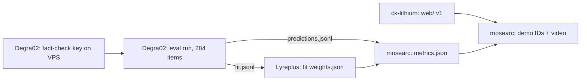

# Next steps (Sat 20:30 round)

Living task list per person, kept by the integrator. Agents: read your section, `AGENTS.md` and `DECISIONS.md` first; do only what is listed for your owner; ask the integrator before touching a folder you do not own. Lyreplus's detailed requests per person are in `docs/ai-core.md` → "Requests to the team".

## State of `main` (Sat 20:30)
- Live at <https://the4thlover.tech> (API docs: `/api/docs`). Every merge to `main` deploys; the deploy goes red if a stage fails to import.
- **All stages are on `main`** and run end to end on the VPS: `extract`, `understand`, `retrieve`, `story`, `signals_single`, `signals_coordinated`, `score`, `explain`.
- Merged since the 16:30 round: #15 signals on real coverage; #16 `retrieve` + `story`; #17 AI-core requests; #18 fact-check adapter (D8), exact-phrase search, ~300 typed outlets, story threshold 0.90 / 0.845; #20 `OutletType::Satire`, fixture technique scale; #21 + #24 **no Chromium: Oxylabs AI Studio** reads blocked pages and searches the web (phrases and news), Playwright removed; #22 labelled set 284 items (en 57, es 54, de 51, it 43, fr 41, nl 18); #23 metrics with coverage, `n/a` and the headline with/without the label's own source; #26 demo analysis IDs and submission text (`docs/pitch/`); #27 AI core: satire guard (single-actor abstains on a satire outlet, `outlet_satire` = -1.0, satire is never a copier or a tone/claim peer), cross-lingual fact-check verdict match (`fcd_de_002`: abstain → single 0.832 via Climate Feedback found by `oxylabs_news`), zero-evidence baseline kept and explained, `known_networks` also counts listed same-story outlets.
- **Oxylabs works on the VPS** (`OXYLABS_TOKEN` set). **The Google Fact Check key is not set yet**: until it is, retrieve finds no fact-checks and the `fact_checks` family is empty.
- **`web/` v1 is on `main`** (#31, mosearc): `/` with the 5 demo presets (`web/src/data/presets.ts`, replay links), `/analyses/{id}`, `/metrics`. Still missing: **no `evals/metrics.json`** (`/api/metrics` is 404, the page says "metrics coming"); `pipeline/score/weights.json` is still priors (`n = 0`), so the explanation says the confidences are uncalibrated.

### Live runs on the VPS (Sat 18:20, `sha-151a062`)
Use them with `GET /api/analyses/{id}` or `rerun?from=<stage>`.

| Input | ID | extract | retrieve | Context | Scores |
|---|---|---|---|---|---|
| France24 URL (DR Congo / Rwanda) | `01a1dadf-ac1c-77ec-9cd9-8b3ccb9efbf6` | 30 s, 9 paragraphs | 12 s | `oxylabs` 1, `oxylabs_news` 1 | both abstain: too few reports |
| ANSA URL (Duffy, air traffic) | `01a1dadf-ae67-7207-a174-62efae9b62ba` | 0 s | 48 s | `feeds` 3, `oxylabs` 1, `oxylabs_news` 1; 3 of 5 in story | single 0.076, coordinated 0.076 |
| Pasted Tylenol–autism claim | `01a1dae0-e28e-71e1-b0dd-12fb920f41cd` | 0 s | 42 s | `oxylabs_news` 2; 0 of 2 in story | both abstain; no fact-check (no key) |

## Critical path

## Deadlines
| When | What |
|---|---|
| ~~Sat 18:00~~ partly missed | MVP green: retrieve + story live (done); **frontend v1, real metrics, demo IDs still open** |
| Sun 03:00 | Feature freeze |
| Sun 09:00 | Submission: video, description, repo public under MIT |

## Rules for every agent
- Own branch `<person>/<topic>`, rebased on `main`; PR every ~2 h; `mise run check` passes before asking for a merge. **Work pushed after a PR is merged does not reach `main`: open a new PR.** Merged branches are deleted on GitHub; start the next piece of work from a fresh branch off `main`.
- A dependency is `uv add <pkg>` on your branch; say in the PR why, and its size if it is large (the worker image and the VPS have 2 vCPU / 8 GB, worker limit 6 GB).
- Contract changes (`contracts/`), `pyproject.toml` conflicts, `mise.toml`, CI, `deploy/`, `README.md`, `docs/plan.md`: ask the integrator.
- Test a stage alone with `pipeline.common.fixtures.example_analysis()`; iterate on a finished analysis with `POST /api/analyses/{id}/rerun?from=<stage>`.
- Never commit secrets, scraped article text or downloaded datasets (`evals/data/` is gitignored).

## ck-lithium — `web/` is yours from here
Retrieve, story and the Oxylabs cutover are merged. Retrieve on the VPS: an Italian ANSA article got 5 context items from 5 outlets in 48 s (task 2 of the last round: done for Italian).
1. **Frontend v1 merged (#31, built by mosearc).** `mise run web:dev` (`VITE_API_TARGET=https://the4thlover.tech` for live data); handoff notes in `web/README.md`. Check the result page on the live runs and fix what reads badly; no "propaganda / not" label (D4).
2. **Satire sites**: `ck-lithium/satire` has the `outlets.json` list (commit 16:39) but no PR: open it. Since #27 a satire outlet makes the single-actor score abstain ("The source is a satire publication…"), so the list is what turns the guard on.
3. **France24 extract took 30 s** on the VPS although it answers plain HTTP from a laptop: probably the VPS address is refused and the page went through Oxylabs. Check the worker log when you can; fine if that is the case.
4. **After the fact-check key is set** (integrator): `fcd_*` items get a context item with `fact_check` and a `fact_checks / rated_*` evidence item; `registered_at` filled for ansa.it, tagesschau.de, rte.ie.
   - **Pravda sister sites** (`pk_*` items get no copies on the network's other editions; their `/rss.xml` feeds are the way): **wait for Lyreplus task 1 before adding listed-network feeds.** Since #27 `known_networks` counts any listed outlet in the document's story; with those feeds in retrieve, mainstream articles on events the network also covers would score coordinated 0.622.
5. Small: `pipeline/extract/tests/test_live.py:130` still mentions `OXYLABS_USERNAME` / `OXYLABS_PASSWORD`; only `OXYLABS_TOKEN` is read.

## Lyreplus — AI core on real data
All AI-core stages are done on `main`. #27 closed the 18:30 items on the zero-evidence baseline, speed (VPS: `signals_single` p50 3.1 s / p95 33 s, analysis p50 22 s / p95 66 s) and satire.
1. **Guard the story path of `known_networks` (#27) before ck-lithium adds Pravda feeds.** `known_network_evidence` now lists any `in_story` outlet on a documented network, but `in_story` means same event, not same text. Repro (integrator, Sat 20:20): the live ANSA record `01a1dadf-ae67-…` with one in-story outlet (`tg24.sky.it`) marked `known_network = portal_kombat` scores coordinated **0.622** on #27 and 0.076 on the code before it, the same as a real Pravda article, with "Another site covering the story is on a published list…". No live record is affected today (none of the 8 known runs has a listed outlet in its story). Suggested guard: count same-story listed outlets only when the document has no outlet (pasted text) or its outlet is not one of `_NOT_COPIERS` (wire, national, local, fact-checker, satire); or require a near-duplicate similarity, not the story threshold. Add a test with a mainstream document and a listed same-story peer.
2. **Fit the combiner** as soon as the integrator hands over `evals/results/fit.jsonl` (blocked on the eval run, which waits for the fact-check key so `fact_checks` is not empty): `python -m pipeline.score.fit evals/results/fit.jsonl`, commit `weights.json` with its `cv` block. Tell mosearc when it is merged so the metrics are recomputed (#23 reads `weights.json → cv` for the headline).
3. **Signals vs real retrieve output**, with ck-lithium: `in_story` under 0.90 / 0.845 (the Tylenol run had 0 of 2 in story, ANSA 3 of 5), `wire_service` outlets, the new `oxylabs` / `oxylabs_news` items, fact-check items once the key is set.
4. Re-run the demo items with `rerun?from=signals_single` after each signal or weight change and compare with mosearc.

## mosearc — evaluation, metrics, pitch
`metrics.py` coverage / `n/a` / headline (#23), the labelled-set gaps (#22) and the demo IDs with the submission text (#26) are merged: done.
1. **Demo after #27**: `fcd_de_002` should now score single-actor (0.832 in Lyreplus's VPS test) without the fact-check key. After the #27 deploy, `POST /api/analyses/01a1daeb-b551-7706-ae2b-6ad7f0540212/rerun?from=signals_single`, put the new ID in `docs/pitch/demo-script.md` and give the single-actor beat back its evidence instead of the abstention. Re-check `fc_de_005` (the BR24 debunk) stays low the same way. Re-submit the `fcd_*` items once more after the fact-check key is set.
   - Open questions from #26 for the team: the project name (not in the repo) and whether to claim Google MLH "Best Use of Gemini API" (no grounded-search adapter; the LLM is `gemini-3.1-flash-lite` via AI Router).
2. **Metrics** (blocked on the integrator's eval run, then on Lyreplus's fit): `mise run eval -- eval evals/results/predictions.jsonl --json evals/metrics.json` and commit `evals/metrics.json` (numbers only). Recompute after the fit lands.
3. **Pitch** (`docs/pitch/`): demo script final now (metrics beat once the numbers exist); video, description and submission text before Sun 09:00. The live runs above show the abstention path ("not enough evidence") honestly: worth a beat.

## Integrator (Degra02)
1. **Google Fact Check key** (blocks the eval run): Google Cloud → enable "Fact Check Tools API" → Credentials → API key, restricted to that API. Put `GOOGLE_FACTCHECK_API_KEY` in the VPS `.env`, `docker compose --env-file .env --env-file release.env up -d --force-recreate worker`, check with a `claims:search` call from the container, then re-run the Tylenol test.
2. **Eval run** (284 items; blocks Lyreplus and mosearc) after the key. The API has no host port on the VPS and the VPS has no checkout, so the runner runs from a laptop: against a local API with the limits off (`deploy/README.md`, "Local"), or `--api https://the4thlover.tech --concurrency 2` (stays under 30/min and 600/h, but the site is busy for hours). `fit.jsonl` → Lyreplus, `predictions.jsonl` → mosearc.
3. **Memory**: `docker stats --no-stream` on the VPS during an analysis; post the worker number (limit 6 GB). ck-lithium cannot reach the VPS shell.
4. **Decision still open**: whether `claim_support` gets an LLM verifier per (claim, passage) for false NLI contradictions (network I/O in a signal stage, beyond D5) or the fit decides its weight.
5. `k8s` branch: 3 commits ahead of `main` (latest: "build docker images on k8s branch"), no PR; Kubernetes is not in `docs/plan.md`. Merge or drop.
6. Keep `main` deployable; update this file after every round.

## Source graph (added Sun 01:45, branch `degra/source-graph`)
Plan, research and first results: `plans/source-graph.md`. Phase 0 is built: `pipeline/graph/` builds `evals/graph.json` from stored analyses (`mise run graph:build -- evals/results/fit.jsonl --labelled evals/labelled.jsonl`) and `GET /api/graph` serves it. On the 277 eval records: 739 outlets, 22 strong ties between different operators, 0 strong text ties from the hard negatives; on content alone the 18 VIGINUM editions do not cluster yet.

Nothing below is on the critical path: your tasks above come first, and nothing here touches a score before it is fitted. "Before the freeze" items are small and independent; the rest waits for the team's decision (plan, section 10) and the submission.

### Degra02
1. **Before the freeze**: decide plan section 10 (merge now or after the submission, wording under D4 / D9, owner of `pipeline/graph/`), add the `DECISIONS.md` line, merge. The deploy copies `evals/graph.json` into the API image (`GRAPH_PATH`).
2. Phase 1, live ingestion: `StageName::Graph` and `GraphPatch` (articles, ties with their evidence, tracking IDs) in `contracts/src/stage.rs`, scheduled with `explain`; `api/migrations/0003_graph.sql` and `api/src/graph.rs` (one transaction per analysis, rows keyed by article URL so a re-run updates instead of adding); `GET /api/graph` from the tables **in the shape of `evals/graph.json`**, so the UI built on the file keeps working; `GET /api/graph/outlets/{domain}`; a backfill that replays stored analyses through the stage. A failed `graph` step must not make a result non-reusable (`Db::find_reusable`).
3. Phase 2, memory: `POST /internal/graph/recall` (cosine over stored embeddings; Caddy only proxies `/api/*`), `StageName::Recall` after `retrieve`, `analysis.graph`, `GRAPH_API_URL` for the worker in `deploy/compose.yaml`.
4. Contract additions when asked, not before: `OutletType::Official` and `OutletType::Aggregator` (ck-lithium), `Family::TrackRecord` and `Family::LinkedSources` (Lyreplus, after the fit).

### Lyreplus (proposed owner of `pipeline/graph/`)
1. **Before the freeze, reading only**: the tie rules in `pipeline/graph/build.py` (`LAYERS`, `republishes`, `copy_ties`) against `signals/coordinated.py`. They import `_NOT_COPIERS`, `COPY_CONTAINMENT`, `MIN_SHARED_SHINGLES`, `TRANSLATED_COPY_SIMILARITY` from it: make `_NOT_COPIERS` public if you agree, and say which prior ($\tau$, $q$) you would change.
2. Phase 1: `pipeline/graph/__init__.py: run(analysis) -> GraphPatch`, the per-analysis form of `build.ties` (the articles of one record, their IDs, the embedding of `story_text`). No network.
3. Phase 2: `recall(analysis)`. Then re-run the `pk_*` items: an earlier copy on another edition arrives as context and should fire `text_reuse` without the list. The number to move is the coordinated CV AUC without `known_networks` (0.3751).
4. Phase 3, only with a fit: `track_record` and `linked_sources` evidence, their `STRENGTH` entries shrunk by $Z = n/(n+k)$, the ablation in `fit.py`, the prequential evaluation with mosearc. Outcomes use the confidence without the graph families.
5. Peers tied to the document's outlet are not independent sources: leave them out of `claim_support` and `tone` (the `eud_ru_*` false negatives, where aligned outlets "confirmed" the claim).

### ck-lithium
1. **Before the freeze, in `retrieve`, independent of the graph**: `context[].language` disagrees with the text for 160 of 1,657 labelled items in the eval records (52 labelled `it` are English; 96 labelled `en` are Spanish, French, German, Dutch, Italian or Russian; `feeds` 67 of 324, `fact_check_api` 40 of 273). Detect it from the item's text (`pipeline.extract.language.detect_language`): `story.threshold_for` picks the same-language or cross-language threshold from this label.
2. **Before the freeze, `outlets.json`**: the graph ties `rtrunews.com` to `rt-english.com` (same analytics ID) and `esrt.press` to `actualidad-rt.com` (same ID, same text, links to `cdn.rt.com`); `de-rt.com` links to `rtd.rt.com`. Look at each and type the RT mirrors `state_affiliated`: `eud_en_002` (`rtrunews.com`) is one of the four false negatives in `docs/ai-core.md`, scored with `source_profile = 0`.
3. Feeds of the `news-pravda.com` editions and of the `topwar.ru` language editions (four Pravda editions carry `topwar.ru` articles word for word). More articles per edition is what the list-free result needs.
4. `web/`, after the decision on the wording: a `/sources` page on `GET /api/graph`: the clusters with what joins them (`joined_by`), an outlet's ties with links to the evidence, counts. No label on an outlet (D4); a line saying a tie is evidence of a relationship, not a judgement, and how to ask for a correction. Start with tables; the map comes after.
5. Once the contract has the types: official sites the host labels miss (`elysee.fr`, `boe.es`, `governo.it`, `bundesregierung.de`) and aggregators (`headtopics.com`).

### mosearc
1. **Before the freeze, pitch**: one beat and the "what's next" of the submission from plan section 3. Safe to say: the analyses we store also give a map of which sites are tied and by what evidence (built offline today; feeding it live from every analysis is the next step); on 277 analyses no strong text tie came from the hard negatives; RT mirror domains found by a shared analytics ID; four Pravda editions carrying `topwar.ru` articles word for word. Say the limit too: on content alone the listed network does not cluster yet. Wording: "tied by", "same analytics ID", never "propaganda network" (D4).
2. Hand-check the 22 strong ties between different operators (`evals/graph.json`: `edges` with `coordination >= 0.5` and no `same_operator` layer), starting with the 3 unverified analytics IDs (plan section 3): same owner or not, with the source. That is the precision of a strong tie, with its Wilson interval.
3. Labelled pairs to fit the layer weights, `evals/graph_pairs.jsonl`: positives are pairs with a documented common operator (VIGINUM editions, owners you verified in 2), negatives are pairs of typed mainstream outlets of different owners and the pairs behind the 33 weak hard-negative ties.
4. The `evaluation` block of `/api/graph` on the metrics page; later the prequential harness for phase 3 (items in `created_at` order, grouped by registrable domain, AUC with and without the graph families).
5. `SPEC.md`: a source-map section only after the decision.
