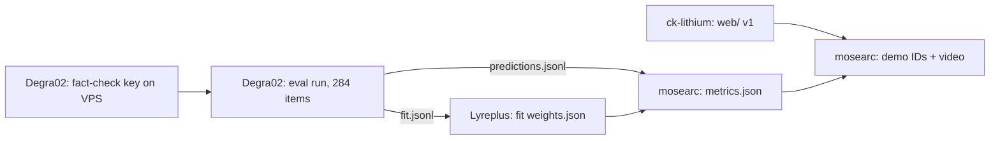

# Next steps (Sat 18:30 round)

Living task list per person, kept by the integrator. Agents: read your section, `AGENTS.md` and `DECISIONS.md` first; do only what is listed for your owner; ask the integrator before touching a folder you do not own. Lyreplus's detailed requests per person are in `docs/ai-core.md` → "Requests to the team".

## State of `main` (Sat 18:30)
- Live at <https://the4thlover.tech> (API docs: `/api/docs`). Every merge to `main` deploys; the deploy goes red if a stage fails to import.
- **All stages are on `main`** and run end to end on the VPS: `extract`, `understand`, `retrieve`, `story`, `signals_single`, `signals_coordinated`, `score`, `explain`.
- Merged since the 16:30 round: #15 signals on real coverage; #16 `retrieve` + `story`; #17 AI-core requests; #18 fact-check adapter (D8), exact-phrase search, ~300 typed outlets, story threshold 0.90 / 0.845; #20 `OutletType::Satire`, fixture technique scale; #21 + #24 **no Chromium: Oxylabs AI Studio** reads blocked pages and searches the web (phrases and news), Playwright removed; #22 labelled set 284 items (en 57, es 54, de 51, it 43, fr 41, nl 18); #23 metrics with coverage, `n/a` and the headline with/without the label's own source.
- **Oxylabs works on the VPS** (`OXYLABS_TOKEN` set). **The Google Fact Check key is not set yet**: until it is, retrieve finds no fact-checks and the `fact_checks` family is empty.
- Still missing on `main`: **no `web/`** (`/` has no UI); **no `evals/metrics.json`** (`/api/metrics` is 404); `pipeline/score/weights.json` is still priors (`n = 0`), so the explanation says the confidences are uncalibrated; demo analysis IDs.

### Live runs on the VPS (Sat 18:20, `sha-151a062`)
Use them with `GET /api/analyses/{id}` or `rerun?from=<stage>`.

| Input | ID | extract | retrieve | Context | Scores |
|---|---|---|---|---|---|
| France24 URL (DR Congo / Rwanda) | `01a1dadf-ac1c-77ec-9cd9-8b3ccb9efbf6` | 30 s, 9 paragraphs | 12 s | `oxylabs` 1, `oxylabs_news` 1 | both abstain: too few reports |
| ANSA URL (Duffy, air traffic) | `01a1dadf-ae67-7207-a174-62efae9b62ba` | 0 s | 48 s | `feeds` 3, `oxylabs` 1, `oxylabs_news` 1; 3 of 5 in story | single 0.076, coordinated 0.076 |
| Pasted Tylenol–autism claim | `01a1dae0-e28e-71e1-b0dd-12fb920f41cd` | 0 s | 42 s | `oxylabs_news` 2; 0 of 2 in story | both abstain; no fact-check (no key) |

## Critical path

## Deadlines
| When | What |
|---|---|
| ~~Sat 18:00~~ partly missed | MVP green: retrieve + story live (done); **frontend v1, real metrics, demo IDs still open** |
| Sun 03:00 | Feature freeze |
| Sun 09:00 | Submission: video, description, repo public under MIT |

## Rules for every agent
- Own branch `<person>/<topic>`, rebased on `main`; PR every ~2 h; `mise run check` passes before asking for a merge. **Work pushed after a PR is merged does not reach `main`: open a new PR.** Merged branches are deleted on GitHub; start the next piece of work from a fresh branch off `main`.
- A dependency is `uv add <pkg>` on your branch; say in the PR why, and its size if it is large (the worker image and the VPS have 2 vCPU / 8 GB, worker limit 6 GB).
- Contract changes (`contracts/`), `pyproject.toml` conflicts, `mise.toml`, CI, `deploy/`, `README.md`, `docs/plan.md`: ask the integrator.
- Test a stage alone with `pipeline.common.fixtures.example_analysis()`; iterate on a finished analysis with `POST /api/analyses/{id}/rerun?from=<stage>`.
- Never commit secrets, scraped article text or downloaded datasets (`evals/data/` is gitignored).

## ck-lithium — the frontend is now the biggest gap
Retrieve, story and the Oxylabs cutover are merged. Retrieve on the VPS: an Italian ANSA article got 5 context items from 5 outlets in 48 s (task 2 of the last round: done for Italian).
1. **Frontend (`web/`), overdue since 18:00.** `bun run build` → `web/dist`; relative `/api/...` URLs; types from `contracts/ts/api.d.ts`; progress with `EventSource("/api/analyses/{id}/events")` (`?replay=true` for the demo); highlights with `Array.from(paragraph).slice(start, end)` (code points). Result page per `docs/plan.md` §9: score per dimension with evidence count, three reasons with links, coverage view, "Show how we calculated this". No "propaganda / not" label (D4).
   - Explanation language (D14): a selector sending `explanation_language` in `POST /api/analyses`; default English; offer the content language (`analysis.language.code`). Invalid codes get a 422 `invalid_input`.
   - Show `scores.<dimension>.reason` when a dimension abstains (most live runs abstain today: make it read well), the failed-step message when a step fails, `steps[].detail` under each step, and the explanation summary as written.
   - Metrics page from `GET /api/metrics` (404 = not published yet: show "metrics coming"). Shape: `headline`, `fit`, `dimensions` (#23); rates can be `null` (= n/a); show coverage next to every rate.
   - The three live runs above are ready-made test data, including `?replay=true`.
2. **Satire sites**: add a `"satire"` list to `pipeline/retrieve/outlets.json` (The Onion, Il Fatto Quotidaino, Der Postillon, Le Gorafi, El Mundo Today, De Speld, Babylon Bee…) and mention it in the `registry.py` docstring.
3. **France24 extract took 30 s** on the VPS although it answers plain HTTP from a laptop: probably the VPS address is refused and the page went through Oxylabs. Check the worker log when you can; fine if that is the case.
4. **After the fact-check key is set** (integrator): `fcd_*` items get a context item with `fact_check` and a `fact_checks / rated_*` evidence item; a `pk_*` item gets ≥ 1 context item on another `*.news-pravda.com` or listed domain (the commit notes sister sites are not in the search index: their `/rss.xml` feeds are the way); `registered_at` filled for ansa.it, tagesschau.de, rte.ie.
5. Small: `pipeline/extract/tests/test_live.py:130` still mentions `OXYLABS_USERNAME` / `OXYLABS_PASSWORD`; only `OXYLABS_TOKEN` is read.

## Lyreplus — AI core on real data
All AI-core stages are done on `main`.
1. **Baseline score without evidence**: on the ANSA run (`01a1dadf-ae67-…`) `coordinated` is 0.076 and not abstained with no coordinated evidence at all, the same value as `single` (whose only evidence is `outlet_wire_service`). Check whether that is the priors' intercept and whether a dimension with zero evidence and enough context should show a number at all.
2. **Fit the combiner** as soon as the integrator hands over `evals/results/fit.jsonl` (blocked on the eval run, which waits for the fact-check key so `fact_checks` is not empty): `python -m pipeline.score.fit evals/results/fit.jsonl`, commit `weights.json` with its `cv` block. Tell mosearc when it is merged so the metrics are recomputed (#23 reads `weights.json → cv` for the headline).
3. **Speed on the VPS**: `signals_single` took 0–2 s on the three live runs (few peers in story). Re-check `/api/stats` p50/p95 once runs with ≥ 3 story items exist; stage timeout 120 s, analysis budget 300 s.
4. **Signals vs real retrieve output**, with ck-lithium: `in_story` under 0.90 / 0.845 (the Tylenol run had 0 of 2 in story, ANSA 3 of 5), `wire_service` outlets, the new `oxylabs` / `oxylabs_news` items, fact-check items once the key is set.
5. **Satire**: signals emit `source_profile / outlet_satire`; `families.py` has no mapping yet, so it is ignored. Decide what score does with it (the request: score stops satire), and whether `_NOT_COPIERS` in `coordinated.py` includes it.
6. Re-run the demo items with `rerun?from=signals_single` after each signal or weight change and compare with mosearc.

## mosearc — evaluation, metrics, pitch
`metrics.py` coverage / `n/a` / headline (#23) and the labelled-set gaps (#22) are merged: done.
1. **Demo inputs (not blocked, do now)**: all 5 analysis IDs in `docs/pitch/demo-script.md` still read "after deploy". Submit each item on the VPS (`POST /api/analyses?force=true`), keep clean runs, fill in the IDs; swap in backups that abstain. Expect the debunked-claim items (`fcd_*`) to abstain until the fact-check key is set: re-submit those after.
2. **Metrics** (blocked on the integrator's eval run, then on Lyreplus's fit): `mise run eval -- eval evals/results/predictions.jsonl --json evals/metrics.json` and commit `evals/metrics.json` (numbers only). Recompute after the fit lands.
3. **Pitch** (`docs/pitch/`): demo script final now (metrics beat once the numbers exist); video, description and submission text before Sun 09:00. The live runs above show the abstention path ("not enough evidence") honestly: worth a beat.

## Integrator (Degra02)
1. **Google Fact Check key** (blocks the eval run): Google Cloud → enable "Fact Check Tools API" → Credentials → API key, restricted to that API. Put `GOOGLE_FACTCHECK_API_KEY` in the VPS `.env`, `docker compose --env-file .env --env-file release.env up -d --force-recreate worker`, check with a `claims:search` call from the container, then re-run the Tylenol test.
2. **Eval run** (284 items; blocks Lyreplus and mosearc) after the key. The API has no host port on the VPS and the VPS has no checkout, so the runner runs from a laptop: against a local API with the limits off (`deploy/README.md`, "Local"), or `--api https://the4thlover.tech --concurrency 2` (stays under 30/min and 600/h, but the site is busy for hours). `fit.jsonl` → Lyreplus, `predictions.jsonl` → mosearc.
3. **Memory**: `docker stats --no-stream` on the VPS during an analysis; post the worker number (limit 6 GB). ck-lithium cannot reach the VPS shell.
4. **Decision still open**: whether `claim_support` gets an LLM verifier per (claim, passage) for false NLI contradictions (network I/O in a signal stage, beyond D5) or the fit decides its weight.
5. `k8s` branch: 3 commits ahead of `main` (latest: "build docker images on k8s branch"), no PR; Kubernetes is not in `docs/plan.md`. Merge or drop.
6. Keep `main` deployable; update this file after every round.
