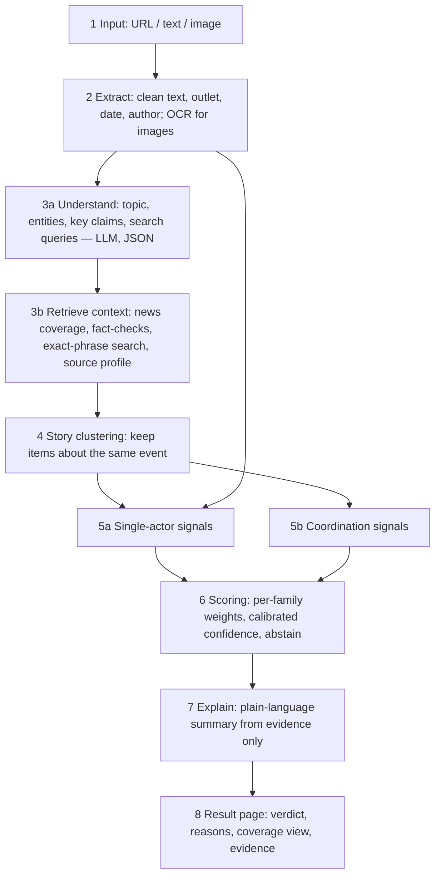

# Project plan — context-aware propaganda detection pipeline

Status: **proposal for the team review** (Fri 13.11, 21:00). Nothing here is decided until it is ticked in "Decisions for the review" at the end and copied into `DECISIONS.md`. Supersedes the direction comparison in `docs/directions.md`; the Hostinger brief and research stay in `docs/hostinger-challenge.md`.

## 1. Project description
A pipeline that takes one piece of online content and tells a non-technical reader whether it shows signs of **propaganda by its author** (single-actor manipulation) and/or **coordinated propaganda** (the same message pushed by many outlets or accounts acting together). The verdict rests on **quantified evidence gathered live from the web about the same topic**, not on a model's opinion of the text alone.

Two examples of the intended behaviour:
- A newspaper (in any language) publishes a story about event *x*. The system finds how other outlets, in the same language and internationally, covered *x*, compares the claims, the tone and the wording, checks fact-checkers, and shows where this article stands relative to everyone else.
- A user pastes a social-media comment or uploads a meme. The system extracts the text, works out what it is about, searches for the same claim and phrasing elsewhere (news, fact-checks, other posts), and reports whether the claim is contested and whether the exact wording is being repeated by many sources at once.

**Inspiration: Ground News.** Ground News groups every article about one event into a story and shows the coverage by source bias, factuality, ownership, location and time; its "Blindspot" flags stories covered mostly by one side ([FAQ](https://ground.news/frequently-asked-questions), [Blindspot](https://ground.news/blindspot/about)). We take the **story-level comparison** idea: an item is judged against its peers covering the same event. We do not copy its bias ratings: Ground News averages third-party ratings from AllSides, Ad Fontes Media and Media Bias/Fact Check ([bias ratings](https://about.ground.news/about-bias-ratings)), which are US-centric and whose reuse terms we have not checked (decision D9).

**Why this fits the challenge and the judges' feedback**
- Hostinger brief: strong, honest detection logic with precision and false-positive rate. Each signal is measured on labelled data and reported separately.
- Judges: show **how the confidence score is calculated** (section 5), **focus on a few detection types** (MVP in section 3 has two: single-actor and coordinated, on one input type first), **scale and impact** (section 8), **frontend later** (section 9).

## 2. Functional requirements
| ID | Requirement | Priority | How we meet it |
|---|---|---|---|
| FR1 | Usable by a non-technical person | Must | One input box (paste a link or text, or upload an image); plain-language traffic-light verdict with three reasons; details hidden behind "show evidence"; no jargon (technique names translated into everyday words); progress shown step by step while the pipeline runs |
| FR2 | Hosted on Hostinger | Must | API, workers, database, models and UI on the VPS; LLM calls through Hostinger AI Router; optional n8n for scheduled ingestion; optional Hostinger GPU for fine-tuning or batch evaluation (section 7) |
| FR3 | Quantifiable detection | Must | Every verdict is a calibrated score built from named signals, each with a measured weight and its source links; metrics page with precision, recall, FPR per hard-negative set and calibration |
| FR4 | Context from live online sources | Must | Retrieval of related coverage, fact-checks and repeated phrasing for every analysis (section 4, stage 3) |
| FR5 | Pretrained vs trained models | Must decide | Proposal: pretrained Hugging Face models for the text signals; we train only the small score combiner (section 6, D5) |
| NH1 | Explainable verdict | Nice | Score breakdown per signal family plus an LLM-written explanation constrained to the evidence |
| NH2 | Dashboard | Nice | Metrics page first; history of analyses and coverage trends later |

Non-functional targets (to confirm): one analysis in ≤ 60 s end to end, async with live progress; **language-agnostic** content analysis (section 4, "Language support"); no user accounts; every result shareable by link.

## 3. Scope
**MVP (must work Sunday morning)**
- Input: a **news article URL or pasted text**, in any language the models support; quality is reported per language (section 4, "Language support").
- Single-actor signals: persuasion techniques, tone compared with peers, claim support across coverage, fact-check matches, source profile.
- Coordinated signals: copied passages across unrelated outlets, timing of the copies, shared infrastructure, membership of documented propaganda networks.
- Verdict per dimension (single / coordinated) with confidence and breakdown; evidence list with links.

**Phase 2 (only if the MVP is green by Sat 18:00)**
- Social post URL and meme/screenshot input (OCR via a vision model on AI Router).
- Social-media search for repeated phrasing. Unauthenticated Bluesky and Reddit search returned 403 from our network on Fri evening; this needs API credentials or a scraping provider (D7).
- Scheduled ingestion with n8n to build our own coverage index.
- Dashboard with history and trends.

**Out**: user accounts, browser extension, real-time social firehose, our own political-bias ratings of outlets, per-language hand-tuned rules.

## 4. Pipeline


### Stage by stage
1. **Input.** URL, pasted text, or image. Detect language; reject unsupported languages with a clear message instead of guessing.
2. **Extract.** Fetch and clean the page (e.g. trafilatura); keep title, body paragraphs, publication date, author, outlet domain, outbound links, and raw HTML for infrastructure checks (tracking IDs). Images: OCR through a vision model on AI Router.
3. **Understand and retrieve.**
   - An LLM returns structured JSON: event summary, entities, date/place, up to five key claims, and search queries **in the item's language plus English** (to reach international coverage). Each claim must be traceable to a sentence of the text (verbatim check), otherwise it is dropped.
   - Retrieval adapters, each behind one interface so they can be swapped:
     | Source | What it gives | Access (checked Fri evening) |
     |---|---|---|
     | Google News RSS search, edition chosen from the detected language and country (`hl`, `gl`, `ceid`) | Related articles with outlet and date | Works without a key; tested with an Italian query |
     | GDELT DOC 2.0 API | Multilingual coverage, outlet domain, source country, first-seen time | No key; **1 request per 5 s**, our test was throttled — needs queueing and caching |
     | Google Fact Check Tools API (`claims:search`, `languageCode`) | ClaimReview fact-checks with rating and publisher ([docs](https://developers.google.com/fact-check/tools/api/reference/rest/v1alpha1/claims/search)) | Needs a Google API key |
     | Fact-checkers publishing ClaimReview (most IFCN signatories, in many languages) | Debunks in the item's language | Reached through the Fact Check API above; site-restricted search for checkers missing from it |
     | Exact-phrase search for distinctive sentences | Copies of the same text elsewhere | Google News RSS with quotes; Oxylabs or Context.dev if we keep them (D7) |
     | RDAP and Certificate Transparency | Domain age, first certificate | Free, no key |
     | VIGINUM Portal Kombat domain list | 371 documented pro-Russian "Pravda network" domains and subdomains, one per target country/language (e.g. `pravda-de[.]com`, `pravda-fr[.]com`, `pravda-pl[.]com`) ([CSV](https://github.com/VIGINUM-FR/Rapports-Techniques/tree/main/202402%20-%20Portal%20Kombat)) | Public CSV; repo has no licence file |
   - Fetch the top N related items (N ≈ 15–30) with the same extractor.
4. **Story clustering.** Embed the item and the retrieved articles with a multilingual model (e.g. `intfloat/multilingual-e5-small` or `-base`, MIT) and keep those above a similarity threshold within a date window. This is the "story" in the Ground News sense. Show how many items were kept and why the others were dropped.
5. **Signals.** Each signal returns a value, the evidence behind it, and its family.
   - **Single-actor**
     - *Persuasion techniques.* Paragraph-level multi-label classifier. Candidate: `Mishtar4/persuasion-detector-xlm-roberta` (XLM-R large, 23 SemEval-2023 techniques, trained on English, French, German, Italian, Polish and Russian; the XLM-R base model covers ~100 languages; MIT). Its card reports **micro-F1 ≈ 0.45** on the Polish dev set: individual technique labels are noisy, so we aggregate to the six SemEval categories and use them as one signal, never as the verdict alone. English-only binary alternative: `IDA-SERICS/PropagandaDetection` (DistilBERT, card claims 90% accuracy on SemEval-2023 test).
     - *Tone relative to peers.* Emotional and loaded-language intensity of the item compared with the other articles in the same story (z-score). This is the context-relative, quantifiable core: "this article is more charged than 90% of the coverage of the same event". Because it compares within one story, it tolerates a model's bias in any single language better than an absolute score. Candidates: the technique model's Loaded Language / Fear probabilities; `MilaNLProc/xlm-emo-t` (multilingual emotion model trained on datasets in 19 languages; licence not stated on the card).
     - *Claim support.* For each key claim, natural-language inference against every retrieved article, also across languages (`MoritzLaurer/mDeBERTa-v3-base-xnli-multilingual-nli-2mil7`, MIT, NLI data in ~27 languages): counts of supporting, contradicting and silent sources.
     - *Fact-check matches.* Matching ClaimReview entries and their ratings.
     - *Omission* (stretch). Facts reported by most peers but absent from the item.
     - *Source profile.* Domain age, outlet type (wire service, national, local, partisan, state-affiliated, documented network), country.
   - **Coordinated**
     - *Text reuse.* MinHash near-duplicate passages between the item and retrieved items from unrelated outlets. Wire services (e.g. Reuters, AP, AFP, dpa, EFE, ANSA) and press releases are recognised through a registry of wire agencies per country and excluded: syndication is the main false positive.
     - *Timing.* Copies appearing within a short window, first-seen timeline.
     - *Infrastructure.* Shared Google Analytics / GTM / AdSense IDs across copying domains, young domains, same hosting network.
     - *Known networks.* Domain present in the VIGINUM list.
     - *Social repetition* (phase 2). Many accounts posting the same phrasing, using the swarm engine in `pcerka/setup`'s `docs/swarm-idea.md`.
6. **Scoring.** Section 5.
7. **Explain.** An LLM (AI Router) writes three plain-language reasons and a short summary **from the evidence JSON only**. Every sentence must reference evidence IDs; quotes are checked verbatim against the source text; anything unverifiable is removed. The LLM never changes the score.
8. **Result.** Section 9.

### Language support
No component may assume one language:
- **Language ID first** (e.g. `papluca/xlm-roberta-base-language-detection`, ~20 languages, MIT, or the LLM in stage 3). It drives search editions, query languages and which per-language thresholds apply.
- **Only multilingual models** in the pipeline (embeddings, NLI, techniques, emotion). No per-language lexicons or rules.
- **Support tiers, shown to the user:**
  - *Evaluated*: languages present in our labelled sets; calibrated scores.
  - *Supported, not evaluated*: the models cover the language but we have no labels; the result says so and the confidence is capped.
  - *Unsupported*: the models do not cover it; the pipeline abstains with a clear message.
- **Calibration and metrics per language** where the set is large enough; otherwise pooled, and the metrics page says which.
- **Cross-language coverage**: retrieved articles in other languages count for claim support (NLI is cross-lingual) and are listed separately in the coverage view.

### Data contract (owned by the integrator, `contracts/`)
Every stage reads and writes one analysis record, so each workstream can be built and tested alone with fixtures:
```text
Analysis
  id, created_at, status, steps[] (name, state, duration_ms)
  input        { kind: url|text|image, value, language }
  document     { url, outlet, published_at, title, paragraphs[], html_meta }
  claims[]     { id, text, sentence_ref }
  context[]    { id, url, outlet, published_at, title, text, retrieved_by, similarity, in_story }
  evidence[]   { id, family, signal, value, detail, source_refs[] }
  scores       { single: Score, coordinated: Score }
  Score        { label, probability, tier, breakdown[] { family, contribution, evidence_ids[] }, abstained, reason }
  explanation  { summary, reasons[] { text, evidence_ids[] } }
```

## 5. Confidence score (what the judges asked for)
- **Families**, scored separately for the two dimensions:
  - single-actor: techniques, tone vs peers, claim support, fact-checks, source profile;
  - coordinated: text reuse, timing, infrastructure, known networks.
- Each family produces one number from its signals. Inside a family only the strongest signal counts, so correlated evidence is not double-counted.
- **Combiner**: logistic regression on the family values, trained on our labelled evaluation set. Its coefficients are the weights shown to the user ("copied passages from 6 unrelated outlets: +1.8"). This is the only model we train in the MVP: small, fast, fully explainable.
- **Calibration**: cross-validated, because the set is small. The metrics page shows a reliability table ("of results scored ≥ 0.8, x% were really propaganda").
- **Abstain**: when too little context is found (e.g. fewer than 3 related items) or families disagree, the verdict is "Not enough evidence", with the reason. Abstain rate is reported.
- **Uncertainty**: with ~150 labelled items, precision and FPR get Wilson 95% intervals; we show the intervals, not only point values.

## 6. Models: pretrained or trained
| Option | Pros | Cons |
|---|---|---|
| **A. Pretrained only** (Hugging Face models above) + trained combiner | Fast to ship; multilingual models cover many languages; the combiner gives calibrated, explainable scores | Technique labels noisy (≈0.45 micro-F1 on the reference card); quality unknown outside the six training languages; no control over training data |
| B. Fine-tune the technique classifier | Possible gains on news in specific languages | Multilingual labelled data needs SemEval-2023 registration (manual approval) or our own labelling; GPU hours; research-only data licences; little time to evaluate properly |
| C. LLM zero-shot for techniques | No training; good explanations | Not reproducible, costs credits per call, prompt-injectable; over-flags |

Proposal: **A** for the MVP; B only if a teammate has time on Saturday and labelled data has arrived. Model licences: the candidates above are MIT, but they were trained on research-only datasets; ask the organisers whether that matters for a public MIT repo.

CPU check before relying on it: XLM-R large on 2 vCPU across ~20 paragraphs may take tens of seconds [inference, not measured]. Measure on the VPS Friday night; fallback is a smaller model or running models on a Hostinger GPU instance (section 7).

## 7. Hosting on Hostinger
| Component | Where | Notes |
|---|---|---|
| API (FastAPI) + pipeline workers + job queue | VPS KVM 2 (2 vCPU, 8 GB) | Docker Compose; Caddy for TLS on the free domain |
| Database | VPS (SQLite or Postgres container) or Aiven Postgres + pgvector | D11 |
| Text models (embeddings, NLI, techniques) | VPS CPU first | Measure latency; cache per URL |
| LLM steps (claims, queries, explanation, OCR) | Hostinger AI Router via `LLM_BASE_URL` | Per-key spend limit; exact model IDs from hPanel |
| Scheduled ingestion (phase 2) | n8n from Hostinger's one-click VPS template | Pull RSS from a configurable list of outlets and fact-checkers in several languages into our DB every N minutes: our own coverage index and first-seen timeline. Not for the core pipeline: logic in n8n is hard to test and version |
| Fine-tuning / batch evaluation (optional) | Hostinger GPU, hourly (from about $0.42/h for an RTX 4090, per a third-party price tracker reading Hostinger's page) | Billed in Hostinger credits, likely the same balance as AI Router; confirm what the team allocation covers |
| Frontend | Served by the VPS | After the spec freeze (section 9) |

## 8. Evaluation and scale
**Labelled sets.** Labels come from third parties, not from our opinion:
| Set | Positives | Negatives / hard negatives | Size target |
|---|---|---|---|
| Single-actor | Claims debunked by fact-checkers (via ClaimReview, several languages); EUvsDisinfo database cases (over 7,000 pro-Kremlin disinformation cases, multilingual; API status unchecked) | Mainstream reporting on the same events; **hard**: fact-checks quoting the claim, satire, op-eds, emotional but accurate reporting | ~100, across at least 3 languages |
| Coordinated | Articles from VIGINUM-listed Pravda network domains (sites in many languages) | **Hard**: wire copy republished by many outlets, press releases | ~50 |
| Techniques | SemEval-2020 Task 11 dev set (English, open download, academic use); SemEval-2023 (6 languages) if registration is approved | — | as available |
| Non-English spot check | ~50 paragraphs in languages the team reads, labelled by two teammates, agreement reported | — | 50 |

**Metrics.** Per dimension: precision, recall, FPR overall and **per hard-negative set**, calibration table, abstain rate, latency. Ablation: what each family adds. A written list of false positives and false negatives with causes.

**Limits stated up front.** EUvsDisinfo and VIGINUM cover pro-Kremlin operations only, so the positives are skewed toward one actor; fact-checker debunks cover domestic misinformation and partly balance this.

**Scale and impact.**
- Throughput on the VPS (analyses per minute, cache hit rate).
- Batch mode: run the pipeline over the n8n coverage index to surface clusters of copied stories across all ingested outlets.
- Hostinger angle: the coordinated detector works on any set of sites. A host could run it across hosted domains to spot networks like Portal Kombat. Pitch only, not built.

## 9. User experience
**Principles**
- One screen to start: a single input, example buttons (articles in two different languages, a meme).
- While running: the pipeline steps with ticks ("Reading the article… Finding other coverage (14 sources)… Checking fact-checkers…").
- Result, top to bottom:
  1. A traffic light per dimension plus a confidence bar ("Likely one-sided propaganda — 82% confident").
  2. Three reasons in plain words, each with a link.
  3. The **coverage view**, inspired by Ground News: how other outlets covered the same event, ordered by time, with this item's position on tone and claim support.
  4. Evidence and score breakdown, behind "Show how we calculated this".
- Words, not labels: "Emotionally charged words", "Same text published by 6 unrelated sites within 2 hours", "Claim contradicted by 5 of 7 sources".

**Timing.** Per the judges, frontend work starts only after the spec freeze (target Sat 12:00). Until then the API returns everything the UI needs; the product owner collects design references and wireframes.

## 10. Team roles (4 people, each driving agents)
Split by folder, one owner per folder, contracts first (`docs/playbook.md`). Names to fill in at the review.

| Role | Person | Owns (folders) | Delivers |
|---|---|---|---|
| **P1 Integrator + platform** | ? | `contracts/`, `api/`, `deploy/`, CI, `DECISIONS.md` | Data contract and OpenAPI in hour one; walking skeleton live on the VPS Friday night; job queue, cache, DB; AI Router client; n8n setup (phase 2); merges every round; keeps `main` deployable |
| **P2 AI core: retrieval and context** | ? | `pipeline/extract/`, `pipeline/retrieve/`, `pipeline/story/` | Extraction, claim and query generation, source adapters (Google News, GDELT, Fact Check API, fact-checkers, RDAP/CT, VIGINUM list), rate limiting and caching, story clustering |
| **P3 AI core: signals and scoring** | ? | `pipeline/signals/`, `pipeline/score/`, `pipeline/explain/` | Technique model, tone vs peers, NLI claim support, text reuse, timing, infrastructure; combiner, calibration, abstain; constrained explanation |
| **P4 Evaluation, product and pitch** | ? | `evals/`, `web/` (after spec freeze), `docs/pitch/` | Labelled sets and labelling guide; eval harness and metrics page; wireframes now, frontend after the freeze; demo script, video, submission text |

Working agreements:
- Every stage is testable alone with fixture `Analysis` records committed in `evals/fixtures/`. Agents build against fixtures, not against each other's branches.
- Each person runs their own agents in a separate clone (`docs/setup.md`); PR to `main` every ~2 h, CI green.
- Only P1 changes `contracts/`. A contract change is announced in the team chat before merging.

## 11. Timeline
| When | P1 platform | P2 retrieval | P3 signals | P4 eval/product |
|---|---|---|---|---|
| Fri 21:30–23:59 | Contract + skeleton API; VPS, domain, Caddy | Extract + Google News RSS adapter | Measure model latency on CPU; technique + NLI wrappers | Start labelled sets; preliminary submission text |
| **Fri 23:59** | Preliminary submission | | | |
| Sat 00:00–12:00 (sleep in shifts) | Deploy pipeline end to end; queue, cache | GDELT, Fact Check API, fact-checker sites, RDAP/CT, VIGINUM | Tone vs peers, reuse, timing, infrastructure | Sets ≥ 100 items; eval harness running on fixtures |
| **Sat 12:00** | **Spec freeze**: final decisions; frontend starts | | | |
| Sat 12:00–18:00 | Integrate, harden, n8n if MVP green | Story clustering, claim extraction quality | Combiner + calibration on labelled set; explanation | Frontend v1 (with P1); first metrics |
| **Sat 16:00** | **Real data through the full demo path** | | | |
| Sat 18:00–Sun 03:00 | Performance, monitoring | Phase 2 input (social/meme) only if green | Ablation, false-positive review | Metrics page, demo script, rehearsal |
| **Sun 03:00** | **Feature freeze** | | | |
| Sun 03:00–09:00 | Fresh-clone rehearsal, backup recording | Bug fixes | Bug fixes | Video, description, submission |

## 12. Risks
| Risk | Mitigation |
|---|---|
| Retrieval finds too little for niche or very new items | Abstain with a reason; multiple adapters; our own n8n index (phase 2) |
| GDELT rate limit (1 request / 5 s) | Queue and cache; Google News RSS as the first adapter |
| Wire copy flagged as coordination | Wire-service and press-release recognition; dedicated hard-negative set with its own FPR |
| Fact-checks and satire flagged as propaganda | Hard-negative sets; quote-aware claim handling |
| Model latency on 2 vCPU | Measure Friday night; smaller models, caching, or GPU |
| Small labelled set → unstable scores | Wilson intervals, cross-validated calibration, say so on the metrics page |
| Licences (research-only training data, scraped content) | Never commit scraped text or datasets; ask organisers about model weights |
| Breadth (judges: focus) | MVP is one input type; phase 2 only after Sat 18:00 if green |

## 13. Decisions for the review
Fill in the "Decision" column during the review, then copy each line into `DECISIONS.md`.

| ID | Question | Options | Proposal | Decision |
|---|---|---|---|---|
| D1 | MVP input type | Article URL/text only · + social post · + meme | Article URL/text only; social and meme in phase 2 | |
| D2 | Language policy | Any language with support tiers · fixed list of languages | Any language; tiers "evaluated / supported, not evaluated / unsupported" shown to the user; evaluated = languages in our labelled sets | |
| D3 | Detection dimensions in the MVP | Single only · Coordinated only · Both | Both, with separate verdicts | |
| D4 | Verdict labels shown to users | Propaganda / not · traffic light + confidence · score only | Traffic light + calibrated confidence + "not enough evidence" | |
| D5 | Models | Pretrained + trained combiner · fine-tune techniques · LLM zero-shot | Pretrained + trained combiner | |
| D6 | Technique model | `Mishtar4/persuasion-detector-xlm-roberta` (multilingual) · `IDA-SERICS/PropagandaDetection` (English only) · other | Mishtar4 after a latency check and a spot check in languages outside its training set | |
| D7 | Scraping providers | Free sources only · + Oxylabs · + Context.dev | Free sources first; one paid provider only if a source blocks us (Oxylabs needs the $500 plan, cancel after the event) | |
| D8 | Fact-check source | Google Fact Check API · site search on checkers missing from it · both | Both | |
| D9 | Outlet ratings (Ground News style) | Third-party bias ratings · our own outlet types · none | Our own measurable outlet types; no political-bias ratings | |
| D10 | n8n | Not used · scheduled ingestion · core orchestration | Scheduled ingestion, phase 2 | |
| D11 | Database | SQLite on VPS · Postgres on VPS · Aiven Postgres + pgvector | SQLite until a need appears; Aiven if we keep that tech challenge | |
| D12 | LLM endpoint | Hostinger AI Router · Nemotron · both via `LLM_BASE_URL` | AI Router default, Nemotron as fallback if we keep that tech challenge | |
| D13 | GPU | None · Hostinger GPU · Verda | None for the MVP; Verda credits for any fine-tune (free), Hostinger GPU only if credits allow | |
| D14 | UI language | English (current team rule) · localised UI | English UI for the hackathon; content analysis in any language; LLM explanation in the user's language as an option | |
| D15 | Tech challenges kept | Previous tier list in `SPEC.md` | Re-pick after D7, D11, D12, D13 | |
| D16 | Role assignment | Section 10 table | Fill in names | |
| D17 | Project name and punchline (needed for 23:59) | — | Proposed punchline: "Paste a link. See how everyone else covered it, what's been copied, and how sure we are — with every source shown." | |
