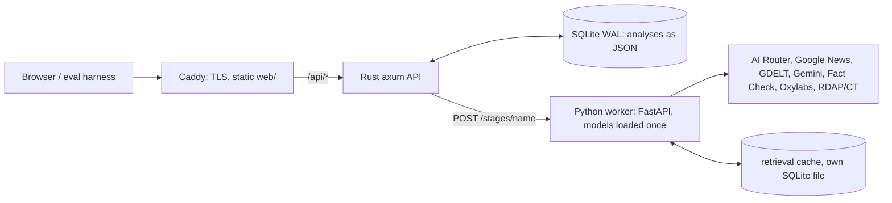

# Integrator stack — platform, API, contracts, deploy

Owner: Degra02 (integrator). Status: **proposal**, Sat 14.11. Replaces "API (FastAPI)" in `docs/plan.md` §7 once recorded in `DECISIONS.md`. Comparison with other approaches: `plans/backend-approaches.md`.

## Shape
The pipeline (models, retrieval, LLM stages) is Python and owned by teammates. Rust is a thin, typed orchestrator: HTTP, job lifecycle, persistence, progress streaming, guards. It drives one long-running Python worker **per stage** over HTTP/JSON.

Per-stage calls (not one "run pipeline" call) give Rust real step progress for SSE, per-stage timeouts, `signals_single ∥ signals_coord` in parallel, partial failure → score abstains with a reason, and keep every Python stage a pure `Analysis → StagePatch` function testable with fixtures (`docs/plan.md` §10).

Rejected: models in Rust (`ort` has no stable release; moves AI core into another language), PyO3 embedding (packaging, GIL), subprocess per stage (model reload per call), Redis/broker, Postgres (D11), gRPC/protobuf, Temporal, Kubernetes.

## Stack
Versions are the latest stable on crates.io / PyPI on Fri 13.11.

| Layer | Choice | Notes |
|---|---|---|
| Toolchain | Rust 1.100.0 via mise `core:rust` + `rust-toolchain.toml` (clippy, rustfmt) | Same convention as the other pinned tools |
| HTTP | `axum 0.8.9`, `tokio 1.54`, `tower-http 0.7.1` (trace, cors, timeout, limit) | |
| OpenAPI | `utoipa 6.0.0` + `utoipa-axum 0.3.0` + `utoipa-scalar 0.4.0` (OpenAPI 3.1) | Code-first: Rust types are the contract |
| DB | `sqlx 0.9.0` (sqlite, bundled), embedded migrations, runtime queries | No `query!` macros: they need `DATABASE_URL` or a `.sqlx` cache in CI |
| Worker client | `reqwest 0.13.5` (rustls, json) | |
| Progress | axum `Sse` + `tokio::sync::broadcast` per analysis | |
| Queue | `tokio::spawn` + `Semaphore(1)` around model stages; state in SQLite; on boot mark `running` → `failed` | No broker on 2 vCPU |
| Public-endpoint guard | `tower_governor 0.8` per IP, body/char cap, dedupe by input hash | Protects LLM/Oxylabs spend; demo replays are instant |
| IDs, logs, errors | `uuid` v7, `tracing` + `tracing-subscriber` JSON, `thiserror`, `anyhow` | Config from env (mise `.env`) |
| Language ID (proposal) | `lingua 1.8.0` in Rust at input | Drops the 1.1 GB lang-id model; drives D2 tiers. Needs agreement with P2/P3 |
| Worker | FastAPI + uvicorn, **one process** | Models in memory once; GDELT 1 req/5 s limiter stays process-global |
| Codegen | `contracts/openapi.json` → pydantic v2 (`datamodel-code-generator`) and TS (`openapi-typescript` + `openapi-fetch`) | CI fails on drift |
| Mock | `bunx @stoplight/prism-cli mock contracts/openapi.json` | Frontend before the backend is ready |
| Frontend (P2's call) | Vite + React static build | No Node runtime on the VPS |
| Edge | Caddy 2: TLS on `srvNNNNNN.hstgr.cloud` or the free domain, serves `web/dist`, proxies `/api` | Flushes SSE immediately |
| Images | Rust: `cargo-chef` → `distroless/cc`; worker: `ghcr.io/astral-sh/uv:python3.14-bookworm-slim`, torch from the `whl/cpu` index | Python 3.14 wheels exist for torch, onnxruntime, tokenizers, sentencepiece |
| Deploy | GH Actions → GHCR → SSH `docker compose pull && up -d` | Hostinger's `deploy-on-vps` action builds `build:` services on the VPS (slow Rust build on 2 vCPU) and posts only the compose URL |
| Model weights | Named `hf-cache` volume, filled once by `mise run deploy:models` | Not baked into images, not downloaded at demo time |
| CI | `Swatinem/rust-cache`; `mise run check` = gitleaks + `cargo fmt --check` + `clippy -D warnings` + `cargo test` + ruff + pytest + contract drift | Raise `timeout-minutes` from 5 to 15 |

## Contract (`contracts/`)
- Source of truth: Rust structs with `serde` + `utoipa::ToSchema`. `mise run contracts` writes `contracts/openapi.json` (public) and `contracts/worker.openapi.json` (stages), then generates `contracts/python/` and the TS types.
- Public API: `POST /api/analyses` → 202 `{id}`; `GET /api/analyses/{id}`; `GET /api/analyses/{id}/events` (SSE); `GET /api/health` (DB + worker `/health` with loaded models); `GET /api/metrics` (eval harness output); `/api/docs` (Scalar).
- Stage API: `POST /stages/{extract|understand|retrieve|story|signals_single|signals_coord|score|explain}` takes the full `Analysis`, returns a typed patch of only the fields that stage owns; Rust merges. Single owner per field makes parallel stages safe (`evidence[]` is append-only).
- Gaps to fix in the `docs/plan.md` §4 record: no `queries[]` (3a output); no language support tier (D2); `Score.tier` ambiguous; `source_refs[]` type undefined; `claims[].sentence_ref` needs char offsets for the verbatim check; `steps[]` lacks `detail` and `error`; no `schema_version` / `pipeline_version`; image input needs upload storage.

## Risks
- **Memory on KVM 2 (8 GB).** fp32 weights from HF parameter counts [estimate]: persuasion XLM-R large 2.2 GB, mDeBERTa NLI 1.1 GB, xlm-emo-t ~1.1 GB, lang-id 1.1 GB, e5-small 0.5 GB → ~6 GB before activations, OS, n8n. Mitigations in order: `lingua` instead of lang-id; ONNX int8 dynamic quantisation (P3's call); 4 GB swap; lazy loading.
- **Rust upfront cost.** The prototype orchestrator compiled first try in minutes; the real costs are CI build time (cold release 2 min 21 s on 4 cores, ~2× on the 2 vCPU private-repo runner [estimate]) and the second image plus compose wiring. Worth it only if Rust stays thin: no business logic in Rust. Details: `plans/backend-approaches.md`.
- **Sandboxed agents (`jomp`).** The nono profile needs write access to `~/.cargo/registry` and `~/.cargo/git`; install the Rust toolchain outside the sandbox first.
- **One LLM client rule.** LLM calls happen in Python stages, so the AI Router client is a Python module (`pipeline/common/llm.py`, `openai` SDK). No `async-openai` in Rust.
- **GHCR auth.** VPS needs `docker login ghcr.io` while the repo is private.

## Build order
1. `mise.toml` (rust pin; tasks `contracts`, `dev`, `api:test`, `mock`), `rust-toolchain.toml`, CI timeout and rust-cache.
2. `contracts/`: `Analysis` types with the gaps fixed, OpenAPI dump, generated pydantic, one fixture in `evals/fixtures/` (coordinate with mosearc).
3. `api/`: endpoints above on SQLite; tests use `wiremock` as the worker (tests only).
4. Worker skeleton: FastAPI `/stages/*` calling `pipeline.<stage>.run()`, plus `/health`.
5. `deploy/`: compose (caddy, api, worker, `hf-cache`), Caddyfile, GHCR build workflow, SSH deploy on `main`, VPS swap and firewall (22/80/443).
6. Skeleton live on the public URL, stages passing the record through; each teammate's merge then shows up live.

## Decisions to record
- Rust (axum) API orchestrates a Python stage worker over HTTP; replaces FastAPI in `docs/plan.md` §7.
- Ownership rows in `AGENTS.md` for `worker/` and `pipeline/common/` (proposed: integrator).
- Language ID at input in Rust (`lingua`): agree with ck-lithium and Lyreplus.
