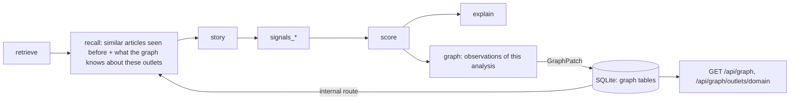

# Source graph: research and implementation plan

Status: **phase 0 built** (Sun 15.11, 01:40) on `degra/source-graph`: the offline build, `evals/graph.json` and `GET /api/graph`; results in section 3. The later phases are a proposal: they go beyond `docs/plan.md` and touch D4 and D9, so they need a team decision and a `DECISIONS.md` line (section 10). The work split is in `docs/next-steps.md`.

Idea under review: every analysis also feeds a persistent graph of outlets, linked by measured similarity. Over time the graph becomes (a) a map of which sites act together, (b) a per-source track record, and (c) a signal whose weight in the score grows as the graph learns more.

## 1. Verdict
- **Worth building, with three corrections** to the idea as brainstormed (section 3): link sites by coordination evidence, not by topic; batch-feed the graph, because user analyses alone leave it too sparse; keep the graph out of its own inputs, or it confirms itself.
- **It fixes a measured weakness, not only a perception.** `docs/ai-core.md`: coordinated CV AUC is 1.000 with `known_networks` and **0.3751 without it**. Today the coordinated score is a list lookup. A graph that remembers earlier articles and infrastructure can find a network without the list. That is the claim to measure (section 8, E1).
- **Not before the Sun 03:00 freeze in the score.** `weights.json` is calibrated on 284 items; a new, unfitted family would make every "calibrated" statement false. Before the freeze only phase 0 fits (offline build, no pipeline or contract change).
- On "GPT wrapper": the pipeline already makes two LLM calls (understand, explain) and neither sets a score; XLM-R, NLI, 5-gram reuse and a fitted logistic regression do. Say that in the pitch regardless of this plan. What the graph adds is different: an asset that accumulates with use and that a prompt cannot reproduce.

## 2. What the research says
| Source | Finding | Consequence for us |
|---|---|---|
| Burdisso et al., NAACL 2024, ["Reliability Estimation of News Media Sources: Birds of a Feather Flock Together"](https://arxiv.org/abs/2404.09565) | A reliability *degree* per outlet, propagated over a hyperlink graph from labelled seeds, correlates with journalists' scores (Spearman 0.80; macro-F1 81.05). Propagating from who points at a source ("past", 78.90) beats where it points ("future", 62.18). | Seeds plus propagation is a published, working design. Use a degree, never a label (matches D4). Direction of an edge matters. |
| Keßler et al., Aug 2026, ["Network Information Enhances Unreliable News Domain Detection"](https://arxiv.org/abs/2608.02399) | On a domain co-sharing graph, reliability assortativity is only 0.22; GraphSAGE beats an MLP on the same features by 8 points (0.63 vs 0.55), but **plain neighbour averaging scores 0.38 against 0.36 for random**. Edges are kept only when significant against a null model (BiCM). | Weak "appears together" edges carry almost no reliability signal on their own. Guilt by association over such edges does not work. Filter co-occurrence against chance. |
| Carragher et al., ICWSM 2024, ["Detection and Discovery of Misinformation Sources using Attributed Webgraphs"](https://arxiv.org/abs/2401.02379) | Over 50% of domains on unmaintained blocklists from 2017–2019 are dead; sites rebrand to new domains (yournewswire → newspunch). | Static lists such as VIGINUM's go stale. A graph that links a new domain to an old one by infrastructure and content is the answer to list decay. Already visible here: the Pravda domains moved to `*.news-pravda.com` (`pipeline/retrieve/sources.py`). |
| ASD / ISD / UvA, [Information Laundromat](https://infolaundromat.com/about) | The closest existing tool. Two functions: content similarity and metadata similarity, with **three evidentiary tiers** (tier 1: unique analytics and verification IDs, certificates; tier 2: IP subnet, meta tags; tier 3: CSS classes, CMS). Warns about spurious matches from shared services (Cloudflare, shared hosting). A "lead generation tool": an analyst queries it by hand; results need manual confirmation. | Adopt tiers for edges. Differentiator: ours fills itself as a by-product of analyses, scores edges, and feeds a calibrated article-level score. |
| Pacheco et al., ICWSM 2021, ["Uncovering Coordinated Networks on Social Media"](https://arxiv.org/abs/2001.05658); [CooRnet](https://coornet.org/) | General recipe: bipartite graph of actors × shared traces (links, text, timing, identities), projected to a weighted actor graph, thresholded, then clustered. | This is our similarity method: outlets × traces (tracking IDs, copied passages, stories), projected per layer. |
| Dong et al., VLDB 2009, ["Integrating Conflicting Data: The Role of Source Dependence"](https://www.vldb.org/pvldb/vol2/vldb09-pvldb47.pdf); Dong et al., VLDB 2015, ["Knowledge-Based Trust"](https://www.vldb.org/pvldb/vol8/p938-dong.pdf) | A source that copies another is not an independent vote; source trust can be estimated from the correctness of what it states. | Second use of the graph: peers tied to the document's outlet must not count as independent corroboration in `claim_support` (the `eud_ru_*` false negatives in `docs/ai-core.md` are exactly this). |
| Gyöngyi et al., VLDB 2004, [TrustRank](https://www.vldb.org/conf/2004/RS15P3.PDF); Zhang et al., [trust and distrust propagation](https://dl.acm.org/doi/10.1145/2628440) | Propagate trust from a small good seed set and distrust from a bad one; they behave differently. | We have both seed sets: ~300 typed outlets in `outlets.json` (agencies, fact-checkers) and 371 VIGINUM domains. |
| Jøsang & Ismail 2002, [Beta reputation system](https://aisel.aisnet.org/cgi/viewcontent.cgi?article=1086&context=bled2002); Bühlmann credibility ([overview](https://openacttexts.github.io/Loss-Data-Analytics/ChapCredibility.html)) | Reputation as a Beta posterior over outcomes with a forgetting factor; credibility factor $Z = n/(n+k)$ weights own experience against a prior. | The principled form of "the graph weighs more as it learns more" (section 6). |
| Hoffman et al., ["A Survey of Attack and Defense Techniques for Reputation Systems"](https://nds2.ccs.neu.edu/papers/reputation_survey.pdf) | Self-promotion, slandering, Sybils; systems that feed their own output back are the fragile ones. | Section 7. |
| Rogers, ["Repurposing Google Analytics IDs"](https://datajournalism.com/read/handbook/two/investigating-data-platforms-and-algorithms/how-do-platforms-see-humans); ["Leveraging Google's Publisher-Specific IDs to Detect Website Administration"](https://dl.acm.org/doi/fullHtml/10.1145/3485447.3512124) | Shared GA / AdSense publisher IDs reveal common administration. | Our `infrastructure` family already collects them; the graph keeps them across analyses. |

Not found: a public tool that builds the outlet graph automatically from end-user checks and uses it in a calibrated per-article score. Commercial ratings (NewsGuard, MBFC) are human-made, US-centric and excluded by D9.

## 3. What our own data says (probe, Sat 23:30)
Eight finished analyses from the VPS (the demo IDs and the three live runs in `docs/next-steps.md`), pairwise comparison of every article in each record with the helpers in `pipeline/signals/coordinated.py`:

| Measured | Result |
|---|---|
| Outlets (nodes) | 26 |
| Outlet pairs seen together | 46, **none in more than one analysis** |
| Context items per analysis | 1–5 |
| Tracking IDs | 10, one shared by two domains |
| Labelled set (`evals/labelled.jsonl`) | 197 items with a URL on 91 hosts; 35 hosts appear once, 31 at least three times; 56 items on 18 `news-pravda.com` editions |

Three false links showed up at once; each is a rule the graph needs from day one:
- `pub-1556223355139109` links two unrelated `blogspot.com` blogs: it is **Blogger's own AdSense ID**, not the authors'. Identifiers issued by a hosting platform are not evidence.
- `repubblica.it` ↔ `tg24.sky.it` share 1,152 5-grams (34% of the shorter page): two live blogs built from the **same agency flashes**, with runs of up to 205 identical words. The ANSA item in the record has 43 5-grams, so removing wire 5-grams, as `find_copies` does, leaves about 1,100 shared. Only the outlet types keep this from being a copy (both are typed `national`, `_NOT_COPIERS`); between two untyped sites the same text would be an edge. The graph needs a guard that does not depend on the agency item being retrieved: text already seen on an agency or on several typed newsrooms is syndicated text (section 4).
- `ca.news.yahoo.com` ↔ `france24.com` at 82%: licensed **aggregation**. The registry types Yahoo as `national`, so it is excluded today; an untyped aggregator would not be. An aggregator copies from many unrelated sources; a network member copies from few.

Real links also showed: `cdm.press` → `cdmespanol.com`, `armedforces.press`, `coloradofreepress.com` (hyperlinks to sister sites); `cdm.press` text on `prophecyupdate.blogspot.com` (90%); `deutsch.news-pravda.com` → `segodnia.ru`, `t.me`. Hyperlinks also link `ansa.it` to `ansabrasil.com.br`: an edge is a relationship, not an accusation.

Corrections to the idea that follow:
1. **"Sites that also talk about propaganda" is not a link.** A fact-checker debunking a Pravda story covers the same topic. The repo already paid for this once: #27 gave a mainstream article 0.622 because a listed site was in its story (`docs/next-steps.md`, Lyreplus task 1). Topic similarity is a display layer only; reliability moves only across coordination-grade edges.
2. **User analyses alone are too sparse.** The graph needs batch input: the 277 stored eval records first, then the feed items `retrieve` already downloads on every run, then scheduled ingestion (D10).
3. **A track record built from what users choose to submit is biased** toward suspicious articles. Show counts and intervals; an unbiased record needs random samples of an outlet's output (phase 4).

### Phase 0 build on the 277 eval records (Sun 01:30)
`mise run graph:build -- evals/results/fit.jsonl --labelled evals/labelled.jsonl` compares every article of every record with every other (1 min 34 s on a laptop) and writes `evals/graph.json`:

| Measured | Result |
|---|---|
| Analyses → articles → outlets | 277 → 1,561 → 739 (87 outlets analysed as a document) |
| Ties | 492: 257 between outlets of one operator, 107 hyperlink only, 128 with shared IDs, copied text or translations |
| Strong ties between different operators (coordination ≥ 0.5) | 22: 17 by a shared analytics ID, 4 by text copied in two or three stories, 1 by ID + copy + link |
| Clusters | 29, of which 14 are joined by more than a shared domain name |
| **Text ties that rest only on hard-negative analyses** (agency copy, press releases, op-eds, satire, mainstream) | 33 weak, **0 strong**: none joins a cluster |
| **VIGINUM editions, found without the list** | all 18 in one cluster through the shared domain; on content alone **0 cluster**, 15 of 18 are tied to another edition by a translated article (13 pairs with one story, 2 with two) |
| Sites the cluster adds to the 18 listed ones | 6 `topwar.ru` language editions: `portuguese.` and `poland.news-pravda.com` each carry three `topwar.ru` articles word for word (98–100% of the 5-grams), `italy.` and `romania.` two |

What it shows:
- **The false negatives named in `docs/ai-core.md` get a tie.** `rtrunews.com` carries the analytics ID of `rt-english.com` (`G-WSRRLSJZ2D`); `esrt.press` and `actualidad-rt.com` share an ID, a text and a link: mirror domains of RT that `outlets.json` does not type. `ru.sputnik.kz` holds 98% of a `ria.ru` article and `mejdurecie.md` 97% of a `vz.ru` one: one story each, so weak ties.
- **One shared story is the normal state of the web**, which is why the count is over distinct articles. Shared text from a single analysis ties `elysee.fr` to `pm.gc.ca` (a joint statement), `actu.orange.fr` to `boursorama.com` (agency copy on untyped sites), `der-postillon.com` to a site reposting it. Five fringe sites republishing one RT France article look the same. Only repetition or an identifier separates them.
- **On content alone the listed network does not cluster yet**: the set has about three articles per edition, so two editions rarely share two sampled stories. Two translated stories give 0.44 at the prior weights, under the 0.5 a cluster needs. The weights were not tuned to pass. More articles per edition (`recall`, the editions' feeds) are what moves this number.
- **Analytics IDs are good evidence, AdSense IDs are not.** Of 15 analytics or Tag Manager IDs on more than one domain, 12 match a known common owner (the UN, AFP, Nexstar, Hearst, Future, RT mirrors, `iz.ru`, `defence24`, `headtopics`); the other 3 are unverified (`andaluciainformacion.es` / `elconfidencialdigital.com` / `eldiariodemadrid.es`, `elperiodico.com` / `noticiasdenavarra.com`, `factchequeado.com` / `kunr.org`) and each makes a cluster on its own: check them before showing the clusters. Of 10 shared AdSense IDs, 2 match a common owner; the rest are Blogger's (also on `der-postillon.com`, a Blogger site under its own domain), the template placeholder `pub-1234567890123456` on `focus.de` and `n-tv.de`, one ID on eight sites in Italy, Ukraine, Ghana and Argentina, and four between `elperiodico.com` and `lacnews24.it`. So `ad_account` is its own weak layer.
- **`context[].language` is wrong for about one item in ten**: 160 of 1,657 labelled context items hold text in another language than their label (52 labelled `it` are English, 96 labelled `en` are Spanish, French, German, Dutch, Italian or Russian; `feeds` 67 of 324, `fact_check_api` 40 of 273). The build detects the language from the text. `story` picks its threshold from the label (`threshold_for`), so this also moves `in_story`.

Limits: the records were chosen by label, not by users; a hyperlink counts only when its target is an outlet of the corpus; official sites are recognised by host labels (`gov`, `gouv`, `gob`, `gc`, `mil`), so `elysee.fr` or `boe.es` pass as ordinary sites (no strong tie resulted); `same_story` is not built.

## 4. Model
### Nodes
- **Outlet**: host with `www.` stripped, as in `sources[].domain`; attribute `registrable` (public-suffix aware, `sources.registrable`) to roll editions up. Carries the `SourceProfile` facts.
- **Article**: URL, outlet, date, title, language, embedding of headline + lead (`story.assign.story_text`, 384 floats). No body text in the graph tables.
- **Identifier**: GA / GTM / AdSense ID. Later: `ads.txt` seller IDs, certificate SANs, IP / ASN.

Stories, claims and fact-checks stay in the analysis records; the graph references them by a story key.

### Observations (facts, one row each, never rewritten by derivation)
An analysis yields relations between the outlets of its document and context items. **Story key** = hash of the normalised document URL, or of the pasted text. Rows are keyed `(kind, a, b, story key)`, so analysing or re-running the same input updates instead of adding: cache hits ingest nothing, re-runs cannot double count.

| Kind | Observed when | Tier | Graph |
|---|---|---|---|
| `analytics_id` | two outlets carry the same Google Analytics or Tag Manager ID; dropped when the ID was seen on a hosting platform (`blogspot.com`, `wordpress.com`, …) or on more than 20 operators | 1 | coordination |
| `ad_account` | the same AdSense publisher ID, same exclusions, placeholders dropped. Weak: these IDs also belong to ad resellers (section 3) | 3 | coordination, corroborating only |
| `same_operator` | same registrable domain; not on hosting platforms: `tld` gives `foo.wordpress.com` → `wordpress.com` and `x.substack.com` → `substack.com`, which would join every blog on them | 1 | affiliation |
| `documented` | both on the same published list (`known_network`). Not a tie in phase 0: an attribute of the outlet, so the clusters are found without the lists | 1 | coordination (seed) |
| `copy` | 5-gram containment ≥ 0.2 and ≥ 8 shared, after removing quoted passages, boilerplate (on 8 or more operators) and syndicated text (on a news agency or on 3 or more typed newsrooms, anywhere in the stored articles); neither side a fact-check, an official site, or typed `wire_service`, `fact_checker`, `satire`, `national`, `local` (`_NOT_COPIERS`). Directed earlier → later when both are dated (not built yet) | 2 | coordination |
| `translation` | different languages, detected from the text, embedding cosine ≥ 0.93 (`TRANSLATED_COPY_SIMILARITY`), at most 7 days apart; same exclusions as `copy` | 2 | coordination |
| `link` | the document links to the other outlet; own operator and social hosts dropped | 3 | affinity |
| `same_story` | both `in_story` (not built yet) | 3 | affinity |

Later kinds: `agree` / `contradict` on a claim (from `claim_support` evidence), `co_shared` (the same social post links both).

### Similarity between two outlets
Per layer $l$, $n_l$ = distinct articles with an observation, the smaller of the two sides (for the ID layers: distinct shared IDs). The repo's saturating count turns it into layer evidence, and a noisy-OR combines the layers:

$$w_l = 1 - e^{-n_l/\tau_l} \qquad S(A,B) = 1 - \prod_l \big(1 - q_l\, w_l\big)$$

| Layer | $\tau$ | $q$ (prior) |
|---|---|---|
| `analytics_id` | 1 | 0.9 |
| `ad_account` | 1 | 0.2 |
| `same_operator`, `documented` | — ($w = 1$) | 1.0 |
| `copy` | 2 | 0.8 |
| `translation` | 2 | 0.7 |
| `link` | 3 | 0.3 |
| `same_story`, only pairs with ≥ 3 shared stories and lift $n_{AB} N / (n_A n_B) \ge 2$ | 5 | 0.15 |

- Why noisy-OR: each layer is separate evidence that a tie exists; the result is bounded, monotone, and decomposes into a sentence ("same analytics ID; same text in 4 stories").
- Counting distinct stories, not article pairs, stops one viral story from making a strong edge.
- Two strengths are derived, never mixed: $S_{coord}$ (tier 1–2 coordination layers) and $S_{all}$ (everything; for the map). `same_operator` is affiliation: it joins a cluster but says nothing about conduct.
- $q_l$ are priors. Fit them like the combiner: pairs inside the VIGINUM list are positives, pairs of typed mainstream outlets of different operators are negatives.
- **Cluster** = connected component over $S_{coord} \ge 0.5$. Every member is reachable by links a reader can inspect. Leiden communities are a later refinement (new dependency, a resolution parameter to tune).
- **Role** of a node from directed `copy`: originator (others copy it), amplifier (copies few sources), aggregator (copies many unrelated sources: high entropy over its sources; excluded from coordination like an agency).

### Track record of an outlet
From analyses whose document came from a URL on that outlet (pasted text never counts: its origin is unverified), one outcome per article URL, abstentions skipped:
- $y_i$ = single-actor confidence **recomputed without graph families** (the breakdown stores each family's log-odds contribution, so subtract them);
- $d_i = 0.5^{\text{age}/180\text{ d}}$ (forgetting factor);
- $r = \sum d_i y_i$, $n = \sum d_i$, prior mean $m_0$ (propagated prior, else the mean over all outlets $\mu$), prior strength $k = 4$:

$$\hat\rho = \frac{k\,m_0 + r}{k + n} \qquad Z = \frac{n}{n + k}$$

Shown as counts, never as a rating: "9 articles from this site analysed, 7 with strong signs; 2 claims rated false by fact-checkers". Below 5 outcomes: "not enough analyses". Third-party facts (fact-check ratings on its articles, list membership) are shown next to it and are the stronger evidence.

### Propagated prior (phase 4)
$m_0(X)$ = weighted mean of the neighbours' $\hat\rho$ over $S_{coord}$ only, weights $S_{coord}(X,j)\cdot Z_j$, two damped rounds, seeds clamped (listed network high; agencies and fact-checkers low). It is a prior: an outlet's own outcomes override it through $Z$.

## 5. How it fits the codebase

Rules kept:
- **The API owns all persistence** (Sat 03:20). The worker stays stateless. Graph tables live in the same SQLite file (D11): adjacency tables, views for the aggregates, recursive CTEs for clusters. No graph database on a 2 vCPU / 8 GB VPS.
- **Signal stages compute from the record only** (Sat 12:20). Graph knowledge enters the record in one new stage, `recall`, and is stored there. So `rerun?from=signals_single` stays reproducible, `rerun?from=recall` refreshes graph knowledge without touching the web, and every explanation can show what the graph said at that moment.
- **Facts are stored, everything else is derived.** Strengths, clusters and track records are recomputed from observations, so a changed formula or a refitted combiner needs no migration. Backfill = replay stored analyses through the `graph` stage.

| Piece | Where | Owner | Notes |
|---|---|---|---|
| `observations(analysis)`: pure function, record → observations | new `pipeline/graph/observe.py` | to assign (AI core fits: it reuses `signals.text`, `coordinated._shingles`) | No network. Pairwise over ≤ 30 context items: milliseconds |
| Stage `graph` (with `explain`, same schedule group, so no added latency) | `pipeline/graph/__init__.py: run` → `GraphPatch` | same | Embeds headline + lead with `story.model.embed` for the article index |
| `StageName::Graph`, `GraphPatch`, `Analysis::apply` (step detail only), `SCHEDULE`, `is_model_stage` | `contracts/src/stage.rs`, `apply.rs`, `api/src/pipeline.rs` | integrator | Validation: every domain and URL must come from the record; weights in [0, 1]; an outcome only for URL input, no failed step. A failed `graph` step must not make the result non-reusable (`find_reusable`) |
| Tables `graph_outlets`, `graph_articles`, `graph_identifiers`, `graph_observations`, `graph_outcomes`; views for edges and track records | `api/migrations/0003_graph.sql`, `api/src/graph.rs` | integrator | Upsert in one transaction per analysis |
| `GET /api/graph` (clusters, top edges, counts), `GET /api/graph/outlets/{domain}` (profile, track record, edges with their evidence, cluster) | `api/src/routes/graph.rs`, `contracts/src/api.rs` | integrator | Typed, in OpenAPI and `api.d.ts` |
| Stage `recall`, after `retrieve`: embeds the document, asks the API's internal route for the nearest stored articles and for the profile of every outlet in `sources[]` | `pipeline/graph/recall.py`; `POST /internal/graph/recall` in the API | AI core + integrator | Caddy proxies only `/api/*`, so `/internal/*` is not reachable from outside. Worker needs `GRAPH_API_URL=http://api:8080`. Cosine over stored embeddings by brute force in Rust: 50,000 × 384 floats is about 19 million multiplications per query, milliseconds [estimate, not measured] |
| Memory items as context (`retrieved_by: "memory"`), `analysis.graph` (per-outlet history, cluster, strongest ties) | `contracts/src/analysis.rs` | integrator | Memory items pass through `story` and the existing signals unchanged: an earlier copy on another site now fires `text_reuse`, `timing`, `infrastructure` |
| New families `track_record` (single) and `linked_sources` (coordinated) | `Family` in the contract; `pipeline/signals/`, `pipeline/score/families.py`, `weights.json` | integrator, AI core | Separate families, not signals inside `source_profile` / `known_networks`: only the strongest signal of a family counts, and the ablation in `fit.py` must be able to remove the graph alone |
| Step label, source page | `web/src/lib/labels.ts`, new page | ck-lithium | After the functional layer |
| Kill switch | `STAGES_DISABLED=graph,recall` | — | Already supported |

## 6. "The graph weighs more as it learns more"
Three mechanisms, none of them a hand-turned global weight (graph size says nothing about graph quality):
1. **Per outlet, automatic.** The feature is shrunk by its own credibility: $v = Z \cdot \operatorname{clip}\big((r/n - \mu)/(1 - \mu),\,-0.3,\,1\big)$, in the family-value convention of `families.py` ($[-1, 1]$, negative floor above the −0.7 disagreement threshold). One analysed article moves the score by a fifth of what twenty do ($Z$ = 0.2 vs 0.83).
2. **Globally, measured.** The family's coefficient is fitted by `pipeline.score.fit` like the others (MAP toward a prior). Start with a small prior (0.5); each refit on a larger labelled set raises it only if the graph actually separates the classes. `cv.ablation` already reports AUC with and without a family.
3. **By coverage.** The share of analyses in which a graph family is non-zero (`items_nonzero`) grows with the graph; report it on the metrics page.

## 7. Risks
| Risk | Mitigation |
|---|---|
| **Self-confirmation**: graph raises a score, the score raises the outlet's record, the record raises the next score | Outcomes use the graph-free confidence; propagation never writes outcomes; the record stores the graph snapshot it used; evaluation is prequential (E3) |
| **Guilt by association** | Reliability crosses only tier 1–2 coordination edges; `same_story` and `link` are display-only; `linked_sources` needs a tie to a listed or well-evidenced outlet, never topic overlap. Keßler et al.: neighbour averaging over weak edges ≈ random |
| **Syndication and aggregators** as "networks" | Wire 5-grams removed per analysis; `_NOT_COPIERS`; syndicated passages from the article index (the live-blog case in section 3); aggregator role from source entropy; false-edge rate measured on `hard_wire_copy` and `hard_press_releases` (E2) |
| **Platform identifiers and hosts** (Blogger AdSense, `wordpress.com` and `substack.com` subdomains, Cloudflare certificates, shared hosting IPs) | One platform suffix list for `identifier` and `same_operator`, cap on carriers per ID, tiers; the Laundromat's "spurious matches" list as the checklist for each new identifier |
| **Poisoning** | Coordination edges are facts about pages *we* fetched: a user chooses where we look, not what we find. Outcomes: URL input only, one per article URL, per-client cap per outlet per day (the rate limiter already keys clients), counts shown |
| **Selection bias** in track records | Counts and intervals, a minimum of 5, the wording "in the articles analysed here"; random audit samples in phase 4 |
| **D4 / D9, and naming outlets in public** | No label on a node ("propaganda outlet", "unreliable"): a track record with counts and a list of inspectable ties. Not political bias, but it is an outlet rating: needs the team's decision. Add a notice and a contact for corrections, as the Laundromat does |
| **Stale edges** (a domain is sold) | `first_seen` / `last_seen` on every edge, time decay on track records |
| **Calibration claims** | No graph family in `weights.json` until fitted and reported with its ablation |
| **Scale** | Brute-force cosine and SQL views hold to ~10⁵ articles; beyond that an ANN index and materialised aggregates. Not a hackathon problem |

## 8. Evaluation
- **E1, list-free rediscovery (the headline).** Build the graph from the stored eval analyses; the lists make no tie. Do the clusters recover the VIGINUM network? Reported twice: with and without the `same_operator` layer, because 18 editions share `news-pravda.com` and that alone is trivial. First result (section 3): 18 of 18 with the layer, 0 of 18 without it, 15 of 18 weakly tied by translations. `recall` and more articles per edition are what should move it.
- **E2, false edges.** Strong text ties that rest only on the hard-negative sets must be zero; first result: 0 strong, 33 weak. Still to do by hand: the 22 strong ties between different operators, one by one.
- **E3, score gain without leakage.** Prequential: for item $i$ the graph holds only items before $i$; grouped by registrable domain so an outlet never informs its own test item. AUC and FPR per hard-negative set with and without the graph families, next to coverage.
- The 284-item set has 35 hosts with a single item: track records will be thin there. Say so.

## 9. Phases
| Phase | Scope | Changes pipeline or contract | Effort (agents) |
|---|---|---|---|
| **0, done** | `pipeline/graph/corpus.py` (articles, outlets, links from stored analyses) and `build.py` (ties, strength, clusters, evaluation), tests on the false ties of section 3; `mise run graph:build` writes `evals/graph.json`; `GET /api/graph` serves it like `/api/metrics` | No | built Sun 00:00–01:40 |
| 1 | Live ingestion: `graph` stage, tables, typed read endpoints, backfill by replay | Yes (new stage, no change to scores) | ~5 h |
| 2 | `recall`: article memory as context; re-run the `pk_*` items and E1 | Yes | ~4 h |
| 3 | `track_record`, `linked_sources` families with shrinkage; fit; E3; explanation wording | Yes (scores) | ~6 h + an eval run |
| 4 | Propagated prior; independence-weighted peers in `claim_support` and `tone`; feed items into the article index on every `retrieve` and by schedule (D10); random audit samples per outlet; more identifiers (`ads.txt`, certificate SANs, ASN); fitted $q_l$ | Yes | open |
| 5 | Visualisation: cluster and outlet pages first (table + ego network), global map later (WebGL renderer such as sigma.js once past a few thousand nodes) | UI | after the functional layer |

Phases 1–2 reuse the tie rules of phase 0, per analysis instead of over the whole corpus. Until they exist the graph grows by running `mise run graph:build` on a larger file of stored analyses.

## 10. Decisions needed
1. Merge phase 0 before the freeze or after the submission. It changes no stage, score or contract type; it adds `GET /api/graph`, and `evals/graph.json` names real outlets and their ties in a public repository.
2. Whether a per-outlet track record is acceptable under D9 and D4, and its wording. Phase 0 publishes ties only, no track record.
3. Owner of `pipeline/graph/`. Proposed: Lyreplus (it reuses `pipeline/signals/`).
4. Whether one shared analytics ID alone may join a cluster (it does today, at 0.57), given the 3 unverified ones in section 3.
5. After the event: internal callback from the worker (`recall`) versus a second store on the worker side. This plan assumes the callback, to keep one database.

Proposed `DECISIONS.md` line once agreed: `Source graph: observations per analysis stored in SQLite, strengths and track records derived; reliability crosses coordination edges only; no graph family in the score until fitted with its ablation (plans/source-graph.md)`.
