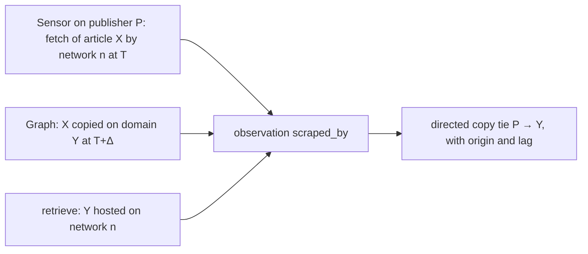

# Traffic sensor: future addition (not built)

Status: **idea reviewed Sun 15.11, 02:20; not built, kept as a future addition.** Nothing here is in `docs/plan.md` or the submission. Do not build any of it before the source graph's live ingestion and `recall` (phases 1–2 of `plans/source-graph.md`) exist: a sensor needs a live graph to write into. Each contract change goes through the integrator.

## 1. The idea
A service that runs for websites and collects their traffic. It sorts visitors into humans and bots and records repeated behaviour (the same client posting the same thing many times). What it learns feeds the source graph, so every user of The4thLover gets better coordination evidence. It brings the fourth Hostinger direction, "Clean the traffic" (dropped Fri 20:30, `docs/hostinger-challenge.md`), into the product as an input to "Spot the swarm" and "Trust the source" instead of a separate detector.

## 2. Verdict
- **Strong as a direction, at host scale.** Only a host sees the same network act on thousands of sites at once (`docs/directions.md`, "A + C"). Hostinger already holds those logs.
- **Weak as stated.** Most bot traffic (scanners, credential stuffing, SEO scrapers) is crime or commerce, not propaganda. Feeding it into the outlet graph adds noise. Graph rule 3: only coordination layers count.
- **Two narrow variants are strong** (section 4). Variant A fills a gap the graph already has: the direction of a `copy` tie.

## 3. Problems with the idea as stated
| Problem | Consequence |
|---|---|
| Access logs record requests, not posts | "A client posts the same thing many times" exists only on sites with user content (comments, forums). There the input is the form submissions, not the traffic. |
| Poisoning | The graph trusts only pages *we* fetch (`plans/source-graph.md` §7: "a user chooses where we look, not what we find"). Site-reported data comes from whoever installs the sensor: a hostile operator can invent traffic that ties a rival domain to a network. |
| Privacy | IP addresses and comment texts are personal data (GDPR); the site owner is the controller, we would be a processor. The graph is public (`GET /api/graph`, `evals/graph.json` in an MIT repo). |
| Evaluation | We are judged on precision and FPR. Bot detection has labels by construction (honeypot paths, crawlers verified by reverse DNS, tagged human sessions; [Zenodo 3477932](https://zenodo.org/records/3477932)). The link "bot traffic → propaganda" has no labels, so no weight can be fitted for it (graph rule 1). |
| A JavaScript snippet misses most bots | Scrapers and credential stuffers rarely run JavaScript. The sensor needs server-side logs: a log shipper or a reverse-proxy module, i.e. a host-level product. |
| Focus | Judges asked for few detection types (`docs/directions.md`, point 3). A standalone bot classifier reads as a generic WAF; it is worth building only as an input to the graph. |

## 4. Variants
| Variant | What it adds | Strength |
|---|---|---|
| **A. Scraper → copier attribution** | The sensor on publisher P sees a client fetch article X at time T. The graph later finds X copied on domain Y. If the fetcher's ASN or address matches Y's hosting, or the same fetcher precedes several copies on Y, that is a **directed, timed `copy` tie with its origin**. Today `copy` is undirected ("Directed earlier → later … not built yet", `plans/source-graph.md` §4), and this is the laundering step behind four `news-pravda.com` editions carrying `topwar.ru` articles word for word. | Strong; tier 2 |
| **B. Cross-site comment brigading** | Text reuse, timing and network on comment submissions across *several* participating sites. Only a sensor on many sites sees it. It is the "Spot the swarm (accounts)" direction the product lacks. | Strong; needs partner sites with comments |
| **C. Referral bursts** | Coordinated amplification shows at the target as a synchronised burst of visitors from one cluster of referrers (`t.me` channels, network domains). | Weak; display only |
| **D. Fleet-wide at the host** | The same botnet, scraper or brigade seen across many hosted sites. | Pitch argument; the scale story for Hostinger |

## 5. Design sketch
### Collection
- Server-side only: a log shipper for Caddy / nginx / Apache access logs, or a Caddy module. Note: `deploy/Caddyfile` has no `log` directive (Sun 02:17), so our own site keeps no access logs yet. Turning them on is the first pilot.
- A site joins with a site key and proves ownership with a DNS TXT record. No data is accepted from an unverified site.
- Variant B also needs the site's comment submissions (text, time, client network), sent by a server-side plugin.

### Privacy rules
- Never store or publish a raw IP address or an account. Keep the ASN, the /24 (IPv4) or /48 (IPv6) prefix and a client fingerprint hashed with a salt that rotates daily.
- Comment texts: keep 5-gram shingles and a MinHash signature for matching, not the text. Delete raw events after a short window (days).
- Only aggregates cross into the public graph: "the same network fetched X before it appeared on Y", never who.

### Graph integration
New observation kinds in the graph tables of `plans/source-graph.md` §4, keyed by reporting site so a re-sent batch updates instead of adding:

| Kind | Observed when | Tier | Graph |
|---|---|---|---|
| `scraped_by` | a network that fetched article X on P hosts, or precedes, a copy of X on Y | 2 | coordination, directed P → Y |
| `brigade` | the same text (5-gram containment) from one client cluster on ≥ 2 independent operators within a window | 2 | coordination (accounts, not outlets) |
| `referral_burst` | synchronised visits to one article from a cluster of referrer domains | 3 | affinity, display only |

### Poisoning guards
- An observation counts only when reported by **at least two independent operators** (different registrable domains, not `same_operator`), or when it agrees with a fact we fetched ourselves (the copy on Y, Y's hosting).
- Per-reporter cap per target domain per day; reporter trust lowered when its observations are never corroborated.
- Shared infrastructure is not evidence on its own: cloud providers, CDNs, VPN exits and venue NAT are on an exclusion list, like the platform identifiers in `plans/source-graph.md` §3.

### Score
Display-only layers until a fit exists. Variant A can enter the `copy` layer only after its $q$ is fitted on labelled pairs (`evals/graph_pairs.jsonl`, task M3) and reported with its ablation; graph rule 1 holds.

## 6. Evaluation
- **Bot classification** (prerequisite, own site first): labels by construction. Honeypot paths, crawlers verified by reverse DNS versus fake ones (claims Googlebot, fails rDNS), our own attack and scraper scripts, sessions we tag as human. Precision and FPR per class.
- **Variant A**: a controlled test. Publish a page on a site we own, scrape it from a known network, republish it on a second domain we own; the sensor must produce the directed tie. Then the false-tie rate on wire copy and aggregators (`hard_wire_copy`, `hard_press_releases`), as in E2 of `plans/source-graph.md`.
- **Variant B**: synthetic brigades injected across two or more pilot sites, plus real comment traffic as negatives; Cresci-2017 for the account-level signals.

## 7. Phases
| Phase | Scope | Needs |
|---|---|---|
| 0 | Caddy JSON access logs on the4thlover.tech; offline session classifier on our own traffic (verified / fake crawler, scanner, human) | Nothing |
| 1 | Ingestion endpoint (`POST /api/sensor/events`, site key, DNS TXT check), separate tables, privacy rules of section 5 | Graph phase 1 (live ingestion) |
| 2 | Variant A on our own site plus 1–2 partner publishers; `scraped_by` as a display layer | Graph phases 1–2, phase 1 here |
| 3 | Variant B with partner sites that have comments | Phase 1, partners |
| 4 | Fit `scraped_by` on labelled pairs; ablation; only then in the score | M3 pairs, an eval run |

## 8. Open questions
- Who installs it: publishers one by one, or Hostinger fleet-wide (needs Hostinger's consent and a data-processing agreement)?
- The legal basis for processing visitor data on third-party sites, and the retention window.
- Whether account-level brigading (variant B) belongs in The4thLover's outlet graph or in a separate view.
